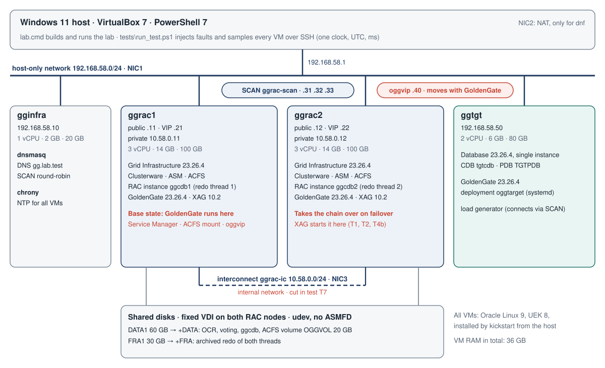
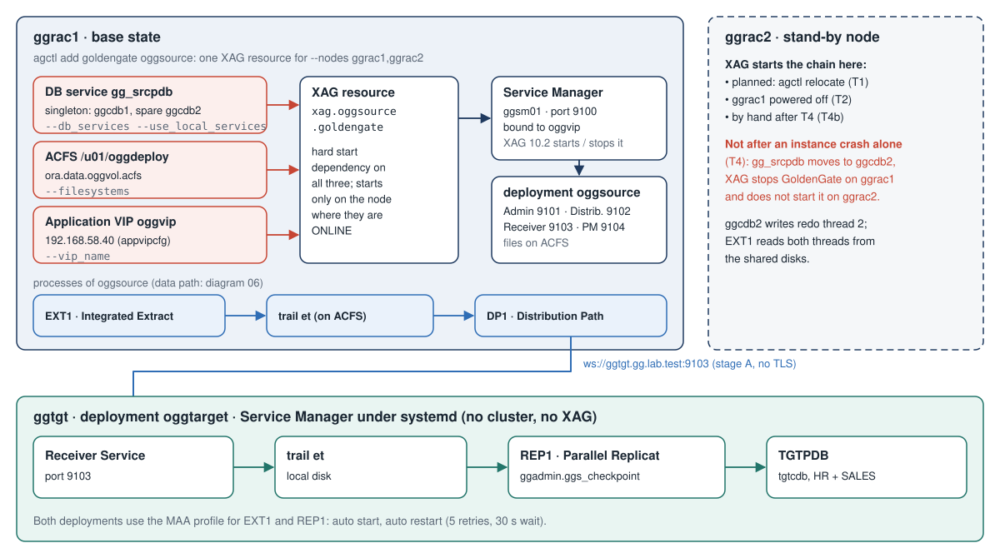
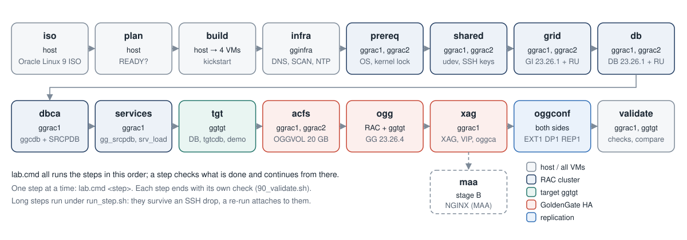
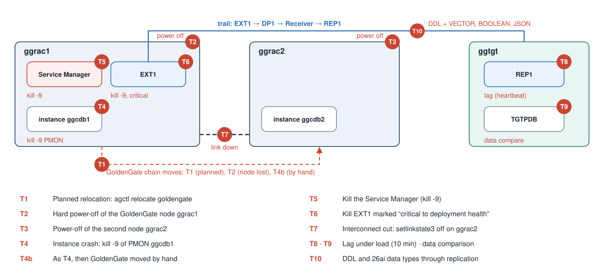
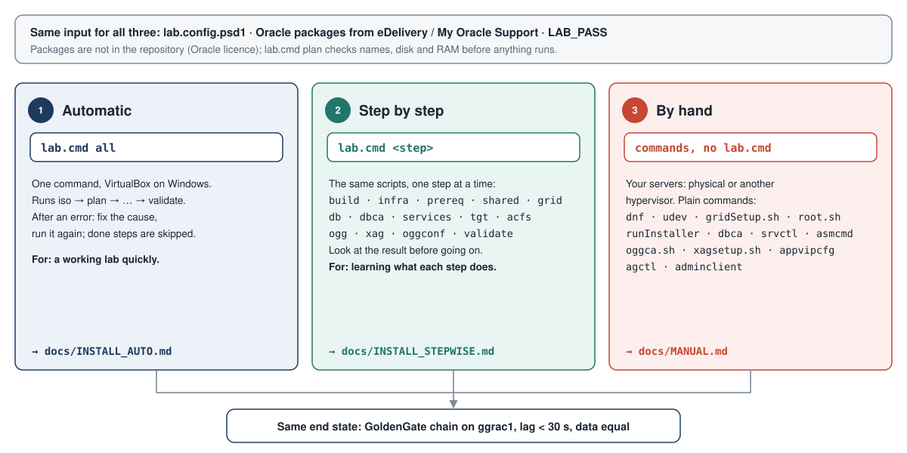
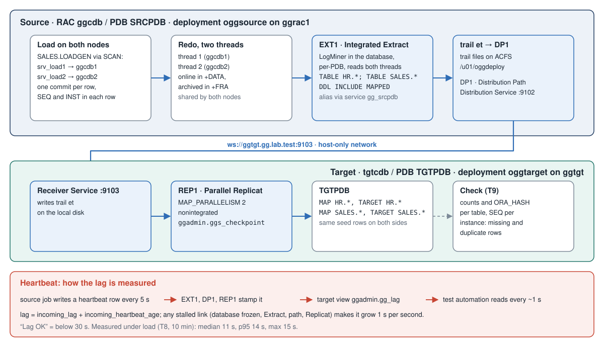
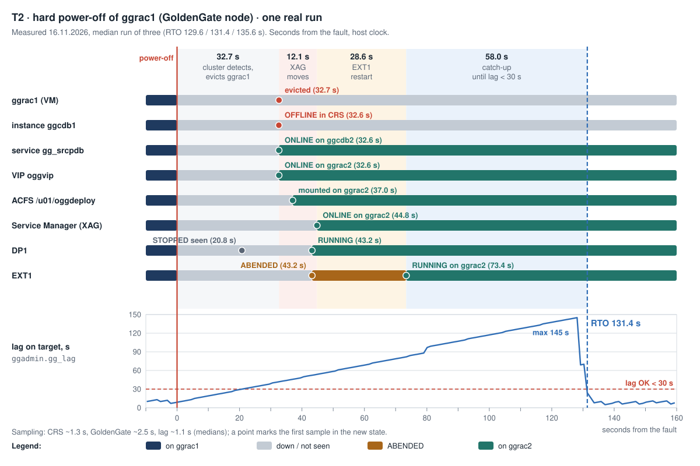

# 🎨 DESIGN — GoldenGate 23.26 + RAC 26ai lab

🇬🇧 English | 🇵🇱 [Polski](DESIGN_PL.md)

> 🎯 Why the lab is built this way: context, decisions (ADR), version compatibility, naming, security, testing.

## 1. 🧭 Context

### 1.1 Goal

A repeatable lab of GoldenGate 23.26 Microservices on a two-node Oracle AI Database 26ai RAC with high availability
through XAG, in which unplanned-failure tests measure failover times and data consistency.

### 1.2 Problem

Public material shows almost only planned `agctl relocate` and the Classic Architecture (removed in GoldenGate 23ai).
Oracle does not publish XAG failover times.

### 1.3 Principles

- Every step re-runnable; a half-finished state stops with instructions, nothing is deleted automatically.
- One configuration file (`lab.config.psd1`); the host renders everything the VMs need (`lab.env`, response files,
  obey files).
- Passwords only from `$LAB_PASS`: never in the repository, argv, `.prm` or obey files.
- The scripts mirror the documented commands: the manual path ([docs/MANUAL.md](docs/MANUAL.md)) uses the same commands
  with the same parameters.

### 1.4 References

Oracle MAA for 26ai, *Oracle GoldenGate Microservices Architecture on Oracle RAC* (configuration tasks 1–11); XAG 10.2
documentation; Oracle GoldenGate 23ai/26ai Reference and Release Notes; My Oracle Support KB129209 (ACFS and kernels),
KB422397, KB101098 (NGINX in front of GoldenGate Microservices, stage B), KB159960.

### 1.5 Diagrams

| Diagram | What it shows |
|---|---|
|  | VMs, networks (host-only, NAT, interconnect), SCAN, `oggvip`, shared disks |
|  | XAG chain (service → ACFS → VIP → Service Manager → deployment) and the data path EXT1 → DP1 → REP1 |
|  | `lab.cmd` steps from `plan` to `validate`, stage B |
|  | where each test T1–T10 hits |
|  | the three installation paths: automatic, step by step, manual |
|  | EXT1 → trail → DP1 → Receiver → REP1, heartbeat and how lag is measured |
|  | phases of a measured failover (T2, median run) |

## 2. 🏛️ Architecture decisions (ADR)

| ADR | Decision | Status |
|---|---|---|
| 001 | ACFS for the deployments (not DBFS) | Accepted 2026-11-14 |
| 002 | HA in two stages: A = XAG + ACFS + VIP, B = MAA with NGINX | Accepted 2026-11-14 |
| 003 | Per-PDB Extract with local `ggadmin` and `OGG_CAPTURE` / `OGG_APPLY` | Accepted 2026-11-14 |
| 004 | XAG 10.2 standalone in `/u01/app/xag`, first in PATH | Accepted 2026-11-14 |
| 005 | Application VIP from `appvipcfg` before `oggca`, passed as `--vip_name` | Accepted 2026-11-14 |
| 006 | Host-only network 192.168.58.0/24, DNS on its own VM (SCAN round-robin) | Accepted 2026-11-14 |
| 007 | udev rules for the shared disks, no ASMFD | Accepted 2026-11-14 |
| 008 | Kernel version-locked after the kickstart (ACFS, KB129209) | Accepted 2026-11-14 |
| 009 | Passwords through pipes and 600 copies only | Accepted 2026-11-14 |
| 010 | Parallel Replicat, nonintegrated, with a checkpoint table | Accepted 2026-11-14 |
| 011 | Tests driven from the host, one clock, results as files | Accepted 2026-11-14 |
| 012 | Same seed data on both sides, no initial load | Accepted 2026-11-14 |
| 013 | `lab.cmd baseline`: one idempotent way back to the base state | Accepted 2026-11-16 |
| 014 | AHF/TFA disabled on the RAC nodes | Accepted 2026-11-16 |
| 015 | 3 vCPU and 14 GB RAM per RAC node | Accepted 2026-11-16 |
| 016 | SELinux stays Enforcing; target autostart runs `dbstart` through bash | Accepted 2026-11-16 |

### ADR-001: ACFS instead of DBFS

- **Context:** MAA allows ACFS or DBFS for the deployment files. DBFS is needed when GoldenGate must follow a Data Guard role change.
- **Decision:** ACFS volume `OGGVOL` (20 GB) on `+DATA`, resource `ora.data.oggvol.acfs`, mounted on one node; XAG moves it.
- **Consequences:** simpler build, no extra schema; a Data Guard variant is a separate project.
- **Rejected:** DBFS (more moving parts for a RAC-only lab), NFS (single point of failure outside the cluster).

### ADR-002: Stages A and B

- **Context:** MAA binds the services to 127.0.0.1 and publishes them through NGINX on the VIP (KB101098). A setup without NGINX is not described.
- **Decision:** stage A binds the Service Manager to the `oggvip` name, `ws://` path, no TLS; stage B follows MAA (`HaStage = 'B'`).
- **Consequences:** tests T1–T10 run on stage A; stage B is a configuration switch (`Get-AgctlAddArgs` adds `nginx` to `--filesystems`); `lab.cmd maa` is reserved and not written.
- **Rejected:** NGINX from day one (more risk in the first build).

### ADR-003: Per-PDB Extract

- **Context:** with GoldenGate 23.26 on Oracle 26ai, `c##ggadmin`, `DBMS_GOLDENGATE_AUTH` and `GRANT DBA` are not needed; the roles `OGG_CAPTURE` / `OGG_APPLY` exist.
- **Decision:** local `ggadmin` in `SRCPDB` and `TGTPDB`; `REGISTER EXTRACT ext1 DATABASE` without `CONTAINER`; alias through the singleton service `gg_srcpdb` (IPC to the local listener, MAA).
- **Consequences:** a static test forbids `c##ggadmin`, `GRANT DBA`, `CONTAINER=ALL`; PDB names without a dash (OGG-08221).

### ADR-004: XAG 10.2 standalone

- **Context:** MAA: "When using Oracle GoldenGate Microservices Architecture you MUST use XAG version 10.2 or later"; the XAG version bundled with GI is not documented.
- **Decision:** `xagsetup.sh --install --directory /u01/app/xag --all_nodes`; the profiles of root, grid and oracle put it before `GRID_HOME/bin`; validation checks `command -v agctl`.

### ADR-005: VIP from appvipcfg

- **Context:** in stage A `oggca` binds the Service Manager to `oggvip`, so the VIP must exist first; `agctl --network --ip` would create it only later.
- **Decision:** `appvipcfg create` (`87_xag_register.sh vip`), then `agctl add goldengate ... --vip_name oggvip`.
- **Rejected:** binding to `0.0.0.0` (the Service Manager would answer on node addresses, not only on the VIP).

### ADR-006: Network

- Host-only 192.168.58.0/24 (does not collide with other labs on .56), NAT for `dnf`, internal network `ggrac-ic` for the interconnect (NIC3, cut in T7).
- `gginfra` runs dnsmasq and chrony; RAC nodes and target resolve names only through it (NetworkManager `dns=none`).

### ADR-007: udev, no ASMFD

- Shared fixed VDI disks with udev names `/dev/oracleasm/DATA1`, `FRA1` (`grid:asmdba 0660`); ASMFD would add kernel-module dependencies on top of ACFS.

### ADR-008: Kernel lock

- `dnf versionlock` of the installed `kernel*` packages in the kickstart; `Os.Kernel` and `Os.UekRepo` come from KB129209.
  A `dnf update` cannot pull a kernel that ACFS does not support.

### ADR-009: Passwords

- `$LAB_PASS` → `/root/.lab_secrets` and `~/.lab_secrets` of grid and oracle (600) by the kickstart.
- Response files and user SQL carry the `@@LAB_PASS@@` / `@@OGG_ADMIN_PASS@@` tokens; `render_secret` fills them inside bash into a 600 copy that is removed after use.
- adminclient and agctl get passwords through their stdin pipe (`adminclient_run`, `87_xag_register.sh`); output is masked.

### ADR-010: Parallel Replicat

- `ADD REPLICAT rep1, PARALLEL, ... CHECKPOINTTABLE` (without the option GoldenGate creates a classic Replicat); nonintegrated by default, integrated as an exercise.

### ADR-011: Tests from the host

- A power-off needs `VBoxManage`, so the test runner runs on the host, samples CRS and XAG over SSH every second, uses the host clock (UTC, ms)
  and writes `events.csv`, `lag.csv`, `load.csv`, `compare.json`, `summary.json` per run.

### ADR-012: Seed data

- `05_demo_schema.sql` creates the same tables and seed rows on source and target before replication starts; later rows come from
  the load generator (`SALES.LOADGEN`, one commit per row, both instances).

### ADR-013: `lab.cmd baseline`

- **Context:** after a full restart or a failure test the lab is valid but not in the base state: services on their available
  instances, ACFS mounted on both nodes (`AUTO_START=restore`), GoldenGate on the other node or OFFLINE after a slow XAG health check.
  Each test must start from the same state, and fixing it by hand between runs costs time and adds mistakes.
- **Decision:** one verb, `lab.cmd baseline`, idempotent, data untouched: power on stopped VMs and the interconnect NIC, target first
  (database, Service Manager, REP1), then the source in phases (cluster, instances, services on preferred instances, GoldenGate on the
  node of `gg_srcpdb`, ACFS only there, EXT1/DP1), then the `validate` checks without load. Each phase prints
  `BASELINE <phase> <seconds> done|noop`, collected in `logs/baseline_steps.csv`. `lab.cmd start` ends with it;
  `tests/run_test.ps1` runs it after every test run.
- **Consequences:** repeatable test starts; the time back to the base state is measured. `baseline` does not reset the CRS restart
  counter of the database resource (a manual instance start does), which matters for repeated instance-crash tests.
- **Rejected:** VM snapshots of the base state (would also roll back data and the evidence between runs; `lab.cmd snapshot` stays reserved).

### ADR-014: AHF/TFA disabled

- **Context:** AHF/TFA is installed with GI 23.26 and runs rediscovery and ADR scans. On a 2 vCPU node it took the CPU: LMD0 stopped
  responding for more than 70 s and LMHB terminated instance `ggcdb1` (ORA-29770).
- **Decision:** phase `ahf` of `40_install_grid.sh` right after `root.sh`: `ahfctl stopahf -all` and
  `systemctl disable --now oracle-tfa.service` (the unit has `Restart=always`); `90_validate.sh grid` checks that it is off.
- **Consequences:** no TFA diagnostic collection in the lab; re-enable with `systemctl enable --now oracle-tfa`. On real servers keep
  AHF and size the CPU instead: this is a lab decision.

### ADR-015: 3 vCPU and 14 GB RAM per RAC node

- **Context:** with 10 GB the RAC nodes swapped during the database software install (applying the RU took most of the step);
  with 2 vCPU a node starved (ADR-014). GI 26ai, a 4 GB SGA and GoldenGate on one node need more.
- **Decision:** RAC nodes 3 vCPU / 14 GB, target 2 vCPU / 6 GB, gginfra 1 vCPU / 2 GB: 36 GB RAM in total, which fits a 64 GB host.
- **Consequences:** the build timings in [docs/TIMINGS.md](docs/TIMINGS.md) were measured with 2 vCPU (and 10 GB for `grid`, `db`)
  and are upper values until a new full build is measured.

### ADR-016: SELinux Enforcing, `dbstart` through bash

- **Context:** after the first restart of ggtgt, `oracle-db.service` failed with `203/EXEC Permission denied` on `dbstart`: SELinux
  is Enforcing and the Oracle home has the label `default_t`, which systemd may not execute.
- **Decision:** keep SELinux Enforcing (kickstart `selinux --enforcing`) and start the database with
  `ExecStart=/usr/bin/bash $ORACLE_HOME/bin/dbstart $ORACLE_HOME` (bash reads the script; the database then runs like a login-shell start).
- **Consequences:** `tgt/90_validate.sh` checks that the unit is enabled and active; no relabelling of the Oracle home.

## 3. 🔀 Version compatibility

| Component | Version | Note |
|---|---|---|
| OL | 9.8, UEK 8 (kernel from KB129209) | UEK 8 needs GI/DB RU ≥ 23.26.2 |
| GI, DB | 23.26.1 + RU 23.26.4 (GI 40002013, DB 40007731), OPatch ≥ 12.2.0.1.53 | response files: schema v23.0.0 with the short 26ai keys (`installOption`, `scanName`, `clusterNodes`; the 19c `oracle.install.*` names are gone); a key the shipped 23.26 sample does not name stops the step (`rsp_keys_check`) |
| GoldenGate | 23.26.4.0.2 (complete install in `OggZip`; `OggBundle` only for an OPatch-style patch) | `INSTALL_OPTION=ORA23ai` (compared with the shipped sample, warning only) |
| XAG | 10.2 | bare `--service_manager` flag (XAG Microservices template), `yes` as the fallback: the script tries both |

Gaps and contradictions in the documentation met while building: the form of `--service_manager`, the heartbeat view and column
names in 23.26, the `ADD PROFILE` syntax in adminclient, the `INSTALL_OPTION` values on the install page, and a stage A without
NGINX that MAA does not describe. More: [docs/PITFALLS_26AI.md](docs/PITFALLS_26AI.md).

## 4. 🏷️ Naming

- Files in English; scripts `NN_name.sh` in run order per role; SQL `01–06` setup, `10` diagnostics, `99` cleanup.
- CRS names: `ora.<dg>.<volume>.acfs`, `ora.<db>.<service>.svc`; GoldenGate groups `ext1`, `dp1`, `rep1` (Parallel Replicat ≤ 5 characters).

## 5. 🔐 Security

- Least privilege in the PDBs (ADR-003); target DDL privileges only for test T10 (`ANY TABLE`, lab only).
- `ENABLE_GOLDENGATE_REPLICATION` requires a GoldenGate licence (Reference 26ai).
- No passwords, user paths or account names in the repository; static tests check scripts, response and obey files.
- Lab trade-offs, not for production: no TLS in stage A, no firewall inside the VMs, AHF/TFA off.

## 6. 🧪 Testing

- Static: `tests/static/Test-Static.ps1` (config, render, dry-run step order, headers, no secrets).
- Live: `lab.cmd validate`, `lab.cmd baseline` and the failure tests T1–T10 ([TESTS.md](TESTS.md), results in
  [docs/RESULTS.md](docs/RESULTS.md)).

---
Author: KCB Kris · 2026
