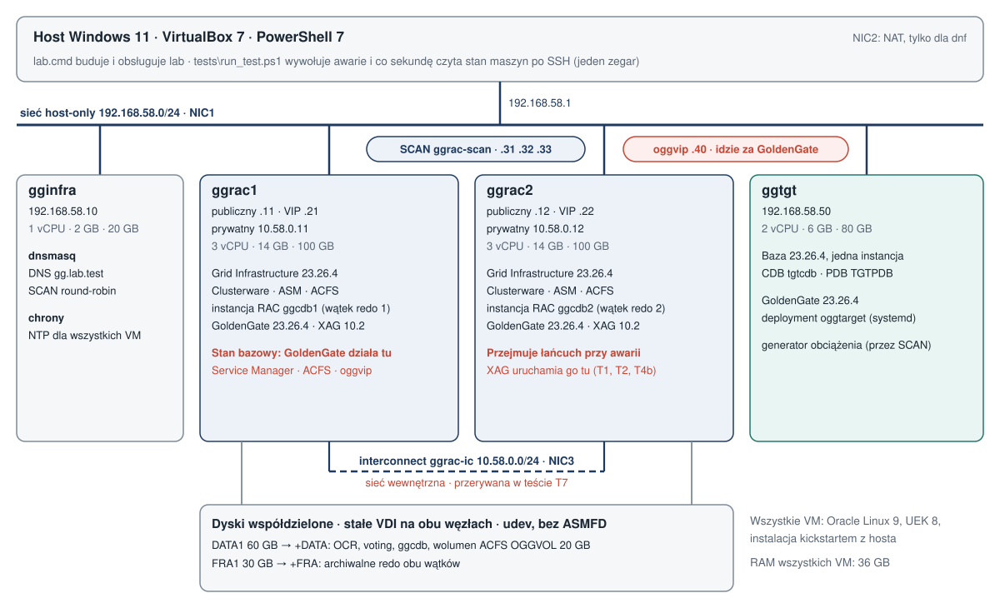
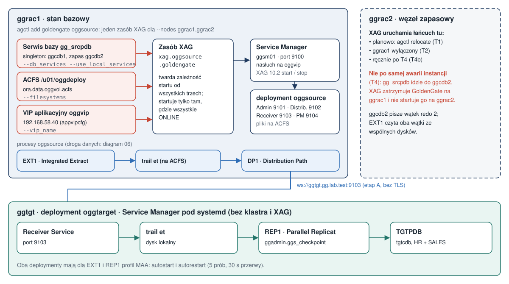
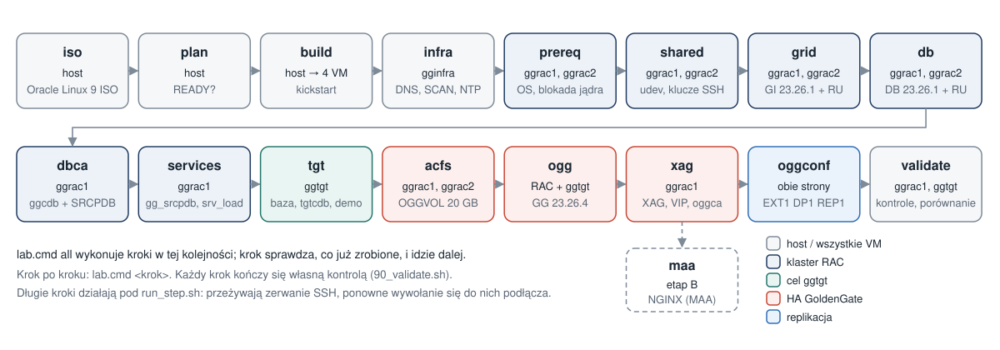
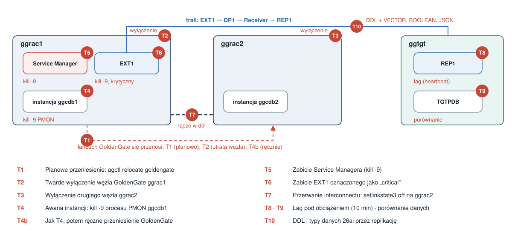
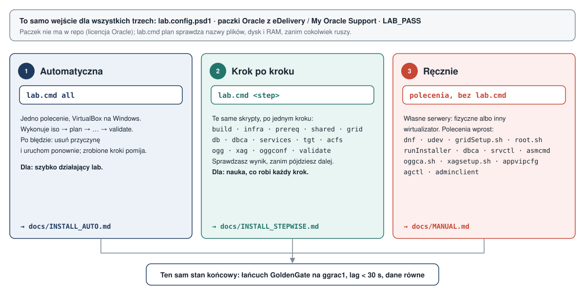
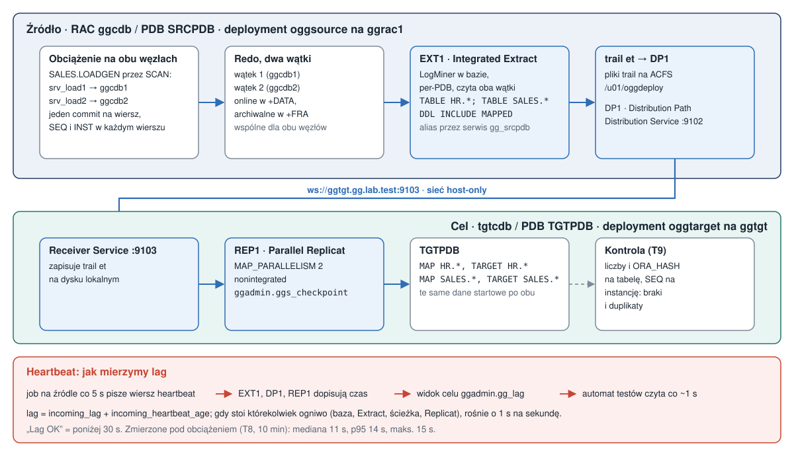
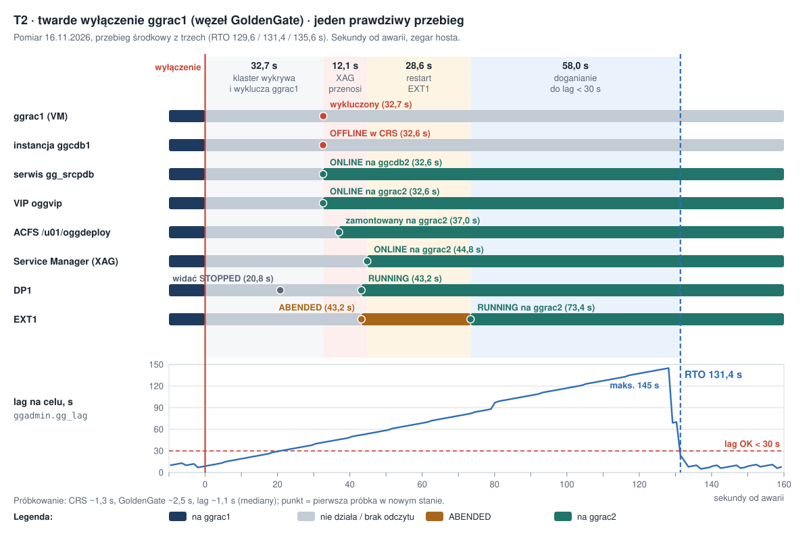

# 🎨 DESIGN — lab GoldenGate 23.26 + RAC 26ai

🇬🇧 [English](DESIGN.md) | 🇵🇱 Polski

> 🎯 Dlaczego lab wygląda tak, a nie inaczej: kontekst, decyzje (ADR), zgodność wersji, nazewnictwo, bezpieczeństwo,
> testy. ADR (Architecture Decision Record) to krótki zapis jednej decyzji: kontekst, wybór, skutki i odrzucone warianty.

## 1. 🧭 Kontekst

### 1.1 Cel

Powtarzalny lab GoldenGate 23.26 Microservices na dwuwęzłowym RAC Oracle AI Database 26ai z wysoką dostępnością przez
XAG, w którym testy nieplanowanych awarii mierzą czasy przełączenia i zgodność danych.

### 1.2 Problem

Materiały publiczne pokazują prawie wyłącznie planowe `agctl relocate` i architekturę Classic (usuniętą w GoldenGate
23ai). Oracle nie publikuje czasów przełączenia XAG.

### 1.3 Zasady

- Każdy krok można powtórzyć; stan w połowie zatrzymuje się z instrukcją, nic nie jest usuwane automatycznie.
- Jeden plik konfiguracji (`lab.config.psd1`); host renderuje wszystko, czego potrzebują maszyny (`lab.env`, pliki
  odpowiedzi, pliki obey).
- Hasła tylko z `$LAB_PASS`: nigdy w repozytorium, w argv, w plikach `.prm` ani obey.
- Skrypty odwzorowują udokumentowane polecenia: droga ręczna ([docs/MANUAL_PL.md](docs/MANUAL_PL.md)) używa tych
  samych poleceń z tymi samymi parametrami.

### 1.4 Źródła

Oracle MAA dla 26ai, *Oracle GoldenGate Microservices Architecture on Oracle RAC* (zadania konfiguracyjne 1–11);
dokumentacja XAG 10.2; Oracle GoldenGate 23ai/26ai Reference i Release Notes; My Oracle Support KB129209 (ACFS i jądra),
KB422397, KB101098 (NGINX przed GoldenGate Microservices, etap B), KB159960.

### 1.5 Diagramy

| Diagram | Co pokazuje |
|---|---|
|  | maszyny, sieci (host-only, NAT, interconnect), SCAN, `oggvip`, dyski współdzielone |
|  | łańcuch XAG (serwis → ACFS → VIP → Service Manager → deployment) i droga danych EXT1 → DP1 → REP1 |
|  | kroki `lab.cmd` od `plan` do `validate`, etap B |
|  | gdzie uderza każdy test T1–T10 |
|  | trzy drogi instalacji: automatyczna, krok po kroku, ręczna |
|  | EXT1 → trail → DP1 → Receiver → REP1, heartbeat i pomiar lagu |
|  | fazy zmierzonego failoveru (T2, przebieg środkowy) |

## 2. 🏛️ Decyzje architektoniczne (ADR)

| ADR | Decyzja | Stan |
|---|---|---|
| 001 | ACFS na deploymenty (nie DBFS) | przyjęta 2026-11-14 |
| 002 | HA w dwóch etapach: A = XAG + ACFS + VIP, B = MAA z NGINX | przyjęta 2026-11-14 |
| 003 | Extract na poziomie PDB z lokalnym `ggadmin` i rolami `OGG_CAPTURE` / `OGG_APPLY` | przyjęta 2026-11-14 |
| 004 | Samodzielny XAG 10.2 w `/u01/app/xag`, pierwszy w PATH | przyjęta 2026-11-14 |
| 005 | VIP aplikacyjny z `appvipcfg` przed `oggca`, podany jako `--vip_name` | przyjęta 2026-11-14 |
| 006 | Sieć host-only 192.168.58.0/24, DNS na osobnej maszynie (SCAN round-robin) | przyjęta 2026-11-14 |
| 007 | Reguły udev dla dysków współdzielonych, bez ASMFD | przyjęta 2026-11-14 |
| 008 | Jądro zablokowane po kickstarcie (ACFS, KB129209) | przyjęta 2026-11-14 |
| 009 | Hasła tylko przez potoki i kopie z prawami 600 | przyjęta 2026-11-14 |
| 010 | Parallel Replicat, niezintegrowany, z tabelą punktów kontrolnych | przyjęta 2026-11-14 |
| 011 | Testy sterowane z hosta, jeden zegar, wyniki jako pliki | przyjęta 2026-11-14 |
| 012 | Te same dane startowe po obu stronach, bez ładowania początkowego | przyjęta 2026-11-14 |
| 013 | `lab.cmd baseline`: jedna powtarzalna droga do stanu bazowego | przyjęta 2026-11-16 |
| 014 | AHF/TFA wyłączone na węzłach RAC | przyjęta 2026-11-16 |
| 015 | 3 vCPU i 14 GB RAM na węzeł RAC | przyjęta 2026-11-16 |
| 016 | SELinux zostaje w trybie Enforcing; autostart celu uruchamia `dbstart` przez bash | przyjęta 2026-11-16 |

### ADR-001: ACFS zamiast DBFS

- **Kontekst:** MAA dopuszcza ACFS albo DBFS na pliki deploymentu. DBFS jest potrzebny, gdy GoldenGate ma iść za zmianą roli w Data Guard.
- **Decyzja:** wolumen ACFS `OGGVOL` (20 GB) w `+DATA`, zasób `ora.data.oggvol.acfs`, zamontowany na jednym węźle; przenosi go XAG.
- **Skutki:** prostsza budowa, bez dodatkowego schematu; wariant z Data Guard to osobny projekt.
- **Odrzucone:** DBFS (więcej ruchomych części jak na lab z samym RAC), NFS (pojedynczy punkt awarii poza klastrem).

### ADR-002: Etapy A i B

- **Kontekst:** MAA wiąże usługi z 127.0.0.1 i udostępnia je przez NGINX na VIP (KB101098). Układ bez NGINX nie jest opisany.
- **Decyzja:** etap A wiąże Service Manager z nazwą `oggvip`, ścieżka `ws://`, bez TLS; etap B idzie za MAA (`HaStage = 'B'`).
- **Skutki:** testy T1–T10 działają na etapie A; etap B to przełącznik w konfiguracji (`Get-AgctlAddArgs` dopisuje `nginx` do `--filesystems`); `lab.cmd maa` jest zarezerwowane i nienapisane.
- **Odrzucone:** NGINX od pierwszego dnia (większe ryzyko przy pierwszej budowie).

### ADR-003: Extract na poziomie PDB

- **Kontekst:** przy GoldenGate 23.26 na Oracle 26ai `c##ggadmin`, `DBMS_GOLDENGATE_AUTH` i `GRANT DBA` nie są potrzebne; są role `OGG_CAPTURE` / `OGG_APPLY`.
- **Decyzja:** lokalny `ggadmin` w `SRCPDB` i `TGTPDB`; `REGISTER EXTRACT ext1 DATABASE` bez `CONTAINER`; alias przez serwis-singleton `gg_srcpdb` (IPC do lokalnego listenera, MAA).
- **Skutki:** test statyczny zabrania `c##ggadmin`, `GRANT DBA`, `CONTAINER=ALL`; nazwy PDB bez myślnika (OGG-08221).

### ADR-004: Samodzielny XAG 10.2

- **Kontekst:** MAA: „When using Oracle GoldenGate Microservices Architecture you MUST use XAG version 10.2 or later”; wersja XAG dołączona do GI nie jest udokumentowana.
- **Decyzja:** `xagsetup.sh --install --directory /u01/app/xag --all_nodes`; profile roota, grid i oracle stawiają go przed `GRID_HOME/bin`; walidacja sprawdza `command -v agctl`.

### ADR-005: VIP z appvipcfg

- **Kontekst:** na etapie A `oggca` wiąże Service Manager z `oggvip`, więc VIP musi istnieć wcześniej; `agctl --network --ip` utworzyłby go dopiero później.
- **Decyzja:** `appvipcfg create` (`87_xag_register.sh vip`), potem `agctl add goldengate ... --vip_name oggvip`.
- **Odrzucone:** wiązanie z `0.0.0.0` (Service Manager odpowiadałby na adresach węzłów, a nie tylko na VIP).

### ADR-006: Sieć

- Host-only 192.168.58.0/24 (nie koliduje z innymi labami na .56), NAT dla `dnf`, sieć wewnętrzna `ggrac-ic` na interconnect (karta 3, przecinana w T7).
- `gginfra` uruchamia dnsmasq i chrony; węzły RAC i cel rozwiązują nazwy tylko przez nią (NetworkManager `dns=none`).

### ADR-007: udev, bez ASMFD

- Współdzielone stałe dyski VDI z nazwami udev `/dev/oracleasm/DATA1`, `FRA1` (`grid:asmdba 0660`); ASMFD dołożyłby zależności od modułów jądra ponad ACFS.

### ADR-008: Blokada jądra

- `dnf versionlock` zainstalowanych pakietów `kernel*` w kickstarcie; `Os.Kernel` i `Os.UekRepo` wynikają z KB129209.
  `dnf update` nie wciągnie jądra, którego ACFS nie obsługuje.

### ADR-009: Hasła

- `$LAB_PASS` → `/root/.lab_secrets` oraz `~/.lab_secrets` użytkowników grid i oracle (600), zapisuje je kickstart.
- Pliki odpowiedzi i SQL użytkowników mają znaczniki `@@LAB_PASS@@` / `@@OGG_ADMIN_PASS@@`; `render_secret` wypełnia je wewnątrz basha w kopii 600, usuwanej po użyciu.
- adminclient i agctl dostają hasła przez potok na standardowe wejście (`adminclient_run`, `87_xag_register.sh`); wyjście jest maskowane.

### ADR-010: Parallel Replicat

- `ADD REPLICAT rep1, PARALLEL, ... CHECKPOINTTABLE` (bez tej opcji GoldenGate tworzy klasyczny Replicat); domyślnie niezintegrowany, zintegrowany jako ćwiczenie.

### ADR-011: Testy z hosta

- Wyłączenie maszyny wymaga `VBoxManage`, więc automat testów działa na hoście, co sekundę odpytuje CRS i XAG przez SSH, używa zegara
  hosta (UTC, ms) i zapisuje dla każdego przebiegu `events.csv`, `lag.csv`, `load.csv`, `compare.json`, `summary.json`.

### ADR-012: Dane startowe

- `05_demo_schema.sql` tworzy te same tabele i wiersze startowe w źródle i celu, zanim ruszy replikacja; kolejne wiersze pochodzą
  z generatora obciążenia (`SALES.LOADGEN`, jeden commit na wiersz, obie instancje).

### ADR-013: `lab.cmd baseline`

- **Kontekst:** po pełnym restarcie albo teście awarii lab jest sprawny, ale nie jest w stanie bazowym: serwisy na instancjach
  zapasowych, ACFS zamontowany na obu węzłach (`AUTO_START=restore`), GoldenGate na drugim węźle albo OFFLINE po wolnej kontroli
  stanu XAG. Każdy test musi startować z tego samego stanu, a ręczne poprawki między przebiegami kosztują czas i dokładają błędów.
- **Decyzja:** jedno polecenie, `lab.cmd baseline`, powtarzalne, bez zmian w danych: włącza zatrzymane maszyny i kartę interconnectu,
  najpierw cel (baza, Service Manager, REP1), potem źródło w fazach (klaster, instancje, serwisy na instancjach preferowanych,
  GoldenGate na węźle `gg_srcpdb`, ACFS tylko tam, EXT1/DP1), potem kontrole `validate` bez obciążenia. Każda faza wypisuje
  `BASELINE <faza> <sekundy> done|noop`, zbierane w `logs/baseline_steps.csv`. `lab.cmd start` kończy się nim;
  `tests/run_test.ps1` uruchamia go po każdym przebiegu testu.
- **Skutki:** powtarzalny start testów; czas powrotu do stanu bazowego jest mierzony. `baseline` nie zeruje licznika restartów
  zasobu bazy w CRS (robi to ręczny start instancji), co ma znaczenie przy powtarzanych testach awarii instancji.
- **Odrzucone:** migawki maszyn w stanie bazowym (cofałyby też dane i dowody między przebiegami; `lab.cmd snapshot` zostaje zarezerwowane).

### ADR-014: AHF/TFA wyłączone

- **Kontekst:** AHF/TFA instaluje się razem z GI 23.26 i uruchamia przeszukiwanie i skany ADR. Na węźle z 2 vCPU zabrał procesor:
  LMD0 nie odpowiadał ponad 70 s i LMHB zakończył instancję `ggcdb1` (ORA-29770).
- **Decyzja:** faza `ahf` w `40_install_grid.sh` zaraz po `root.sh`: `ahfctl stopahf -all` i
  `systemctl disable --now oracle-tfa.service` (jednostka ma `Restart=always`); `90_validate.sh grid` sprawdza, że jest wyłączone.
- **Skutki:** w labie nie ma zbierania diagnostyki TFA; ponowne włączenie: `systemctl enable --now oracle-tfa`. Na prawdziwych
  serwerach zostaw AHF i dobierz CPU: to decyzja dla labu.

### ADR-015: 3 vCPU i 14 GB RAM na węzeł RAC

- **Kontekst:** przy 10 GB węzły RAC używały swapu w czasie instalacji oprogramowania bazy (nakładanie RU zajęło większość kroku);
  przy 2 vCPU węzeł nie nadążał (ADR-014). GI 26ai, SGA 4 GB i GoldenGate na jednym węźle potrzebują więcej.
- **Decyzja:** węzły RAC 3 vCPU / 14 GB, cel 2 vCPU / 6 GB, gginfra 1 vCPU / 2 GB: razem 36 GB RAM, co mieści się na hoście z 64 GB.
- **Skutki:** czasy budowy w [docs/TIMINGS_PL.md](docs/TIMINGS_PL.md) zmierzono przy 2 vCPU (i 10 GB dla `grid`, `db`); są wartościami
  górnymi, dopóki nie zostanie zmierzona nowa pełna budowa.

### ADR-016: SELinux Enforcing, `dbstart` przez bash

- **Kontekst:** po pierwszym restarcie ggtgt `oracle-db.service` padał z `203/EXEC Permission denied` na `dbstart`: SELinux jest
  w trybie Enforcing, a katalog Oracle ma etykietę `default_t`, z której systemd nie może uruchamiać plików.
- **Decyzja:** SELinux zostaje w trybie Enforcing (kickstart `selinux --enforcing`), a baza startuje przez
  `ExecStart=/usr/bin/bash $ORACLE_HOME/bin/dbstart $ORACLE_HOME` (bash czyta skrypt; baza działa potem jak przy starcie z powłoki logowania).
- **Skutki:** `tgt/90_validate.sh` sprawdza, że jednostka jest włączona i aktywna; bez zmiany etykiet katalogu Oracle.

## 3. 🔀 Zgodność wersji

| Składnik | Wersja | Uwaga |
|---|---|---|
| OL | 9.8, UEK 8 (jądro według KB129209) | UEK 8 wymaga RU GI/DB ≥ 23.26.2 |
| GI, DB | 23.26.1 + RU 23.26.4 (GI 40002013, DB 40007731), OPatch ≥ 12.2.0.1.53 | pliki odpowiedzi: schemat v23.0.0 z krótkimi kluczami 26ai (`installOption`, `scanName`, `clusterNodes`; nazwy `oracle.install.*` z 19c zniknęły); klucz, którego nie zna dostarczony wzorzec 23.26, zatrzymuje krok (`rsp_keys_check`) |
| GoldenGate | 23.26.4.0.2 (pełna instalacja w `OggZip`; `OggBundle` tylko dla łatki w stylu OPatch) | `INSTALL_OPTION=ORA23ai` (porównane z dostarczonym wzorcem, tylko ostrzeżenie) |
| XAG | 10.2 | sama flaga `--service_manager` (szablon XAG dla Microservices), `yes` jako zapas: skrypt próbuje obu |

Luki i sprzeczności w dokumentacji spotkane przy budowie: forma `--service_manager`, nazwy widoku i kolumn heartbeat w 23.26,
składnia `ADD PROFILE` w adminclient, wartości `INSTALL_OPTION` na stronie instalacji i etap A bez NGINX, którego MAA nie opisuje.
Więcej: [docs/PITFALLS_26AI_PL.md](docs/PITFALLS_26AI_PL.md).

## 4. 🏷️ Nazewnictwo

- Pliki po angielsku; skrypty `NN_nazwa.sh` w kolejności uruchamiania dla każdej roli; SQL `01–06` przygotowanie, `10` diagnostyka, `99` sprzątanie.
- Nazwy CRS: `ora.<dg>.<wolumen>.acfs`, `ora.<baza>.<serwis>.svc`; grupy GoldenGate `ext1`, `dp1`, `rep1` (Parallel Replicat ≤ 5 znaków).

## 5. 🔐 Bezpieczeństwo

- Najmniejsze potrzebne uprawnienia w PDB (ADR-003); uprawnienia DDL w celu tylko dla testu T10 (`ANY TABLE`, tylko w labie).
- `ENABLE_GOLDENGATE_REPLICATION` wymaga licencji GoldenGate (Reference 26ai).
- Bez haseł, ścieżek użytkownika i nazw kont w repozytorium; testy statyczne sprawdzają skrypty, pliki odpowiedzi i obey.
- Kompromisy labu, nie dla produkcji: bez TLS na etapie A, bez zapory w maszynach, AHF/TFA wyłączone.

## 6. 🧪 Testy

- Statyczne: `tests/static/Test-Static.ps1` (konfiguracja, renderowanie, kolejność kroków w trybie podglądu, nagłówki, brak sekretów).
- Na żywym labie: `lab.cmd validate`, `lab.cmd baseline` i testy awarii T1–T10 ([TESTS_PL.md](TESTS_PL.md), wyniki w
  [docs/RESULTS_PL.md](docs/RESULTS_PL.md)).

---
Autor: KCB Kris · 2026
