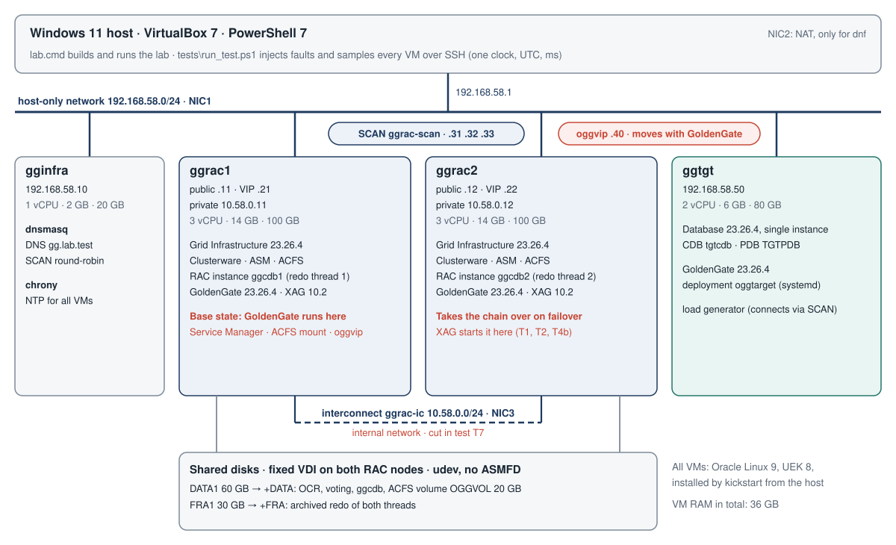
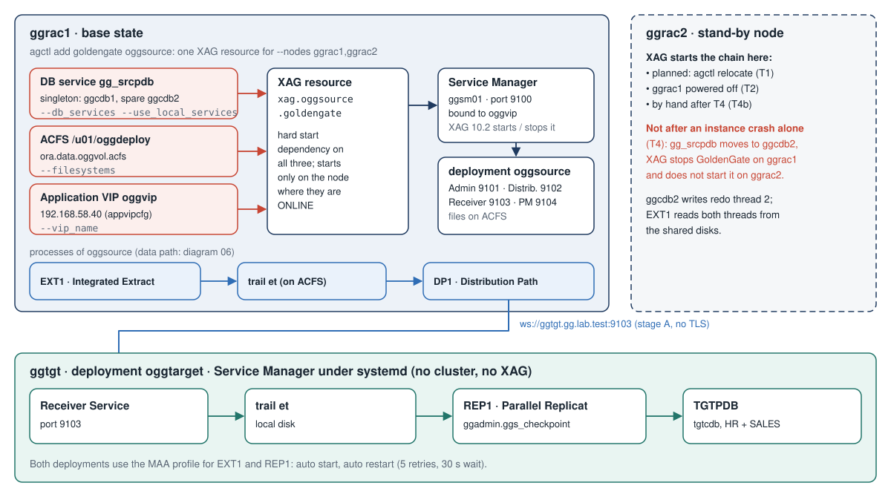
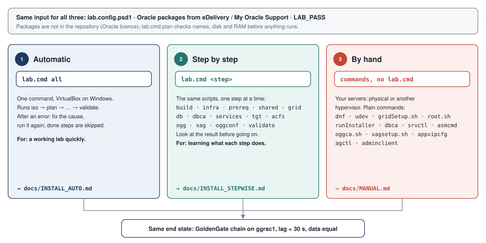

# 🔁 GoldenGate 23.26 on a 2-node Oracle AI Database 26ai RAC — a VirtualBox lab with measured failure tests

🇬🇧 English | 🇵🇱 [Polski](README_PL.md)

[-red)]()
[]()
[]()
[]()
[-success)](LICENSE)

> 🎯 **What this is.** One command builds a complete GoldenGate high-availability lab on your Windows laptop: a two-node
> RAC database on Oracle AI Database 26ai, GoldenGate 23.26 Microservices protected by XAG and ACFS, and a single-instance
> target database. Then an automated test runner breaks the cluster on purpose (node power-off, instance crash, killed
> processes, cut interconnect) and measures **how long replication really stops** and **whether any data is lost**.
>
> 🌐 Website: `https://<owner>.github.io/gg-rac26ai-lab/` · 🎬 Video: link after the premiere



## 💡 Why this lab

GoldenGate on RAC is where many replication projects get hard: the replication software runs on **one** node, but the
database runs on **two**. When that node fails, something has to move GoldenGate, its files and its network address to the
surviving node, in the right order. Oracle's answer (Maximum Availability Architecture, MAA) is **XAG**: a Clusterware agent
that keeps GoldenGate together with an ACFS file system, an application VIP and the database service it depends on.

Documentation tells you how it should work. This lab shows you **what happens, in seconds**, when you pull the plug:

| Test | What we break | What happened (16.11.2026, VirtualBox laptop) |
|---|---|---|
| T1 | planned relocation of GoldenGate to the other node | replication lag back under 30 s after **54–65 s** |
| T2 | power-off of the node running GoldenGate | GoldenGate moved to the other node, lag OK after **130–136 s**, no data lost |
| T3 | power-off of the *other* node | GoldenGate stays put; lag OK after **40 s** (median of 3) |
| T4 | `kill -9` of the database instance under GoldenGate | **GoldenGate does not come back by itself** (hard dependency on the service) — see [RESULTS](docs/RESULTS.md) |
| T4b | same, with a documented manual relocation | **24–53 s** from the operator's decision to lag OK |
| T5 | killed Service Manager | restart in place, **47–57 s** |
| T6 | killed critical GoldenGate process | restart in place, **37–42 s** |
| T7 | cut private interconnect | node evicted after **66 s**, replication OK after **159 s** |
| T8–T10 | heartbeat lag, data comparison, DDL and 26ai data types | consistent source = target, DDL replicated |

Every number comes from `results/runs/` and is reproducible with the same runner. The full story, including the runs that
did not go as expected and why: **[docs/RESULTS.md](docs/RESULTS.md)**.

## 🧩 What gets built

| VM | Role | vCPU / RAM |
|---|---|---|
| `gginfra` | DNS (dnsmasq, SCAN round-robin) and NTP (chrony) | 1 / 2 GB |
| `ggrac1`, `ggrac2` | Grid Infrastructure + RAC CDB `ggcdb` (PDB `SRCPDB`), GoldenGate `oggsource` on ACFS, XAG | 3 / 14 GB each |
| `ggtgt` | single-instance CDB `tgtcdb` (PDB `TGTPDB`), GoldenGate `oggtarget` | 2 / 6 GB |

Oracle Linux 9 (UEK), Grid Infrastructure and Database 26ai 23.26.1 + Release Update, GoldenGate 23.26 Microservices,
XAG 10.2. Data flows `Integrated Extract EXT1 → trail → Distribution Path → Receiver → Parallel Replicat REP1`
([docs/CONCEPTS.md](docs/CONCEPTS.md) explains every piece in plain language).



## 🚀 Three ways to install



| Way | For whom | Start here |
|---|---|---|
| **1. Automatic** | you want the lab, not the installation: one command, about 4 hours of unattended work ([measured](docs/TIMINGS.md)) | [docs/INSTALL_AUTO.md](docs/INSTALL_AUTO.md) |
| **2. Step by step** | you want to watch each stage, check it and continue: `lab.cmd <step>` | [docs/INSTALL_STEPWISE.md](docs/INSTALL_STEPWISE.md) |
| **3. Manual** | you install on your own servers (physical or another hypervisor), or you want to learn every command | [docs/MANUAL.md](docs/MANUAL.md) |

Quick start (automatic):

```powershell
$env:LAB_PASS = '<password>'   # letters, digits, _ ; never stored in the repository
.\lab.cmd plan                 # read-only check: binaries, RAM, disk, VM plan; READY = go
.\lab.cmd all                  # builds everything; every step skips what is already done
.\lab.cmd validate             # checks + 60 s load + source = target comparison → "VALID"
```

## 📋 Requirements

- Windows 11 host, about **36 GB free RAM** (64 GB machine recommended) and **250–350 GB** free disk.
- VirtualBox 7.x, PowerShell 7, OpenSSH client with a key, Python 3, Git for Windows. Windows hypervisor features
  (Hyper-V, VBS) **off** — with them VirtualBox runs much slower. Details: [docs/ENVIRONMENT.md](docs/ENVIRONMENT.md).
- Oracle software is **not** in this repository (Oracle licence). You download it yourself from Oracle Software Delivery
  Cloud and My Oracle Support; the exact file names and patch numbers are in `lab.config.psd1` and in
  [docs/INSTALL_AUTO.md](docs/INSTALL_AUTO.md).

## 🧪 Run the failure tests yourself

```powershell
pwsh tests/run_test.ps1 -Test T3 -ApprovedBy <your-name>   # destructive tests need an explicit approver
.\lab.cmd baseline                                          # back to the base state after a test
```

Each run writes `results/<test>-<timestamp>/` with a timeline of cluster events, replication lag samples and a
source/target data comparison. Test specification: [TESTS.md](TESTS.md).

## 📚 Documentation map

| Document | Contents |
|---|---|
| [docs/CONCEPTS.md](docs/CONCEPTS.md) | the building blocks: Clusterware, ASM, ACFS, services, VIP, Service Manager, Extract, trail, Replicat, XAG, heartbeat |
| [docs/ENVIRONMENT.md](docs/ENVIRONMENT.md) | machines, networks, addresses, disks, versions, host requirements |
| [docs/INSTALL_AUTO.md](docs/INSTALL_AUTO.md) · [INSTALL_STEPWISE.md](docs/INSTALL_STEPWISE.md) · [MANUAL.md](docs/MANUAL.md) | the three installation paths |
| [docs/OPERATIONS.md](docs/OPERATIONS.md) | start, stop, status, baseline, validate, troubleshooting |
| [TESTS.md](TESTS.md) · [docs/RESULTS.md](docs/RESULTS.md) | failure tests and measured results, with charts |
| [docs/PITFALLS_26AI.md](docs/PITFALLS_26AI.md) · [docs/TIMINGS.md](docs/TIMINGS.md) | what bit us in 26ai / GoldenGate 23.26, how long each step takes |
| [DESIGN.md](DESIGN.md) · [SETTINGS.md](SETTINGS.md) | design decisions (ADR), parameters and conventions |

## 📁 Repository layout

```
lab.cmd, lab.ps1, lab.config.psd1   entry point, steps, the whole configuration
host/                               PowerShell modules (VMs, kickstart, guest files, binaries, test evidence)
kickstart/, response/, ogg/         OL9 kickstarts, installer response files, GoldenGate parameter and obey files
guest/infra|rac|tgt|shared/         bash scripts run on the VMs (lib.sh = shared functions)
sql/                                01-06 setup, 10 compare, 99 reset
tests/                              run_test.ps1, sampler, failure tests T1-T10, static tests (no VMs needed)
results/                            results/runs/ = measured runs used in docs/RESULTS.md
tools/                              make_charts.py (charts for docs/RESULTS.md)
docs/                               documentation, diagrams, charts, GitHub Pages site (index.html)
```

## ⚠️ Important notes

- This is a **lab**, not a production blueprint. Timings come from VirtualBox on a laptop; on real hardware detection and
  restart times differ. What carries over is the **order of events** and the **behaviour of the HA chain**.
- `ENABLE_GOLDENGATE_REPLICATION=TRUE` and GoldenGate itself need a licence; check the Oracle licence terms for your use.
- ACFS supports only certain kernels; the kernel is pinned after the kickstart (see [docs/ENVIRONMENT.md](docs/ENVIRONMENT.md)).
- `lab.cmd destroy <vm|all>` removes only the VMs tagged with this lab. The scripts never delete Oracle homes or databases
  outside the lab VMs.

## 🎬 Video

A video walks through the lab and the failure tests: *link after the premiere*.

## 👤 Author and licence

© 2026 KCB Consulting · KCB Kris. Scripts and documentation: [MIT](LICENSE). Oracle products are licensed by Oracle;
see [NOTICE](NOTICE). Built with the help of Claude Code.
