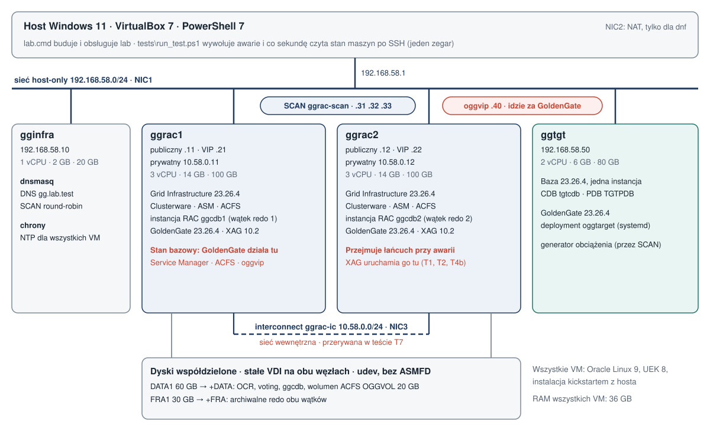
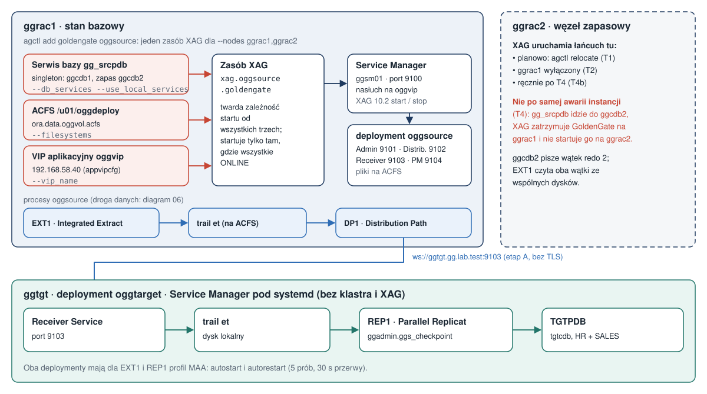
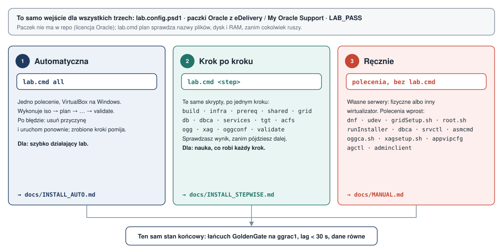

# 🔁 GoldenGate 23.26 na dwuwęzłowym RAC Oracle AI Database 26ai: lab w VirtualBox ze zmierzonymi testami awarii

🇬🇧 [English](README.md) | 🇵🇱 Polski

[-red)]()
[]()
[]()
[]()
[-success)](LICENSE)

> 🎯 **Co to jest.** Jedno polecenie buduje na laptopie z Windows kompletny lab wysokiej dostępności GoldenGate:
> dwuwęzłową bazę RAC w Oracle AI Database 26ai, GoldenGate 23.26 Microservices chroniony przez XAG i ACFS oraz bazę
> docelową na pojedynczej instancji. Potem automat testów celowo psuje klaster: wyłącza węzeł, zabija instancję i procesy,
> odcina interconnect. Przy tym mierzy, **ile naprawdę trwa przerwa w replikacji** i **czy giną dane**.
>
> 🌐 Strona: `https://<owner>.github.io/gg-rac26ai-lab/pl/` · 🎬 Film: link po premierze



## 💡 Po co ten lab

GoldenGate na RAC to miejsce, w którym wiele projektów replikacji robi się trudnych. Oprogramowanie replikacji działa na
**jednym** węźle, a baza na **dwóch**. Gdy ten węzeł pada, ktoś musi przenieść GoldenGate, jego pliki i adres sieciowy na
węzeł, który przeżył, i to w dobrej kolejności. Odpowiedzią Oracle (Maximum Availability Architecture, MAA) jest **XAG**:
agent Clusterware, który trzyma GoldenGate razem z systemem plików ACFS, adresem VIP aplikacji i serwisem bazy, od którego
GoldenGate zależy.

Dokumentacja mówi, jak to powinno działać. Ten lab pokazuje **co się dzieje, w sekundach**, gdy wyciągniesz wtyczkę:

| Test | Co psujemy | Co się stało (16.11.2026, VirtualBox na laptopie) |
|---|---|---|
| T1 | planowe przeniesienie GoldenGate na drugi węzeł | lag replikacji poniżej 30 s po **54–65 s** |
| T2 | wyłączenie węzła, na którym działa GoldenGate | GoldenGate przeniósł się na drugi węzeł, lag OK po **130–136 s**, bez utraty danych |
| T3 | wyłączenie *drugiego* węzła | GoldenGate zostaje na miejscu; lag OK po **40 s** (mediana z 3) |
| T4 | `kill -9` instancji bazy pod GoldenGate | **GoldenGate sam nie wraca** (twarda zależność od serwisu), patrz [WYNIKI](docs/RESULTS_PL.md) |
| T4b | to samo, z opisaną ręczną przeprowadzką | **24–53 s** od decyzji operatora do lag OK |
| T5 | zabity Service Manager | restart na miejscu, **47–57 s** |
| T6 | zabity krytyczny proces GoldenGate | restart na miejscu, **37–42 s** |
| T7 | odcięty prywatny interconnect | węzeł wykluczony po **66 s**, replikacja OK po **159 s** |
| T8–T10 | lag heartbeat, porównanie danych, DDL i typy danych 26ai | źródło = cel, DDL zreplikowany |

Każda liczba pochodzi z `results/runs/` i da się ją powtórzyć tym samym automatem. Pełny opis, także przebiegów, które
nie poszły zgodnie z oczekiwaniem, i ich przyczyn: **[docs/RESULTS_PL.md](docs/RESULTS_PL.md)**.

## 🧩 Co powstaje

| Maszyna | Rola | vCPU / RAM |
|---|---|---|
| `gginfra` | DNS (dnsmasq, SCAN round-robin) i NTP (chrony) | 1 / 2 GB |
| `ggrac1`, `ggrac2` | Grid Infrastructure + CDB RAC `ggcdb` (PDB `SRCPDB`), GoldenGate `oggsource` na ACFS, XAG | 3 / 14 GB każdy |
| `ggtgt` | CDB na pojedynczej instancji `tgtcdb` (PDB `TGTPDB`), GoldenGate `oggtarget` | 2 / 6 GB |

Oracle Linux 9 (UEK), Grid Infrastructure i Database 26ai 23.26.1 + Release Update, GoldenGate 23.26 Microservices,
XAG 10.2. Dane płyną `Integrated Extract EXT1 → trail → Distribution Path → Receiver → Parallel Replicat REP1`
([docs/CONCEPTS_PL.md](docs/CONCEPTS_PL.md) objaśnia każdy element prostym językiem).



## 🚀 Trzy drogi instalacji



| Droga | Dla kogo | Zacznij tu |
|---|---|---|
| **1. Automatyczna** | chcesz mieć lab, a nie przechodzić instalację: jedno polecenie, ok. 4 godziny pracy bez nadzoru ([pomiar](docs/TIMINGS_PL.md)) | [docs/INSTALL_AUTO_PL.md](docs/INSTALL_AUTO_PL.md) |
| **2. Krok po kroku** | chcesz oglądać każdy etap, sprawdzić go i iść dalej: `lab.cmd <krok>` | [docs/INSTALL_STEPWISE_PL.md](docs/INSTALL_STEPWISE_PL.md) |
| **3. Ręczna** | instalujesz na własnych serwerach (fizycznych albo w innym wirtualizatorze) albo chcesz poznać każde polecenie | [docs/MANUAL_PL.md](docs/MANUAL_PL.md) |

Szybki start (droga automatyczna):

```powershell
$env:LAB_PASS = '<hasło>'      # litery, cyfry, _ ; nigdy nie trafia do repozytorium
.\lab.cmd plan                 # tylko sprawdza: paczki, RAM, dysk, plan maszyn; READY = można
.\lab.cmd all                  # buduje wszystko; każdy krok pomija to, co już zrobione
.\lab.cmd validate             # kontrole + 60 s obciążenia + porównanie źródło = cel → „VALID”
```

## 📋 Wymagania

- Host z Windows 11, ok. **36 GB wolnego RAM** (zalecany komputer z 64 GB) i **250–350 GB** wolnego miejsca na dysku.
- VirtualBox 7.x, PowerShell 7, klient OpenSSH z kluczem, Python 3, Git for Windows. Funkcje hypervisora Windows
  (Hyper-V, VBS) **wyłączone**, bo przy nich VirtualBox działa dużo wolniej. Szczegóły: [docs/ENVIRONMENT_PL.md](docs/ENVIRONMENT_PL.md).
- Oprogramowania Oracle **nie ma** w repozytorium (licencja Oracle). Pobierasz je sam z Oracle Software Delivery Cloud
  i My Oracle Support; dokładne nazwy plików i numery łatek są w `lab.config.psd1` i w [docs/INSTALL_AUTO_PL.md](docs/INSTALL_AUTO_PL.md).

## 🧪 Testy awarii u siebie

```powershell
pwsh tests/run_test.ps1 -Test T3 -ApprovedBy <twoje-imię>   # testy niszczące wymagają jawnego zatwierdzającego
.\lab.cmd baseline                                           # powrót do stanu bazowego po teście
```

Każdy przebieg zapisuje `results/<test>-<znacznik czasu>/`: oś zdarzeń klastra, próbki lagu replikacji i porównanie
danych źródła z celem. Opis testów: [TESTS_PL.md](TESTS_PL.md).

## 📚 Mapa dokumentów

| Dokument | Zawartość |
|---|---|
| [docs/CONCEPTS_PL.md](docs/CONCEPTS_PL.md) | klocki: Clusterware, ASM, ACFS, serwisy, VIP, Service Manager, Extract, trail, Replicat, XAG, heartbeat |
| [docs/ENVIRONMENT_PL.md](docs/ENVIRONMENT_PL.md) | maszyny, sieci, adresy, dyski, wersje, wymagania hosta |
| [docs/INSTALL_AUTO_PL.md](docs/INSTALL_AUTO_PL.md) · [INSTALL_STEPWISE_PL.md](docs/INSTALL_STEPWISE_PL.md) · [MANUAL_PL.md](docs/MANUAL_PL.md) | trzy drogi instalacji |
| [docs/OPERATIONS_PL.md](docs/OPERATIONS_PL.md) | start, stop, status, baseline, validate, rozwiązywanie problemów |
| [TESTS_PL.md](TESTS_PL.md) · [docs/RESULTS_PL.md](docs/RESULTS_PL.md) | testy awarii i zmierzone wyniki z wykresami |
| [docs/PITFALLS_26AI_PL.md](docs/PITFALLS_26AI_PL.md) · [docs/TIMINGS_PL.md](docs/TIMINGS_PL.md) | pułapki 26ai i GoldenGate 23.26, ile trwa każdy krok |
| [DESIGN_PL.md](DESIGN_PL.md) · [SETTINGS.md](SETTINGS.md) | decyzje projektowe (ADR), parametry i konwencje |

## 📁 Układ repozytorium

```
lab.cmd, lab.ps1, lab.config.psd1   punkt wejścia, kroki, cała konfiguracja
host/                               moduły PowerShell (maszyny, kickstart, pliki gości, paczki, dowody z testów)
kickstart/, response/, ogg/         kickstarty OL9, pliki odpowiedzi instalatorów, parametry i pliki obey GoldenGate
guest/infra|rac|tgt|shared/         skrypty bash uruchamiane na maszynach (lib.sh = wspólne funkcje)
sql/                                01-06 przygotowanie, 10 porównanie, 99 reset
tests/                              run_test.ps1, sampler, testy awarii T1-T10, testy statyczne (bez maszyn)
results/                            results/runs/ = zmierzone przebiegi użyte w docs/RESULTS_PL.md
tools/                              make_charts.py (wykresy do docs/RESULTS_PL.md)
docs/                               dokumentacja, diagramy, wykresy, strona GitHub Pages (index.html)
```

## ⚠️ Ważne uwagi

- To **lab**, a nie wzór produkcji. Czasy pochodzą z VirtualBox na laptopie; na prawdziwym sprzęcie wykrywanie awarii i
  restarty trwają inaczej. Przenosi się **kolejność zdarzeń** i **zachowanie łańcucha HA**.
- `ENABLE_GOLDENGATE_REPLICATION=TRUE` i sam GoldenGate wymagają licencji; sprawdź warunki licencji Oracle dla swojego użycia.
- ACFS obsługuje tylko wybrane jądra; jądro jest blokowane po kickstarcie (patrz [docs/ENVIRONMENT_PL.md](docs/ENVIRONMENT_PL.md)).
- `lab.cmd destroy <vm|all>` usuwa tylko maszyny oznaczone jako maszyny tego labu. Skrypty nigdy nie usuwają katalogów
  Oracle ani baz poza maszynami labu.

## 🎬 Film

Film pokazuje lab i testy awarii: *link po premierze*.

## 👤 Autor i licencja

© 2026 KCB Consulting · KCB Kris. Skrypty i dokumentacja: [MIT](LICENSE). Produkty Oracle podlegają licencji Oracle;
patrz [NOTICE](NOTICE). Powstało z pomocą Claude Code.
