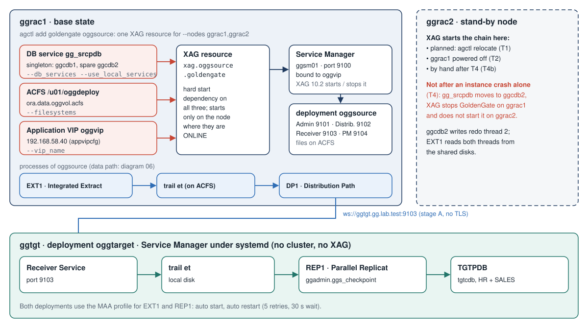
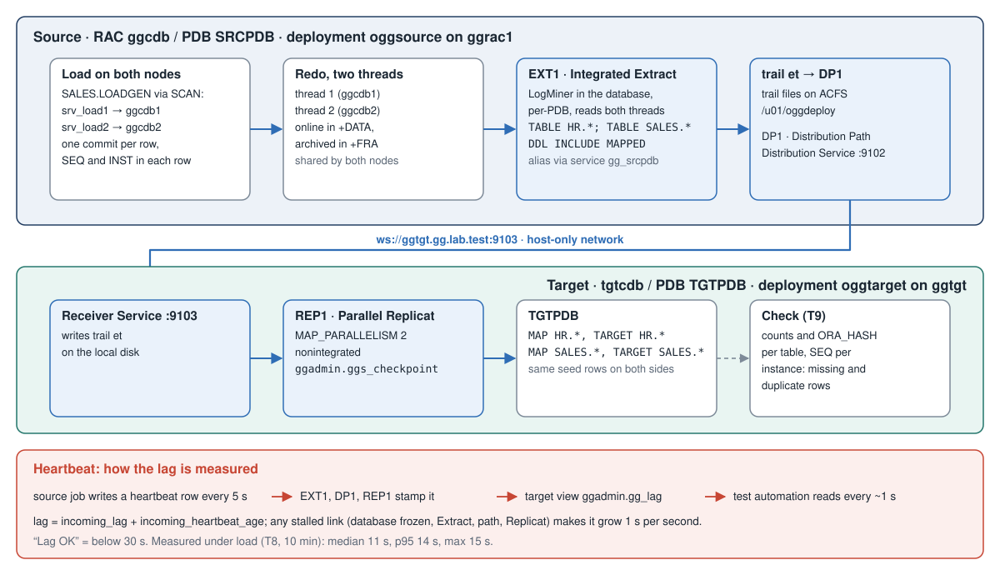

# 🧱 Concepts: the building blocks of GoldenGate on RAC

🇬🇧 English | 🇵🇱 [Polski](CONCEPTS_PL.md)

[]()
[]()
[]()
[]()

> 🎯 Every block of this lab in plain words: what it is, what it is made of, and where you can see it in the running lab
> (one command). Read this first if GoldenGate Microservices on RAC is new to you; the failure tests in
> [TESTS.md](../TESTS.md) and the numbers in [RESULTS.md](RESULTS.md) assume these words.

Commands below run on a lab node: `ggrac1`/`ggrac2` (source RAC) or `ggtgt` (target). Clusterware commands run as `root`
or `grid` with `/u01/app/23.26/grid/bin` in `PATH`; `srvctl` as `oracle`; `agctl` from `/u01/app/xag/bin` (XAG 10.2 is
first in `PATH`); `adminclient` from `/u01/app/ogg/ogg26ai_ma/bin`. Names come from `lab.config.psd1`.

## 🗺️ The picture first



The source is a two-node RAC database. GoldenGate runs on **one** node at a time, its files live on a cluster file
system, and it is reachable at a moving address. When that node or its database instance fails, Clusterware moves the
whole package to the other node. Changes travel: redo of both instances → Extract → trail → Distribution Path →
Receiver on the target → Replicat → target database. Topology: [01-topology.svg](diagrams/01-topology.svg); data path:
[06-data-path.svg](diagrams/06-data-path.svg).

## 🏛️ Cluster layer

### Oracle Clusterware (CRS)

- **What it is:** the cluster manager of Oracle Grid Infrastructure. It knows which nodes are members, starts and stops
  *resources* (databases, services, VIPs, file systems, GoldenGate) and moves them when something fails. CRS = Cluster
  Ready Services, the Clusterware daemon (`crsd`) that manages resources.
- **Made of:** daemons on every node (`ohasd`, `crsd`, `ocssd` for membership and voting, `evmd`), the Oracle Cluster
  Registry (OCR) and voting files on the `+DATA` disk group, and a private network between the nodes (the interconnect,
  NIC3 `ggrac-ic`, 10.58.0.0/24). A node that stops answering on the interconnect is **evicted** (removed from the
  cluster); test T7 cuts exactly this network.
- **Resource attributes** decide the behaviour: for example `RESTART_ATTEMPTS` (how many local restarts) and
  `UPTIME_THRESHOLD` (after how long the counter resets), see *Oracle Clusterware Administration and Deployment Guide*,
  appendix "Oracle Clusterware Resource Reference". They explain one T4 result ([analysis](analysis/T4_INSTANCE_RESTART.md)).
- **Where to see it:**
  ```bash
  crsctl stat res -t          # every resource, its state and node
  olsnodes -s                 # cluster members: Active / Inactive
  crsctl stat res ora.ggcdb.db -f | grep -E 'RESTART_ATTEMPTS|UPTIME_THRESHOLD'
  ```

### ASM (Automatic Storage Management)

- **What it is:** Oracle's volume manager and file system for database files, shared by both nodes.
- **Made of:** disk groups `+DATA` (60 GB disk `DATA1`: OCR, voting, database files and the ACFS volume) and `+FRA`
  (30 GB disk `FRA1`: archived redo of **both** instances). The disks are shared VirtualBox disks named by udev rules
  (`/dev/oracleasm/DATA1`, `FRA1`).
- **Why it matters here:** the Extract on the surviving node reads the archived redo of the dead instance from the shared
  `+FRA` (test T3).
- **Where to see it:** `asmcmd lsdg` (as `grid`).

### ACFS (ASM Cluster File System)

- **What it is:** a POSIX file system on top of an ASM volume. GoldenGate keeps its deployments (configuration,
  checkpoints, trail files, logs) there, so the node that takes over finds exactly the files the failed node wrote.
- **Made of:** ASM volume `OGGVOL` (20 GB in `+DATA`), CRS resource `ora.data.oggvol.acfs`, mount point `/u01/oggdeploy`
  with the Service Manager home `ggsm01` and the deployment `oggsource`.
- **Detail you will see in the data:** the ACFS resource is a *local* resource: it can be ONLINE on both nodes at once.
  XAG only guarantees that it is mounted on the node where GoldenGate runs. The lab's probe therefore reports ACFS on the
  node of `oggvip`.
- **Where to see it:**
  ```bash
  crsctl stat res ora.data.oggvol.acfs -t
  df -h /u01/oggdeploy
  ```

### PDB service, singleton, preferred / available

- **What it is:** a database *service* is a name clients connect to; Clusterware decides on which instance it runs.
  `gg_srcpdb` is the service GoldenGate uses to reach the source PDB `SRCPDB`.
- **Singleton, preferred / available:** `gg_srcpdb` runs on **one** instance at a time: preferred `ggcdb1`, available
  `ggcdb2`. When `ggcdb1` fails, CRS starts the service on `ggcdb2`. It does **not** move back by itself
  (no failback): `lab.cmd baseline` moves it back. This is the configuration the MAA paper describes (see "MAA profile").
- **Load services:** `srv_load1` (preferred `ggcdb1`) and `srv_load2` (preferred `ggcdb2`) are used only by the load
  generator, so that both instances, and therefore both redo threads, write rows.
- **Where to see it:**
  ```bash
  srvctl config service -db ggcdb -service gg_srcpdb
  srvctl status service -db ggcdb
  ```

### SCAN and node VIPs

- **SCAN** (Single Client Access Name): one name for clients of the whole cluster, `ggrac-scan.gg.lab.test`, resolved by
  the DNS on `gginfra` to three addresses (192.168.58.31–33, round robin). The load generator connects through it.
- **Node VIP:** one virtual IP per node (`ggrac1-vip` 192.168.58.21, `ggrac2-vip` .22). When a node dies, its VIP moves
  to the other node and answers "connection refused" at once, so clients do not wait for a TCP timeout.
- **Where to see it:** `srvctl config scan`, `srvctl config vip -node ggrac1`, `nslookup ggrac-scan.gg.lab.test`.

### oggvip, the application VIP of GoldenGate

- **What it is:** a separate virtual IP (192.168.58.40, name `oggvip`) created with `appvipcfg`. The GoldenGate Service
  Manager listens on it, so the Web UI, `adminclient` and the Distribution Path endpoint keep one address whichever node
  runs GoldenGate.
- **Where to see it:** `crsctl stat res oggvip -t`; Web UI `http://oggvip.gg.lab.test:9100` (stage A: plain HTTP,
  no NGINX; stage B of [DESIGN.md](../DESIGN.md) adds NGINX and TLS as in MAA).

## 🔁 GoldenGate layer

### Service Manager and deployment

- **What they are:** GoldenGate Microservices Architecture (the only architecture in GoldenGate 23ai/26ai) runs as a set
  of small web services. The **Service Manager** (`ggsm01`, port 9100) starts and watches the services of one or more
  **deployments**. A deployment is one GoldenGate "installation instance" with its own configuration and processes:
  `oggsource` on the RAC (on ACFS) and `oggtarget` on `ggtgt`.
- **Services of a deployment:** Administration Service (9101: processes, parameters), Distribution Service (9102: sends
  trails), Receiver Service (9103: receives trails), Performance Metrics Service (9104).
- **Where to see it:**
  ```bash
  agctl status goldengate oggsource          # which node runs it
  adminclient                                 # then:
  #   CONNECT http://oggvip.gg.lab.test:9100 DEPLOYMENT oggsource AS oggadmin
  #   INFO ALL
  ```

### Integrated Extract and the two redo threads of RAC

- **What it is:** Extract `EXT1` captures committed changes of the schemas `HR` and `SALES` in `SRCPDB`. *Integrated*
  means the database itself mines the redo for it (a LogMiner server inside the database, visible as
  `v$goldengate_capture`). The Extract is registered per PDB (`REGISTER EXTRACT ext1 DATABASE` with a local `ggadmin`).
- **Two threads:** each RAC instance writes its own redo *thread* (thread 1 = `ggcdb1`, thread 2 = `ggcdb2`). One Extract
  reads both and merges them in SCN order. If one instance dies, its thread must be closed (the surviving instance runs
  instance recovery) before the Extract can safely go past that point. That is why lag grows for about 31 s after a node
  power-off in T3 even though GoldenGate itself never moves ([analysis](analysis/T3_EXTRACT_STALLS.md)).
- **Where to see it:**
  ```sql
  -- in CDB$ROOT on a RAC node (sqlplus / as sysdba)
  select thread#, status, enabled from v$thread;
  -- in SRCPDB
  select capture_name, state from v$goldengate_capture;
  ```
  and `INFO EXTRACT ext1, DETAIL` in `adminclient`.

### Trail

- **What it is:** GoldenGate's own change files. `EXT1` writes trail `et`; the Distribution Path reads it and the Receiver
  writes a copy `et` on the target, which `REP1` reads. Trail files and checkpoints are what make a restart lossless: a
  process starts again from its last checkpoint, on whichever node.
- **Where to see it:** `INFO EXTTRAIL *` in `adminclient` on `oggsource`.

### Distribution Path and Receiver

- **Distribution Path** `DP1`: a job of the Distribution Service of `oggsource` that reads trail `et` and sends it over
  WebSocket (`ws://` in stage A) to the Receiver Service of `oggtarget` on `ggtgt:9103`. Its source is always
  `localhost`, so it works on whichever RAC node runs the deployment.
- **Receiver Service:** writes the incoming trail on the target.
- **Where to see it:** `INFO DISTPATH dp1` in `adminclient` (source); the Receiver paths in the target Web UI
  `http://ggtgt.gg.lab.test:9100`.

### Parallel Replicat

- **What it is:** `REP1` applies the trail to `TGTPDB`. *Parallel* means the work is split: mappers read and map the trail,
  appliers apply independent transactions in parallel (`MAP_PARALLELISM 2`) while keeping dependent ones in order. It
  is nonintegrated and keeps its position in the checkpoint table `ggadmin.ggs_checkpoint` on the target.
- **Where to see it:** `INFO REPLICAT rep1, DETAIL` in `adminclient` on `oggtarget`.

### Heartbeat and how the lab measures lag

- **What it is:** `ADD HEARTBEATTABLE, FREQUENCY 5` makes the source write a heartbeat row every 5 s. It travels like any
  change (Extract → trail → path → Replicat). The target view `ggadmin.gg_lag` shows, per path, how old the last heartbeat
  was when it arrived (`incoming_lag`) and how long ago it arrived (`incoming_heartbeat_age`).
- **The lab's lag** = `incoming_lag + incoming_heartbeat_age` of the **freshest** path row. Why the sum: if anything in the
  chain stops, no new heartbeat arrives, `incoming_lag` freezes at its old value and only the age keeps growing, 1 s per
  second. The sum therefore grows during an outage and falls when replication catches up. Why the freshest row: the view
  keeps one row per path; after GoldenGate moves, the row of the old path only ages (a probe that took the maximum
  reported 730 s while replication worked: run `T1-20261116-112526`).
- **What "normal" looks like:** a saw tooth between about 5 and 15 s under load (heartbeat every 5 s plus the age). Test T8
  measured a median of 11 s, maximum 15 s. The threshold for "lag OK" is **30 s**.
- **Where to see it:**
  ```sql
  -- on ggtgt, in TGTPDB
  select incoming_path, incoming_lag, incoming_heartbeat_age from ggadmin.gg_lag;
  ```



## 🛡️ High availability layer

### XAG and the dependency chain

- **What it is:** XAG (Oracle Grid Infrastructure Agents, standalone version 10.2 in `/u01/app/xag`) registers GoldenGate
  as a Clusterware resource and teaches CRS how to start, stop, check and move it. One XAG resource = one Service Manager:
  here `xag.oggsource.goldengate`. MAA requires XAG 10.2 or later for GoldenGate Microservices.
- **Registered with:** `agctl add goldengate oggsource --service_manager ... --vip_name oggvip
  --filesystems ora.data.oggvol.acfs --db_services ora.ggcdb.gg_srcpdb.svc --use_local_services --nodes ggrac1,ggrac2`.
- **The chain** (what must be up, in order, on the same node): **PDB service → ACFS → VIP → Service Manager →
  deployment** (and then the processes `EXT1`, `DP1` from their checkpoints). XAG starts GoldenGate only where the
  database service runs, the deployment files are mounted and the address is up.
- **Why `--use_local_services`:** the Extract logs in through the singleton service on the **local** instance (MAA). XAG
  then keeps GoldenGate on the node where `gg_srcpdb` runs. Measured consequences in this lab:
  - a planned `agctl relocate` moves the service too (T1: service on `ggrac2` about 2 s after the command);
  - after a node failure the whole chain follows the service (T2);
  - after an **instance** crash the service moves, but GoldenGate does not follow it: CRS logged "Hard Stop dependency
    prevents a relocate of xag.oggsource.goldengate" (CRS-0222), stopped XAG and made no further attempt (T4). An
    operator move fixes it in about half a minute (T4b).
- **In the test data** the marker `t_sm_running` is the moment the XAG resource `xag.oggsource.goldengate` becomes ONLINE
  again (the probe reads CRS, not the Service Manager process).
- **Where to see it:**
  ```bash
  agctl config goldengate oggsource
  agctl status goldengate oggsource
  crsctl stat res xag.oggsource.goldengate -p | grep -E 'START_DEPENDENCIES|STOP_DEPENDENCIES'
  ```
- **Reference:** *Oracle Grid Infrastructure Standalone Agents for Oracle Clusterware 10.2* (agctl reference) and the MAA
  paper below.

### MAA profile

- **What it is:** the Oracle Maximum Availability Architecture paper *Oracle GoldenGate Microservices Architecture on
  Oracle Real Application Clusters* (MAA best practices for Oracle AI Database 26ai) describes the configuration this lab
  follows: singleton service, ACFS (or DBFS) for the deployment, application VIP, XAG 10.2, and a **managed process
  profile** for the GoldenGate processes.
- **The profile in this lab** (`ADD PROFILE MAA` in `ogg/setup_source.oby` and `setup_target.oby`): auto start after
  60 s, auto restart after 30 s, at most 5 retries in a 30 min window, disable on failure. Measured: after `kill -9` of
  `EXT1` (T6) the Extract was RUNNING again 31 s later in all three runs; after a Service Manager kill (T5) or a node
  failure (T2) `EXT1` stayed ABENDED for another 24–29 s after the XAG resource was ONLINE. Both fit the 30 s restart
  delay of the profile (an interpretation, the restart attempts themselves were not logged).
- **"Critical to deployment health":** a per-process option in the profile. MAA warns that a failure of a process marked
  critical *can interfere* with XAG restarting the deployment. Test T6 checks it: with the flag ON for `EXT1`, three
  `kill -9` of the Extract all recovered by themselves (the XAG resource was INTERMEDIATE for about 30 s).
- **Where to see it:** Web UI of `oggsource` → Extract `EXT1` → Managed Options; or `INFO PROFILE *` in `adminclient`
  (not checked).

## 🔗 See also

- [ENVIRONMENT.md](ENVIRONMENT.md): machines, networks, versions.
- [TESTS.md](../TESTS.md): what each failure test does and why. [RESULTS.md](RESULTS.md): what happened.
- Diagrams: [HA chain](diagrams/02-ha-chain-and-data.svg), [failure tests](diagrams/04-failure-tests.svg),
  [failover timeline](diagrams/07-failover-timeline.svg).
