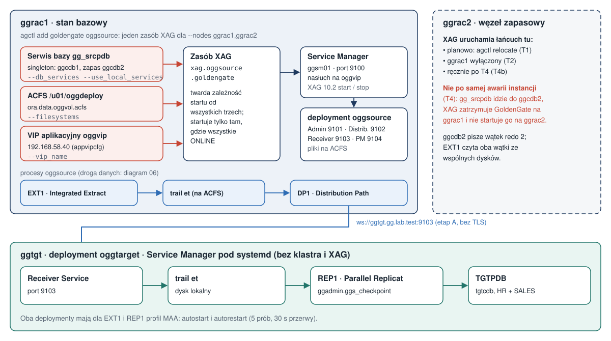
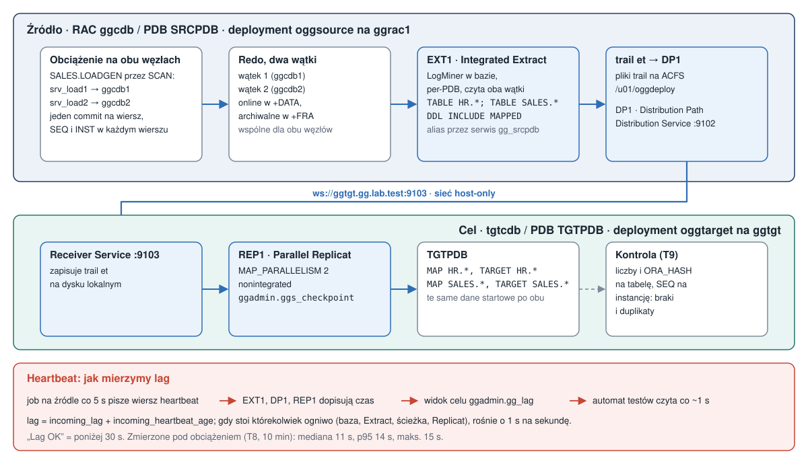

# 🧱 Pojęcia: klocki GoldenGate na RAC

🇬🇧 [English](CONCEPTS.md) | 🇵🇱 Polski

[]()
[]()
[]()
[]()

> 🎯 Każdy klocek tego labu prostymi słowami: co to jest, z czego się składa i gdzie to zobaczyć w działającym labie
> (jedno polecenie). Zacznij tutaj, jeśli GoldenGate Microservices na RAC widzisz pierwszy raz. Testy awarii w
> [TESTS_PL.md](../TESTS_PL.md) i liczby w [RESULTS_PL.md](RESULTS_PL.md) używają tych słów.

Polecenia poniżej wykonuje się na węźle labu: `ggrac1`/`ggrac2` (źródłowy RAC) albo `ggtgt` (cel). Polecenia
Clusterware jako `root` albo `grid` z `/u01/app/23.26/grid/bin` w `PATH`; `srvctl` jako `oracle`; `agctl` z
`/u01/app/xag/bin` (XAG 10.2 jest pierwszy w `PATH`); `adminclient` z `/u01/app/ogg/ogg26ai_ma/bin`. Nazwy pochodzą
z `lab.config.psd1`.

## 🗺️ Najpierw obraz



Źródło to dwuwęzłowa baza RAC. GoldenGate działa w danej chwili na **jednym** węźle, jego pliki leżą na klastrowym
systemie plików, a dostęp do niego jest pod „wędrującym” adresem. Gdy ten węzeł albo jego instancja bazy padnie,
Clusterware przenosi całą paczkę na drugi węzeł. Zmiany płyną tak: redo obu instancji → Extract → trail → Distribution
Path → Receiver na celu → Replicat → baza docelowa. Topologia: [01-topology_pl.svg](diagrams/01-topology_pl.svg);
droga danych: [06-data-path_pl.svg](diagrams/06-data-path_pl.svg).

## 🏛️ Warstwa klastra

### Oracle Clusterware (CRS)

- **Co to jest:** menedżer klastra z Oracle Grid Infrastructure. Wie, które węzły należą do klastra, uruchamia
  i zatrzymuje *zasoby* (bazy, serwisy, adresy VIP, systemy plików, GoldenGate) i przenosi je po awarii. CRS (Cluster
  Ready Services) to demon Clusterware (`crsd`), który zarządza zasobami.
- **Z czego się składa:** demony na każdym węźle (`ohasd`, `crsd`, `ocssd` od członkostwa i głosowania, `evmd`),
  rejestr klastra OCR i pliki głosujące (voting) w grupie dysków `+DATA` oraz prywatna sieć między węzłami (interconnect,
  karta NIC3 `ggrac-ic`, 10.58.0.0/24). Węzeł, który przestaje odpowiadać w interconnect, zostaje **wykluczony**
  (eviction, usunięcie z klastra); test T7 przecina właśnie tę sieć.
- **Atrybuty zasobów** decydują o zachowaniu, np. `RESTART_ATTEMPTS` (ile lokalnych restartów) i `UPTIME_THRESHOLD`
  (po jakim czasie licznik się zeruje), zob. *Oracle Clusterware Administration and Deployment Guide*, dodatek
  „Oracle Clusterware Resource Reference”. Wyjaśniają jeden z wyników T4 ([analiza](analysis/T4_INSTANCE_RESTART_PL.md)).
- **Gdzie zobaczyć:**
  ```bash
  crsctl stat res -t          # wszystkie zasoby, stan i węzeł
  olsnodes -s                 # członkowie klastra: Active / Inactive
  crsctl stat res ora.ggcdb.db -f | grep -E 'RESTART_ATTEMPTS|UPTIME_THRESHOLD'
  ```

### ASM (Automatic Storage Management)

- **Co to jest:** menedżer wolumenów i system plików Oracle dla plików bazy, wspólny dla obu węzłów.
- **Z czego się składa:** grupy dysków `+DATA` (dysk `DATA1` 60 GB: OCR, voting, pliki bazy i wolumen ACFS) i `+FRA`
  (dysk `FRA1` 30 GB: zarchiwizowane redo **obu** instancji). Dyski to współdzielone dyski VirtualBox nazwane regułami
  udev (`/dev/oracleasm/DATA1`, `FRA1`).
- **Dlaczego to ważne:** Extract na węźle, który przeżył, czyta zarchiwizowane redo padniętej instancji ze wspólnego
  `+FRA` (test T3).
- **Gdzie zobaczyć:** `asmcmd lsdg` (jako `grid`).

### ACFS (ASM Cluster File System)

- **Co to jest:** system plików POSIX na wolumenie ASM. GoldenGate trzyma na nim swoje deploymenty (konfigurację,
  checkpointy, pliki trail, logi), więc węzeł, który przejmuje pracę, widzi dokładnie te pliki, które zapisał węzeł,
  który padł.
- **Z czego się składa:** wolumen ASM `OGGVOL` (20 GB w `+DATA`), zasób CRS `ora.data.oggvol.acfs`, punkt montowania
  `/u01/oggdeploy` z katalogiem Service Managera `ggsm01` i deploymentem `oggsource`.
- **Szczegół widoczny w danych:** zasób ACFS jest *lokalny*: może być ONLINE na obu węzłach naraz. XAG pilnuje tylko,
  żeby był zamontowany tam, gdzie działa GoldenGate. Dlatego próbnik labu podaje ACFS na węźle, na którym jest `oggvip`.
- **Gdzie zobaczyć:**
  ```bash
  crsctl stat res ora.data.oggvol.acfs -t
  df -h /u01/oggdeploy
  ```

### Serwis PDB, singleton, preferred / available

- **Co to jest:** *serwis* bazy to nazwa, do której łączą się klienci; Clusterware decyduje, na której instancji działa.
  `gg_srcpdb` to serwis, przez który GoldenGate łączy się ze źródłową PDB `SRCPDB`.
- **Singleton, preferred / available:** `gg_srcpdb` działa naraz tylko na **jednej** instancji: preferowana (preferred)
  `ggcdb1`, zapasowa (available) `ggcdb2`. Gdy `ggcdb1` padnie, CRS uruchamia serwis na `ggcdb2`. Serwis **nie wraca**
  sam (brak failbacku); z powrotem przenosi go `lab.cmd baseline`. Tak konfigurację opisuje dokument MAA (zob. „Profil MAA”).
- **Serwisy obciążenia:** `srv_load1` (preferowana `ggcdb1`) i `srv_load2` (preferowana `ggcdb2`) służą tylko generatorowi
  obciążenia, żeby obie instancje, a więc oba wątki redo, zapisywały wiersze.
- **Gdzie zobaczyć:**
  ```bash
  srvctl config service -db ggcdb -service gg_srcpdb
  srvctl status service -db ggcdb
  ```

### SCAN i VIP węzłów

- **SCAN** (Single Client Access Name): jedna nazwa dla klientów całego klastra, `ggrac-scan.gg.lab.test`; DNS na
  `gginfra` zamienia ją na trzy adresy (192.168.58.31–33, na zmianę). Generator obciążenia łączy się przez SCAN.
- **VIP węzła:** jeden wirtualny adres IP na węzeł (`ggrac1-vip` 192.168.58.21, `ggrac2-vip` .22). Gdy węzeł padnie,
  jego VIP przechodzi na drugi węzeł i od razu odpowiada „connection refused”, więc klient nie czeka na timeout TCP.
- **Gdzie zobaczyć:** `srvctl config scan`, `srvctl config vip -node ggrac1`, `nslookup ggrac-scan.gg.lab.test`.

### oggvip, aplikacyjny VIP GoldenGate

- **Co to jest:** osobny wirtualny adres IP (192.168.58.40, nazwa `oggvip`) utworzony przez `appvipcfg`. Service Manager
  GoldenGate słucha na nim, więc Web UI, `adminclient` i końcówka Distribution Path mają jeden adres niezależnie od tego,
  który węzeł uruchamia GoldenGate.
- **Gdzie zobaczyć:** `crsctl stat res oggvip -t`; Web UI `http://oggvip.gg.lab.test:9100` (etap A: zwykłe HTTP, bez
  NGINX; etap B z [DESIGN.md](../DESIGN.md) dodaje NGINX i TLS jak w MAA).

## 🔁 Warstwa GoldenGate

### Service Manager i deployment

- **Co to jest:** architektura Microservices GoldenGate (jedyna w GoldenGate 23ai/26ai) to zestaw małych usług
  sieciowych. **Service Manager** (`ggsm01`, port 9100) uruchamia i pilnuje usług jednego albo kilku **deploymentów**.
  Deployment to jedna „instancja instalacji” GoldenGate z własną konfiguracją i procesami: `oggsource` na RAC (na ACFS)
  i `oggtarget` na `ggtgt`.
- **Usługi deploymentu:** Administration Service (9101: procesy, parametry), Distribution Service (9102: wysyła traile),
  Receiver Service (9103: odbiera traile), Performance Metrics Service (9104).
- **Gdzie zobaczyć:**
  ```bash
  agctl status goldengate oggsource          # na którym węźle działa
  adminclient                                 # potem:
  #   CONNECT http://oggvip.gg.lab.test:9100 DEPLOYMENT oggsource AS oggadmin
  #   INFO ALL
  ```

### Integrated Extract i dwa wątki redo RAC

- **Co to jest:** Extract `EXT1` przechwytuje zatwierdzone zmiany schematów `HR` i `SALES` w `SRCPDB`. *Integrated*
  znaczy, że redo czyta dla niego sama baza (serwer LogMiner wewnątrz bazy, widoczny w `v$goldengate_capture`). Extract
  jest zarejestrowany per PDB (`REGISTER EXTRACT ext1 DATABASE` z lokalnym `ggadmin`).
- **Dwa wątki:** każda instancja RAC zapisuje własny *wątek* redo (wątek 1 = `ggcdb1`, wątek 2 = `ggcdb2`). Jeden Extract
  czyta oba i łączy je w kolejności SCN. Gdy instancja padnie, jej wątek trzeba zamknąć (instancja, która przeżyła,
  robi instance recovery), zanim Extract bezpiecznie przejdzie dalej. Dlatego po wyłączeniu węzła w T3 lag rośnie przez
  ok. 31 s, choć GoldenGate się nie przenosi ([analiza](analysis/T3_EXTRACT_STALLS_PL.md)).
- **Gdzie zobaczyć:**
  ```sql
  -- w CDB$ROOT na węźle RAC (sqlplus / as sysdba)
  select thread#, status, enabled from v$thread;
  -- w SRCPDB
  select capture_name, state from v$goldengate_capture;
  ```
  oraz `INFO EXTRACT ext1, DETAIL` w `adminclient`.

### Trail

- **Co to jest:** własne pliki zmian GoldenGate. `EXT1` zapisuje trail `et`; Distribution Path go czyta, a Receiver
  zapisuje kopię `et` na celu, którą czyta `REP1`. Pliki trail i checkpointy sprawiają, że restart nic nie gubi: proces
  rusza od ostatniego checkpointu, na dowolnym węźle.
- **Gdzie zobaczyć:** `INFO EXTTRAIL *` w `adminclient` na `oggsource`.

### Distribution Path i Receiver

- **Distribution Path** `DP1`: zadanie usługi Distribution deploymentu `oggsource`, które czyta trail `et` i wysyła go
  przez WebSocket (`ws://` w etapie A) do usługi Receiver deploymentu `oggtarget` na `ggtgt:9103`. Jego źródłem jest zawsze
  `localhost`, więc działa na tym węźle RAC, który akurat uruchamia deployment.
- **Receiver Service:** zapisuje przychodzący trail na celu.
- **Gdzie zobaczyć:** `INFO DISTPATH dp1` w `adminclient` (źródło); ścieżki Receivera w Web UI celu
  `http://ggtgt.gg.lab.test:9100`.

### Parallel Replicat

- **Co to jest:** `REP1` nakłada trail na `TGTPDB`. *Parallel* znaczy, że praca jest podzielona: mappery czytają
  i mapują trail, a appliery nakładają niezależne transakcje równolegle (`MAP_PARALLELISM 2`), zachowując kolejność
  zależnych. Działa w trybie nonintegrated i pamięta pozycję w tabeli checkpointów `ggadmin.ggs_checkpoint` na celu.
- **Gdzie zobaczyć:** `INFO REPLICAT rep1, DETAIL` w `adminclient` na `oggtarget`.

### Heartbeat i jak lab mierzy lag

- **Co to jest:** `ADD HEARTBEATTABLE, FREQUENCY 5` sprawia, że źródło co 5 s zapisuje wiersz heartbeatu („bicie serca”).
  Płynie on jak każda zmiana (Extract → trail → ścieżka → Replicat). Widok `ggadmin.gg_lag` na celu pokazuje dla każdej
  ścieżki, jak stary był ostatni heartbeat w chwili dotarcia (`incoming_lag`) i jak dawno dotarł (`incoming_heartbeat_age`).
- **Lag w labie** (opóźnienie replikacji) = `incoming_lag + incoming_heartbeat_age` z **najświeższego** wiersza ścieżki.
  Dlaczego suma: gdy cokolwiek w łańcuchu stanie, nowy heartbeat nie dociera, `incoming_lag` zamraża się na starej
  wartości i rośnie tylko wiek, 1 s na sekundę. Suma rośnie więc w czasie przestoju i spada, gdy replikacja nadrobi.
  Dlaczego najświeższy wiersz: widok trzyma wiersz na każdą ścieżkę; po przeniesieniu GoldenGate wiersz starej ścieżki
  tylko się starzeje (próbnik, który brał maksimum, pokazał 730 s przy działającej replikacji: przebieg
  `T1-20261116-112526`).
- **Jak wygląda „normalnie”:** piła między ok. 5 a 15 s pod obciążeniem (heartbeat co 5 s plus jego wiek). T8 zmierzył
  medianę 11 s i maksimum 15 s. Próg „lag OK” to **30 s**.
- **Gdzie zobaczyć:**
  ```sql
  -- na ggtgt, w TGTPDB
  select incoming_path, incoming_lag, incoming_heartbeat_age from ggadmin.gg_lag;
  ```



## 🛡️ Warstwa wysokiej dostępności

### XAG i łańcuch zależności

- **Co to jest:** XAG (Oracle Grid Infrastructure Agents, samodzielna wersja 10.2 w `/u01/app/xag`) rejestruje GoldenGate
  jako zasób Clusterware i uczy CRS, jak go uruchomić, zatrzymać, sprawdzić i przenieść. Jeden zasób XAG = jeden Service
  Manager: tu `xag.oggsource.goldengate`. MAA wymaga XAG 10.2 lub nowszego dla GoldenGate Microservices.
- **Rejestracja:** `agctl add goldengate oggsource --service_manager ... --vip_name oggvip
  --filesystems ora.data.oggvol.acfs --db_services ora.ggcdb.gg_srcpdb.svc --use_local_services --nodes ggrac1,ggrac2`.
- **Łańcuch** (co musi działać, po kolei, na tym samym węźle): **serwis PDB → ACFS → VIP → Service Manager →
  deployment** (a potem procesy `EXT1`, `DP1` od swoich checkpointów). XAG uruchamia GoldenGate tylko tam, gdzie działa
  serwis bazy, zamontowane są pliki deploymentu i podniesiony jest adres.
- **Dlaczego `--use_local_services`:** Extract loguje się przez singleton serwis na **lokalnej** instancji (MAA). XAG
  trzyma wtedy GoldenGate na węźle, na którym działa `gg_srcpdb`. Zmierzone skutki w tym labie:
  - planowe `agctl relocate` przenosi też serwis (T1: serwis na `ggrac2` ok. 2 s po poleceniu);
  - po awarii węzła cały łańcuch idzie za serwisem (T2);
  - po awarii samej **instancji** serwis się przenosi, ale GoldenGate za nim nie idzie: CRS zapisał „Hard Stop dependency
    prevents a relocate of xag.oggsource.goldengate” (CRS-0222), zatrzymał XAG i nie próbował ponownie (T4). Ręczne
    przeniesienie przez dyżurnego naprawia to w ok. pół minuty (T4b).
- **W danych testów** znacznik `t_sm_running` to chwila, w której zasób XAG `xag.oggsource.goldengate` znów jest ONLINE
  (próbnik czyta CRS, nie proces Service Managera).
- **Gdzie zobaczyć:**
  ```bash
  agctl config goldengate oggsource
  agctl status goldengate oggsource
  crsctl stat res xag.oggsource.goldengate -p | grep -E 'START_DEPENDENCIES|STOP_DEPENDENCIES'
  ```
- **Dokumentacja:** *Oracle Grid Infrastructure Standalone Agents for Oracle Clusterware 10.2* (opis agctl) i dokument
  MAA niżej.

### Profil MAA

- **Co to jest:** dokument Oracle Maximum Availability Architecture *Oracle GoldenGate Microservices Architecture on
  Oracle Real Application Clusters* (dobre praktyki MAA dla Oracle AI Database 26ai) opisuje konfigurację, którą lab
  odtwarza: singleton serwis, ACFS (albo DBFS) na deployment, aplikacyjny VIP, XAG 10.2 i **profil zarządzanych procesów**
  (managed process profile) dla procesów GoldenGate.
- **Profil w tym labie** (`ADD PROFILE MAA` w `ogg/setup_source.oby` i `setup_target.oby`): auto start po 60 s, auto
  restart po 30 s, najwyżej 5 prób w oknie 30 min, wyłączenie po porażce. Zmierzone: po `kill -9` procesu `EXT1` (T6)
  Extract był znów RUNNING 31 s później we wszystkich trzech przebiegach; po zabiciu Service Managera (T5) albo awarii
  węzła (T2) `EXT1` był jeszcze 24–29 s w stanie ABENDED po tym, jak zasób XAG wrócił do ONLINE. Oba wyniki pasują do
  30 s opóźnienia restartu z profilu (to interpretacja, samych prób restartu nie zapisywaliśmy).
- **„Critical to deployment health”:** opcja procesu w profilu. MAA ostrzega, że awaria procesu oznaczonego jako krytyczny
  *może przeszkodzić* XAG w restarcie deploymentu. Sprawdza to test T6: z flagą WŁ. dla `EXT1` trzy `kill -9` Extractu
  wróciły same (zasób XAG był INTERMEDIATE przez ok. 30 s).
- **Gdzie zobaczyć:** Web UI `oggsource` → Extract `EXT1` → Managed Options; albo `INFO PROFILE *` w `adminclient`
  (niesprawdzone).

## 🔗 Zobacz też

- [ENVIRONMENT_PL.md](ENVIRONMENT_PL.md): maszyny, sieci, wersje.
- [TESTS_PL.md](../TESTS_PL.md): co robi każdy test awarii i po co. [RESULTS_PL.md](RESULTS_PL.md): co z tego wyszło.
- Diagramy: [łańcuch HA](diagrams/02-ha-chain-and-data_pl.svg), [testy awarii](diagrams/04-failure-tests_pl.svg),
  [oś failoveru](diagrams/07-failover-timeline_pl.svg).
