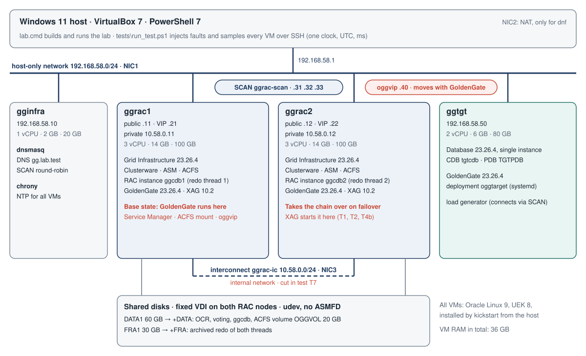

# 🧩 Environment — machines, networks, storage, versions, host

🇬🇧 English | 🇵🇱 [Polski](ENVIRONMENT_PL.md)

[]()
[]()
[]()
[]()

> 🎯 Everything the lab is made of, in one place: four VMs, three networks, two shared disks, the software versions and
> what your Windows host needs. Every value comes from `lab.config.psd1` and the scripts that use it; change the file,
> run `lab.cmd plan`, and the scripts follow.



## 🖥️ Machines

| VM | Role | vCPU | RAM | OS disk | Shared disks |
|---|---|---|---|---|---|
| `gginfra` | DNS (dnsmasq) and time server (chrony) for the lab | 1 | 2 GB | 20 GB | – |
| `ggrac1` | RAC node 1: Grid Infrastructure, ASM, instance `ggcdb1`, GoldenGate `oggsource` (base state), XAG | 3 | 14 GB | 100 GB | DATA1, FRA1 |
| `ggrac2` | RAC node 2: Grid Infrastructure, ASM, instance `ggcdb2`, takes GoldenGate over on failover | 3 | 14 GB | 100 GB | DATA1, FRA1 |
| `ggtgt` | target: single-instance CDB `tgtcdb` (PDB `TGTPDB`), GoldenGate `oggtarget` | 2 | 6 GB | 80 GB | – |

Totals: **9 vCPU, 36 GB RAM**. Why 3 vCPU and 14 GB on the RAC nodes: with 2 vCPU the node starved (see
[PITFALLS_26AI](PITFALLS_26AI.md) and ADR-015 in [DESIGN.md](../DESIGN.md)); with 10 GB the nodes swapped during the
database software install.

VirtualBox settings of every VM (from `host/modules/VmBuilder.psm1`): `--paravirtprovider kvm` (stable guest clock),
`--ioapic on`, `--rtcuseutc on`, boot order disk then DVD, VMSVGA graphics, no audio, no USB, SATA controller (port 0 =
OS disk, port 1 = DVD, ports 2 and 3 = shared disks on the RAC nodes). Each VM carries the description
`vbox-lab:gg-rac26ai`; `lab.cmd destroy` removes only VMs with this tag.

### Partitions (kickstart)

| Mount | Size | VMs |
|---|---|---|
| `/boot` | 1 GB (xfs) | all |
| swap | RAM in GB, at least 1 and at most 16 GB (14 GB on the RAC nodes, 6 GB on ggtgt, 2 GB on gginfra) | all |
| `/` | 30 GB (xfs); on gginfra the rest of the disk | all |
| `/u01` | the rest of the disk (xfs): Oracle homes, stage directory, target datafiles | RAC nodes, ggtgt |

## 🌐 Networks

| NIC | VirtualBox type | Linux name | Used for | Addresses |
|---|---|---|---|---|
| 1 | host-only adapter (`192.168.58.1/24` on the host, VirtualBox DHCP removed) | `enp0s3` | public network: SSH from the host, SQL*Net, SCAN, VIPs, GoldenGate | static, **no default route** |
| 2 | NAT | `enp0s8` | internet for `dnf` and the OS install (the only default route) | DHCP from VirtualBox |
| 3 | internal network `ggrac-ic` (RAC nodes only) | `enp0s9` | private interconnect and ASM traffic (GI interface type 5) | 10.58.0.0/24 |

All NICs use the `virtio` driver. Grid Infrastructure gets `networkInterfaceList=enp0s3:192.168.58.0:1,enp0s9:10.58.0.0:5`
(1 = public, 5 = ASM and private).

### Addresses and names (domain `gg.lab.test`)

| Name | Address | Where it lives |
|---|---|---|
| host (Windows) | 192.168.58.1 | VirtualBox host-only adapter; serves the kickstarts on TCP 8000 during `build` only |
| `gginfra` | 192.168.58.10 | DNS and NTP for everybody |
| `ggrac1` / `ggrac2` | 192.168.58.11 / .12 | node public addresses |
| `ggrac1-vip` / `ggrac2-vip` | 192.168.58.21 / .22 | node VIPs (Clusterware) |
| `ggrac1-priv` / `ggrac2-priv` | 10.58.0.11 / .12 | interconnect |
| `ggrac-scan` | 192.168.58.31, .32, .33 | SCAN: three A records, round-robin, **only in DNS** (not in `/etc/hosts`) |
| `oggvip` | 192.168.58.40 | application VIP for GoldenGate (`appvipcfg`, network 1); moves with GoldenGate |
| `ggtgt` | 192.168.58.50 | target |

DNS: `dnsmasq` on gginfra serves `/etc/lab.hosts` (forward and PTR for 192.168.58.0/24) and forwards every other name to
the NAT resolver. RAC nodes and ggtgt resolve **only** through gginfra: NetworkManager has `dns=none` and
`/etc/resolv.conf` is `search gg.lab.test` / `nameserver 192.168.58.10`. Time: chrony on gginfra syncs from the internet
pool and serves the lab with `local stratum 8` (keeps serving without internet); all other VMs use
`server 192.168.58.10 iburst` only. Grid Infrastructure 23.26 has no CTSS resource, so chrony alone keeps the cluster time.

### Ports

| Port | Service |
|---|---|
| 22 | SSH (root with the host key only) |
| 1521 | node listeners, SCAN listeners, ggtgt listener |
| 9100 | GoldenGate Service Manager (source: on `oggvip`; target: on `ggtgt`) |
| 9101 / 9102 / 9103 / 9104 | Administration, Distribution, Receiver, Performance Metrics Service of each deployment |
| 53, 123 | DNS and NTP on gginfra |
| 8000 (host) | kickstart HTTP server, only while `lab.cmd build` runs |

There is no firewall inside the VMs (`firewalld` disabled; the lab is on a host-only network). SELinux stays
**Enforcing**.

## 💾 Storage: ASM and ACFS

| VirtualBox disk | Size | Type | udev name (owner, mode) | ASM disk group |
|---|---|---|---|---|
| `gg-rac26ai-DATA1.vdi` | 60 GB | fixed, shareable, SATA port 2 on both nodes | `/dev/oracleasm/DATA1` (`grid:asmdba 0660`) | `+DATA`: external redundancy, AU 4 MB; OCR, voting files, database `ggcdb`, ACFS volume |
| `gg-rac26ai-FRA1.vdi` | 30 GB | fixed, shareable, SATA port 3 | `/dev/oracleasm/FRA1` (`grid:asmdba 0660`) | `+FRA`: external redundancy, AU 4 MB, `compatible.asm/rdbms 23.0.0.0.0`; archived logs of both threads |

VirtualBox allows the shareable type only on fixed disks, so these 90 GB are taken at once; OS disks are dynamic and grow.
The udev rule binds each disk by its `ID_SERIAL`, so both nodes see the same name whatever `sdX` letter the kernel gives.
No ASMLib and no ASM Filter Driver.

**ACFS** for the GoldenGate deployment files: volume `OGGVOL` (20 GB) in `+DATA`, file system mounted at
`/u01/oggdeploy`, Clusterware resource `ora.data.oggvol.acfs` (`-user oracle -autostart RESTORE`). It holds the
Service Manager `ggsm01` and the deployment `oggsource`. In the base state it is mounted on **one** node, the node that
runs GoldenGate; XAG moves it together with GoldenGate. On ggtgt `/u01/oggdeploy` is a plain local directory.

## 📦 Software and versions

| Component | Version | Package (file name in `lab.config.psd1`) | Where to get it |
|---|---|---|---|
| Oracle Linux | 9.8, kernel UEK 8 (`Os.UekRepo = 'UEKR8'`) | `OracleLinux-R9-U8-x86_64-boot.iso` (boot ISO, packages from yum.oracle.com) | downloaded by `lab.cmd iso`, SHA-256 in `host/os-profiles.psd1` |
| Grid Infrastructure | 23.26.1 base image | `V1054596-01-OracleDatabaseGridInfrastructure23.26.1.0.0forLinux x86-64.zip` | Oracle Software Delivery Cloud (eDelivery) |
| Database | 23.26.1 base image, Enterprise Edition | `V1054592-01-OracleDatabase23.26.1.0.0forLinux x86-64.zip` | Oracle Software Delivery Cloud |
| GI Release Update | 23.26.4 (patch 40002013) | `p40002013_230000_Linux-x86-64.zip` | My Oracle Support |
| DB Release Update | 23.26.4 (patch 40007731) | `p40007731_230000_Linux-x86-64.zip` | My Oracle Support |
| OPatch | 12.2.0.1.55 (`plan` requires ≥ 12.2.0.1.53) | `p6880880_230000_Linux-x86-64.zip` | My Oracle Support |
| GoldenGate | 23.26.4.0.2 for Oracle, Microservices, complete install | `p40225913_2326402OGGRU_Linux-x86-64.zip` | My Oracle Support |
| XAG | 10.2 (bug fix MLR, full package) | `p31215432_190000_Generic.zip` | My Oracle Support |

The Oracle files are not in this repository (Oracle licence). Put them in `Binaries.Dir` of `lab.config.psd1`;
`lab.cmd plan` checks that each file is there, reads the RU numbers from inside the ZIPs and checks the OPatch version
and the XAG ZIP layout. Optional SHA-256 sums go to `Binaries.Sha256`.

The kernel matters: ACFS/ADVM drivers run only on kernels that Oracle certifies for them (My Oracle Support document on
ACFS and kernel support, KB129209). The kickstart pins the installed `kernel*` packages with `dnf versionlock`, so a
later `dnf update` cannot bring a kernel ACFS does not support. UEK 8 on OL 9 needs GI and DB at 23.26.2 or later, which
is one reason the Release Updates are part of the build. The exact UEK build is whatever the UEKR8 repository served at
install time: `uname -r` on a RAC node shows it.

### Oracle homes and names

| Item | Value |
|---|---|
| Grid home / base | `/u01/app/23.26/grid` / `/u01/app/grid` (owner `grid`) |
| DB home / base | `/u01/app/oracle/product/23.26/dbhome_1` / `/u01/app/oracle` (owner `oracle`) |
| Inventory, stage | `/u01/app/oraInventory`, `/u01/stage` (Oracle ZIPs, spaces in names replaced by `_`) |
| GoldenGate home | `/u01/app/ogg/ogg26ai_ma` (local on each RAC node and on ggtgt) |
| XAG home | `/u01/app/xag` (both RAC nodes; first in `PATH` of root, grid and oracle) |
| Cluster | `ggrac`, SCAN `ggrac-scan:1521` |
| Source | CDB `ggcdb` (instances `ggcdb1`, `ggcdb2`), PDB `SRCPDB`, SGA 4096 MB, PGA 1024 MB, `processes=400`, `streams_pool_size=1280M` |
| Services | `gg_srcpdb` (singleton, preferred `ggcdb1`, available `ggcdb2`: GoldenGate follows it); `srv_load1` (preferred `ggcdb1`), `srv_load2` (preferred `ggcdb2`) for the load generator |
| Target | CDB `tgtcdb`, PDB `TGTPDB`, file system storage `/u01/oradata`, SGA 2560 MB, PGA 512 MB |
| GoldenGate | Service Manager `ggsm01`, deployments `oggsource` / `oggtarget`, admin user `oggadmin`; Extract `ext1`, trail `et`, Distribution Path `dp1`, Parallel Replicat `rep1`, checkpoint table `ggadmin.ggs_checkpoint` |
| OS users | `grid` (uid 54331; groups oinstall, asmadmin, asmdba, asmoper, dba, racdba), `oracle` (from the preinstall RPM, plus asmdba, racdba) |

Kernel and memory settings: package `oracle-ai-database-preinstall-26ai`; HugePages `vm.nr_hugepages` = SGA/2 + 64
(2112 on the RAC nodes, 1344 on ggtgt), `use_large_pages=TRUE`; Transparent HugePages stay at `madvise` (what the
26ai preinstall sets on UEK 7 and later); `NOZEROCONF=yes` on the RAC nodes; memlock unlimited for grid and oracle.

## 💻 Host requirements

| Need | Detail |
|---|---|
| Windows 11 | the lab was built and measured on a Windows 11 laptop with 64 GB RAM |
| RAM | 36 GB for the VMs, plus Windows itself: a 64 GB machine is the realistic minimum |
| CPU | hardware virtualisation (VT-x / AMD-V) enabled in firmware; the VMs have 9 vCPU in total |
| Disk | 90 GB taken at once (shared disks) + OS disks that grow up to 300 GB: up to 390 GB. `plan` warns below `MinFreeGb = 300` (`SpaceCheck = 'warn'`; `'error'` makes it blocking). Any drive letter: `LabDrive` or `lab.cmd plan -Drive E` |
| VirtualBox | 7.x (`VBoxManage` must be found by the scripts) |
| PowerShell | 7 (`pwsh`). `lab.cmd` refuses to run without it and prints the `winget` command |
| OpenSSH client | with an ed25519 key at `~\.ssh\id_ed25519` (`Ssh.KeyPath`). Create it **before** `build`: `ssh-keygen -t ed25519`. The kickstart puts its public part into root's `authorized_keys` on every VM |
| Python 3.8+ | runs the small kickstart HTTP server during `build` (the Microsoft Store stub `python.exe` does not count) |
| Firewall rule | inbound TCP 8000 from 192.168.58.0/24; `build` creates it (one UAC prompt) |
| Internet | the OS install and `dnf` packages come from yum.oracle.com through the NAT NIC |

### Windows hypervisor off

With Hyper-V, Virtual Machine Platform or Virtualization-Based Security (VBS, "Memory integrity") on, VirtualBox cannot
use VT-x/AMD-V directly and falls back to the Windows hypervisor (`VBox.log` of a VM shows `AMD-V is not available` /
`fall back to NEM`). In this lab that made everything several times slower and the guest clocks jumped, which Clusterware
tolerates badly. The lab is built and measured with the hypervisor off.

Check in PowerShell (both should be off: `False` and `0`):

```powershell
(Get-CimInstance Win32_ComputerSystem).HypervisorPresent
(Get-CimInstance -Namespace root\Microsoft\Windows\DeviceGuard -ClassName Win32_DeviceGuard).VirtualizationBasedSecurityStatus
```

To turn it off: Windows Security → Device security → Core isolation → Memory integrity **off**, and remove the Hyper-V /
Virtual Machine Platform features if they are installed; restart. In the lab it took two restarts before
`HypervisorPresent` became `False`. Side effect: WSL2, Docker Desktop and Windows Sandbox do not work while the
hypervisor is off. `lab.cmd plan` does not check this: check it yourself.

## 🗺️ Diagrams

| Diagram | Shows |
|---|---|
| [01-topology.svg](diagrams/01-topology.svg) | VMs, networks, addresses, SCAN and VIPs, ASM and ACFS |
| [02-ha-chain-and-data.svg](diagrams/02-ha-chain-and-data.svg) | the XAG dependency chain and the data path |
| [03-build-steps.svg](diagrams/03-build-steps.svg) | the `lab.cmd` build steps |
| [06-data-path.svg](diagrams/06-data-path.svg) | EXT1 → trail → DP1 → Receiver → REP1, heartbeat, lag |

---
Next: [INSTALL_AUTO.md](INSTALL_AUTO.md) · [INSTALL_STEPWISE.md](INSTALL_STEPWISE.md) · [MANUAL.md](MANUAL.md)
