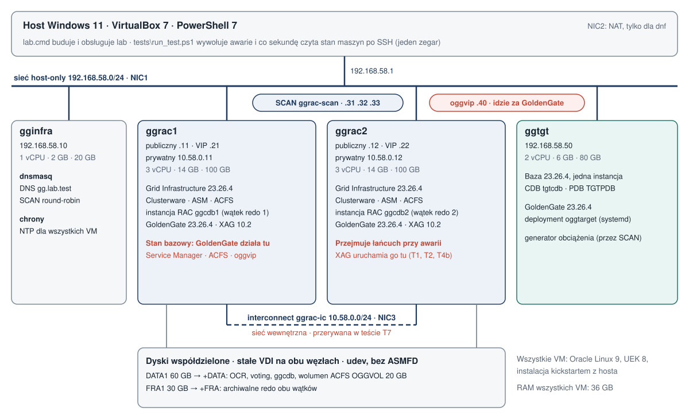

# 🧩 Środowisko — maszyny, sieci, dyski, wersje, host

🇬🇧 [English](ENVIRONMENT.md) | 🇵🇱 Polski

[]()
[]()
[]()
[]()

> 🎯 Wszystko, z czego składa się lab, w jednym miejscu: cztery maszyny wirtualne, trzy sieci, dwa dyski współdzielone,
> wersje oprogramowania i wymagania wobec komputera z Windows. Każda wartość pochodzi z `lab.config.psd1` i ze
> skryptów, które z niego korzystają: zmieniasz plik, uruchamiasz `lab.cmd plan`, a skrypty idą za zmianą.



## 🖥️ Maszyny

| VM | Rola | vCPU | RAM | Dysk systemowy | Dyski współdzielone |
|---|---|---|---|---|---|
| `gginfra` | DNS (dnsmasq) i serwer czasu (chrony) dla labu | 1 | 2 GB | 20 GB | – |
| `ggrac1` | węzeł RAC 1: Grid Infrastructure, ASM, instancja `ggcdb1`, GoldenGate `oggsource` (w stanie bazowym), XAG | 3 | 14 GB | 100 GB | DATA1, FRA1 |
| `ggrac2` | węzeł RAC 2: Grid Infrastructure, ASM, instancja `ggcdb2`, przejmuje GoldenGate przy awarii | 3 | 14 GB | 100 GB | DATA1, FRA1 |
| `ggtgt` | cel: baza CDB `tgtcdb` (PDB `TGTPDB`) na jednej instancji, GoldenGate `oggtarget` | 2 | 6 GB | 80 GB | – |

Razem: **9 vCPU, 36 GB RAM**. Dlaczego 3 vCPU i 14 GB na węzłach RAC: przy 2 vCPU węzeł nie nadążał z pracą
(patrz [PITFALLS_26AI_PL](PITFALLS_26AI_PL.md) i ADR-015 w [DESIGN_PL.md](../DESIGN_PL.md)), a przy 10 GB węzły
używały swapu w czasie instalacji oprogramowania bazy.

Ustawienia VirtualBoxa każdej maszyny (z `host/modules/VmBuilder.psm1`): `--paravirtprovider kvm` (stabilny zegar
systemu gościa), `--ioapic on`, `--rtcuseutc on`, kolejność rozruchu: dysk, potem DVD, grafika VMSVGA, bez dźwięku,
bez USB, kontroler SATA (port 0 = dysk systemowy, port 1 = DVD, porty 2 i 3 = dyski współdzielone na węzłach RAC).
Każda maszyna ma opis `vbox-lab:gg-rac26ai`; `lab.cmd destroy` usuwa tylko maszyny z tym znacznikiem.

### Partycje (kickstart)

Kickstart to plik odpowiedzi instalatora Oracle Linux: instalacja systemu przebiega bez pytań.

| Punkt montowania | Rozmiar | Maszyny |
|---|---|---|
| `/boot` | 1 GB (xfs) | wszystkie |
| swap | RAM w GB, co najmniej 1 i najwyżej 16 GB (14 GB na węzłach RAC, 6 GB na ggtgt, 2 GB na gginfra) | wszystkie |
| `/` | 30 GB (xfs); na gginfra reszta dysku | wszystkie |
| `/u01` | reszta dysku (xfs): katalogi domowe Oracle, katalog z paczkami, pliki danych celu | węzły RAC, ggtgt |

## 🌐 Sieci

| Karta | Typ w VirtualBoxie | Nazwa w Linuksie | Do czego | Adresy |
|---|---|---|---|---|
| 1 | karta host-only (`192.168.58.1/24` na hoście, serwer DHCP VirtualBoxa usunięty) | `enp0s3` | sieć publiczna: SSH z hosta, SQL*Net, SCAN, VIP-y, GoldenGate | stałe, **bez trasy domyślnej** |
| 2 | NAT | `enp0s8` | internet dla `dnf` i instalacji systemu (jedyna trasa domyślna) | DHCP z VirtualBoxa |
| 3 | sieć wewnętrzna `ggrac-ic` (tylko węzły RAC) | `enp0s9` | prywatny interconnect i ruch ASM (typ interfejsu GI 5) | 10.58.0.0/24 |

Host-only to sieć widoczna tylko dla hosta i jego maszyn wirtualnych. Interconnect to prywatna sieć między węzłami
klastra, którą Clusterware sprawdza, czy węzły żyją, i którą wymieniają bloki pamięci podręcznej bazy.
Wszystkie karty mają sterownik `virtio`. Grid Infrastructure dostaje
`networkInterfaceList=enp0s3:192.168.58.0:1,enp0s9:10.58.0.0:5` (1 = publiczna, 5 = ASM i prywatna).

### Adresy i nazwy (domena `gg.lab.test`)

| Nazwa | Adres | Gdzie |
|---|---|---|
| host (Windows) | 192.168.58.1 | karta host-only VirtualBoxa; udostępnia kickstarty na TCP 8000, tylko w czasie `build` |
| `gginfra` | 192.168.58.10 | DNS i NTP dla wszystkich |
| `ggrac1` / `ggrac2` | 192.168.58.11 / .12 | adresy publiczne węzłów |
| `ggrac1-vip` / `ggrac2-vip` | 192.168.58.21 / .22 | VIP-y węzłów (Clusterware) |
| `ggrac1-priv` / `ggrac2-priv` | 10.58.0.11 / .12 | interconnect |
| `ggrac-scan` | 192.168.58.31, .32, .33 | SCAN: trzy rekordy A po kolei (round-robin), **tylko w DNS** (nie ma go w `/etc/hosts`) |
| `oggvip` | 192.168.58.40 | VIP aplikacyjny GoldenGate (`appvipcfg`, sieć 1); przenosi się razem z GoldenGate |
| `ggtgt` | 192.168.58.50 | cel |

VIP (virtual IP) to adres, który Clusterware przenosi między węzłami: klient łączy się zawsze z tym samym adresem,
niezależnie od tego, który węzeł go teraz obsługuje. SCAN to jedna nazwa całego klastra z trzema adresami.

DNS: `dnsmasq` na gginfra podaje rekordy z `/etc/lab.hosts` (w przód i wstecz, PTR, dla 192.168.58.0/24), a każdą inną
nazwę przekazuje do resolvera NAT. Węzły RAC i ggtgt pytają **tylko** gginfra: NetworkManager ma `dns=none`, a
`/etc/resolv.conf` zawiera `search gg.lab.test` / `nameserver 192.168.58.10`. Czas: chrony na gginfra bierze czas z
puli w internecie i udostępnia go labowi z `local stratum 8` (działa także bez internetu); pozostałe maszyny mają tylko
`server 192.168.58.10 iburst`. Grid Infrastructure 23.26 nie ma już zasobu CTSS, więc czas klastra trzyma sam chrony.

### Porty

| Port | Usługa |
|---|---|
| 22 | SSH (root tylko kluczem z hosta) |
| 1521 | listenery węzłów, listenery SCAN, listener ggtgt |
| 9100 | Service Manager GoldenGate (źródło: na `oggvip`; cel: na `ggtgt`) |
| 9101 / 9102 / 9103 / 9104 | Administration, Distribution, Receiver, Performance Metrics Service każdego deploymentu |
| 53, 123 | DNS i NTP na gginfra |
| 8000 (host) | serwer HTTP kickstartów, tylko w czasie `lab.cmd build` |

W maszynach nie ma zapory (`firewalld` wyłączony; lab działa w sieci host-only). SELinux zostaje w trybie
**Enforcing**.

## 💾 Dyski: ASM i ACFS

| Dysk VirtualBoxa | Rozmiar | Typ | Nazwa udev (właściciel, prawa) | Grupa dysków ASM |
|---|---|---|---|---|
| `gg-rac26ai-DATA1.vdi` | 60 GB | stały (fixed), współdzielony, port SATA 2 na obu węzłach | `/dev/oracleasm/DATA1` (`grid:asmdba 0660`) | `+DATA`: redundancja zewnętrzna, AU 4 MB; OCR, pliki voting, baza `ggcdb`, wolumen ACFS |
| `gg-rac26ai-FRA1.vdi` | 30 GB | stały, współdzielony, port SATA 3 | `/dev/oracleasm/FRA1` (`grid:asmdba 0660`) | `+FRA`: redundancja zewnętrzna, AU 4 MB, `compatible.asm/rdbms 23.0.0.0.0`; archiwalne logi obu wątków |

ASM (Automatic Storage Management) to menedżer dysków Oracle: łączy surowe dyski w grupy, na których leżą pliki bazy.
VirtualBox pozwala na typ „shareable” tylko dla dysków stałych, więc te 90 GB są zajęte od razu; dyski systemowe są
dynamiczne i rosną w miarę potrzeby. Reguła udev rozpoznaje każdy dysk po jego `ID_SERIAL`, więc oba węzły widzą tę samą
nazwę bez względu na literę `sdX`, jaką nada jądro. Bez ASMLib i bez ASM Filter Driver.

**ACFS** (system plików klastra na wolumenie ASM) na pliki deploymentu GoldenGate: wolumen `OGGVOL` (20 GB) w `+DATA`,
system plików zamontowany w `/u01/oggdeploy`, zasób Clusterware `ora.data.oggvol.acfs`
(`-user oracle -autostart RESTORE`). Leży na nim Service Manager `ggsm01` i deployment `oggsource`. W stanie bazowym
jest zamontowany na **jednym** węźle, na tym, na którym działa GoldenGate; XAG przenosi go razem z GoldenGate. Na ggtgt
`/u01/oggdeploy` jest zwykłym lokalnym katalogiem.

## 📦 Oprogramowanie i wersje

| Składnik | Wersja | Paczka (nazwa pliku w `lab.config.psd1`) | Skąd |
|---|---|---|---|
| Oracle Linux | 9.8, jądro UEK 8 (`Os.UekRepo = 'UEKR8'`) | `OracleLinux-R9-U8-x86_64-boot.iso` (ISO startowe, pakiety z yum.oracle.com) | pobiera `lab.cmd iso`, suma SHA-256 w `host/os-profiles.psd1` |
| Grid Infrastructure | obraz bazowy 23.26.1 | `V1054596-01-OracleDatabaseGridInfrastructure23.26.1.0.0forLinux x86-64.zip` | Oracle Software Delivery Cloud (eDelivery) |
| Database | obraz bazowy 23.26.1, Enterprise Edition | `V1054592-01-OracleDatabase23.26.1.0.0forLinux x86-64.zip` | Oracle Software Delivery Cloud |
| Release Update GI | 23.26.4 (łatka 40002013) | `p40002013_230000_Linux-x86-64.zip` | My Oracle Support |
| Release Update DB | 23.26.4 (łatka 40007731) | `p40007731_230000_Linux-x86-64.zip` | My Oracle Support |
| OPatch | 12.2.0.1.55 (`plan` wymaga ≥ 12.2.0.1.53) | `p6880880_230000_Linux-x86-64.zip` | My Oracle Support |
| GoldenGate | 23.26.4.0.2 for Oracle, Microservices, pełna instalacja | `p40225913_2326402OGGRU_Linux-x86-64.zip` | My Oracle Support |
| XAG | 10.2 (bug fix MLR, pełny pakiet) | `p31215432_190000_Generic.zip` | My Oracle Support |

Release Update (RU) to kwartalny zestaw poprawek do bazy i Grid Infrastructure. Plików Oracle nie ma w tym repozytorium
(licencja Oracle). Umieść je w katalogu `Binaries.Dir` z `lab.config.psd1`; `lab.cmd plan` sprawdza, czy każdy plik
jest na miejscu, odczytuje numery RU z wnętrza ZIP-ów, sprawdza wersję OPatch i układ ZIP-a XAG. Opcjonalne sumy
SHA-256 wpisuje się w `Binaries.Sha256`.

Jądro ma znaczenie: sterowniki ACFS/ADVM działają tylko na jądrach, które Oracle dla nich certyfikuje (dokument My
Oracle Support o obsłudze jąder przez ACFS, KB129209). Kickstart blokuje zainstalowane pakiety `kernel*` przez
`dnf versionlock`, więc późniejszy `dnf update` nie wciągnie jądra, którego ACFS nie obsługuje. UEK 8 na OL 9 wymaga GI
i DB co najmniej 23.26.2: to jeden z powodów, dla których RU są częścią budowy. Dokładna wersja UEK to ta, którą
repozytorium UEKR8 podało w chwili instalacji: pokazuje ją `uname -r` na węźle RAC.

### Katalogi Oracle i nazwy

| Element | Wartość |
|---|---|
| Grid home / base | `/u01/app/23.26/grid` / `/u01/app/grid` (właściciel `grid`) |
| DB home / base | `/u01/app/oracle/product/23.26/dbhome_1` / `/u01/app/oracle` (właściciel `oracle`) |
| Inventory, paczki | `/u01/app/oraInventory`, `/u01/stage` (ZIP-y Oracle, spacje w nazwach zamienione na `_`) |
| GoldenGate home | `/u01/app/ogg/ogg26ai_ma` (lokalnie na każdym węźle RAC i na ggtgt) |
| XAG home | `/u01/app/xag` (oba węzły RAC; pierwszy w `PATH` użytkowników root, grid i oracle) |
| Klaster | `ggrac`, SCAN `ggrac-scan:1521` |
| Źródło | CDB `ggcdb` (instancje `ggcdb1`, `ggcdb2`), PDB `SRCPDB`, SGA 4096 MB, PGA 1024 MB, `processes=400`, `streams_pool_size=1280M` |
| Serwisy | `gg_srcpdb` (singleton, preferowana `ggcdb1`, zapasowa `ggcdb2`: GoldenGate idzie za nim); `srv_load1` (preferowana `ggcdb1`), `srv_load2` (preferowana `ggcdb2`) dla generatora obciążenia |
| Cel | CDB `tgtcdb`, PDB `TGTPDB`, pliki na systemie plików `/u01/oradata`, SGA 2560 MB, PGA 512 MB |
| GoldenGate | Service Manager `ggsm01`, deploymenty `oggsource` / `oggtarget`, administrator `oggadmin`; Extract `ext1`, trail `et`, Distribution Path `dp1`, Parallel Replicat `rep1`, tabela punktów kontrolnych `ggadmin.ggs_checkpoint` |
| Użytkownicy systemu | `grid` (uid 54331; grupy oinstall, asmadmin, asmdba, asmoper, dba, racdba), `oracle` (z pakietu preinstall, plus asmdba, racdba) |

Serwis bazy to nazwa, pod którą klienci łączą się z PDB; Clusterware decyduje, na której instancji serwis działa.
Ustawienia jądra i pamięci: pakiet `oracle-ai-database-preinstall-26ai`; HugePages `vm.nr_hugepages` = SGA/2 + 64
(2112 na węzłach RAC, 1344 na ggtgt), `use_large_pages=TRUE`; Transparent HugePages zostają na `madvise` (tak ustawia
pakiet preinstall 26ai na UEK 7 i nowszych); `NOZEROCONF=yes` na węzłach RAC; memlock bez limitu dla grid i oracle.

## 💻 Wymagania wobec hosta

| Potrzeba | Szczegóły |
|---|---|
| Windows 11 | lab zbudowano i zmierzono na laptopie z Windows 11 i 64 GB RAM |
| RAM | 36 GB dla maszyn plus sam Windows: realne minimum to komputer z 64 GB |
| CPU | włączona wirtualizacja sprzętowa (VT-x / AMD-V) w firmware; maszyny mają razem 9 vCPU |
| Dysk | 90 GB zajęte od razu (dyski współdzielone) + dyski systemowe rosnące do 300 GB: do 390 GB. `plan` ostrzega poniżej `MinFreeGb = 300` (`SpaceCheck = 'warn'`; `'error'` blokuje). Dowolna litera dysku: `LabDrive` albo `lab.cmd plan -Drive E` |
| VirtualBox | 7.x (skrypty muszą znaleźć `VBoxManage`) |
| PowerShell | 7 (`pwsh`). `lab.cmd` bez niego się nie uruchomi i pokaże polecenie `winget` |
| Klient OpenSSH | z kluczem ed25519 w `~\.ssh\id_ed25519` (`Ssh.KeyPath`). Utwórz go **przed** `build`: `ssh-keygen -t ed25519`. Kickstart wpisuje jego część publiczną do `authorized_keys` roota na każdej maszynie |
| Python 3.8+ | uruchamia mały serwer HTTP z kickstartami w czasie `build` (atrapa `python.exe` ze Sklepu Microsoft się nie liczy) |
| Reguła zapory | przychodzący TCP 8000 z 192.168.58.0/24; `build` ją tworzy (jedno okno UAC) |
| Internet | instalacja systemu i pakiety `dnf` przychodzą z yum.oracle.com przez kartę NAT |

### Hypervisor Windows wyłączony

Gdy włączony jest Hyper-V, Virtual Machine Platform albo zabezpieczenia oparte na wirtualizacji (VBS, „Integralność
pamięci”), VirtualBox nie może korzystać z VT-x/AMD-V bezpośrednio i przechodzi na hypervisor Windows (w `VBox.log`
maszyny widać `AMD-V is not available` / `fall back to NEM`). W tym labie wszystko szło wtedy kilka razy wolniej, a
zegary maszyn skakały, co Clusterware znosi źle. Lab budowano i mierzono z wyłączonym hypervisorem.

Sprawdzenie w PowerShellu (oba mają być wyłączone: `False` i `0`):

```powershell
(Get-CimInstance Win32_ComputerSystem).HypervisorPresent
(Get-CimInstance -Namespace root\Microsoft\Windows\DeviceGuard -ClassName Win32_DeviceGuard).VirtualizationBasedSecurityStatus
```

Wyłączenie: Zabezpieczenia Windows → Zabezpieczenia urządzenia → Izolacja rdzenia → Integralność pamięci **wyłączona**,
a jeśli są zainstalowane funkcje Hyper-V / Virtual Machine Platform, usuń je; restart. W labie dopiero po dwóch
restartach `HypervisorPresent` pokazał `False`. Skutek uboczny: przy wyłączonym hypervisorze nie działają WSL2, Docker
Desktop i Piaskownica Windows. `lab.cmd plan` tego nie sprawdza: sprawdź sam.

## 🗺️ Diagramy

| Diagram | Pokazuje |
|---|---|
| [01-topology_pl.svg](diagrams/01-topology_pl.svg) | maszyny, sieci, adresy, SCAN i VIP-y, ASM i ACFS |
| [02-ha-chain-and-data_pl.svg](diagrams/02-ha-chain-and-data_pl.svg) | łańcuch zależności XAG i drogę danych |
| [03-build-steps_pl.svg](diagrams/03-build-steps_pl.svg) | kroki budowy `lab.cmd` |
| [06-data-path_pl.svg](diagrams/06-data-path_pl.svg) | EXT1 → trail → DP1 → Receiver → REP1, heartbeat, lag |

---
Dalej: [INSTALL_AUTO_PL.md](INSTALL_AUTO_PL.md) · [INSTALL_STEPWISE_PL.md](INSTALL_STEPWISE_PL.md) · [MANUAL_PL.md](MANUAL_PL.md)
