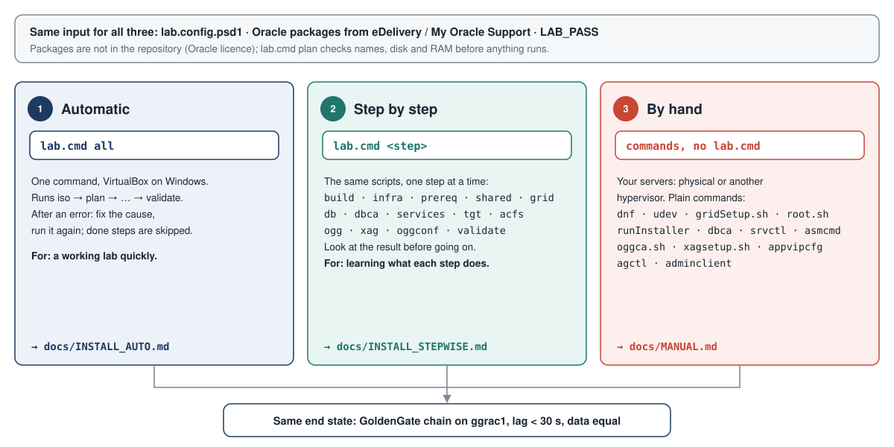

# 🚀 Install path 1 — automatic: `lab.cmd all`

🇬🇧 English | 🇵🇱 [Polski](INSTALL_AUTO_PL.md)

[]()
[](TIMINGS.md)
[]()
[]()

> 🎯 One command builds the whole lab: four VMs, Oracle Linux 9, a two-node RAC 26ai, the target database, GoldenGate
> 23.26 with XAG and ACFS, the replication, and a final check that source and target hold the same data. You prepare
> the host and the Oracle files; the rest runs unattended for about four hours.



Other paths: step by step with a check after each step → [INSTALL_STEPWISE.md](INSTALL_STEPWISE.md);
fully by hand on your own servers → [MANUAL.md](MANUAL.md).

## 📋 1. Before you start

1. **Host**: Windows 11, 64 GB RAM, up to 390 GB free disk, VirtualBox 7, PowerShell 7, OpenSSH client, Python 3.8+,
   Windows hypervisor **off**. Details and checks: [ENVIRONMENT.md](ENVIRONMENT.md#-host-requirements).
2. **SSH key** (once): `ssh-keygen -t ed25519` → `~\.ssh\id_ed25519`. The VMs accept root only with this key.
3. **Oracle files** in one folder (not in this repository, Oracle licence):

   | `lab.config.psd1` key | File | Source |
   |---|---|---|
   | `GridZip` | `V1054596-01-OracleDatabaseGridInfrastructure23.26.1.0.0forLinux x86-64.zip` | Oracle Software Delivery Cloud |
   | `DbZip` | `V1054592-01-OracleDatabase23.26.1.0.0forLinux x86-64.zip` | Oracle Software Delivery Cloud |
   | `GridRu` | `p40002013_230000_Linux-x86-64.zip` (GI RU 23.26.4) | My Oracle Support |
   | `DbRu` | `p40007731_230000_Linux-x86-64.zip` (DB RU 23.26.4) | My Oracle Support |
   | `OPatch` | `p6880880_230000_Linux-x86-64.zip` (≥ 12.2.0.1.53) | My Oracle Support |
   | `OggZip` | `p40225913_2326402OGGRU_Linux-x86-64.zip` (GoldenGate 23.26.4.0.2, complete install) | My Oracle Support |
   | `XagZip` | `p31215432_190000_Generic.zip` (XAG 10.2) | My Oracle Support |

   If Oracle has published newer files, put their names into `lab.config.psd1`; the RU numbers are read from inside the
   ZIPs, so nothing else changes. Newer releases were not tested here.
4. **`lab.config.psd1`**: set `Binaries.Dir` (the folder above), `LabDrive` (drive for the VMs) and `IsoDir` (where
   the Oracle Linux boot ISO goes). Everything else can stay.
5. **Password** for the session (never written to the repository):

   ```powershell
   $env:LAB_PASS = '<password>'    # at least 8 characters: letters, digits, _ only
   ```

   It becomes the root, grid and oracle OS password, the SYS / SYSTEM / PDB admin / ASM password and the `ggadmin`
   password. The GoldenGate administrator `oggadmin` gets `LAB_PASS` plus the character classes GoldenGate 23.26 requires
   (`_`, an upper-case letter, a lower-case letter, a digit, whichever are missing; at most 30 characters). How it travels
   to the VMs: [SETTINGS.md](../SETTINGS.md).

## 🔎 2. Preview

```powershell
cd D:\labs\gg-rac26ai-lab
.\lab.cmd plan
```

`plan` changes nothing. It lists the Oracle files (present, version, OPatch check), the ISO, the VM plan (vCPU, RAM,
disks, NICs, state), renders the kickstarts with the password masked, checks free disk space and refuses if VMs of
another lab run on the same host-only network. It ends with `== READY` (exit code 0) or `== NOT READY` with the list of
what to fix. A missing ISO is only a warning: `all` downloads it first.

Optional: `.\lab.cmd all -DryRun` prints every VBoxManage call and every guest script with its arguments, without
touching anything.

## ▶️ 3. Run

```powershell
.\lab.cmd all
```

`all` runs these steps in order. Each step skips what is already done, so `all` can be repeated after an error.
Clean times are from the measured build ([TIMINGS.md](TIMINGS.md): VirtualBox on a laptop; `grid` and `db` measured with
2 vCPU / 10 GB per RAC node, so they are on the high side).

| Step | What happens | Clean time |
|---|---|---|
| `iso` | downloads the OL 9.8 boot ISO if missing, checks SHA-256 | seconds (download: your internet) |
| `plan` | must be READY, otherwise `all` stops | seconds |
| `build` | host-only network, shared disks, 4 VMs, unattended OL 9 install from kickstarts | 10 min |
| `infra` | DNS (dnsmasq) and NTP (chrony) on gginfra | 13 s |
| `prereq` | resolver and time from gginfra, OS checks on both RAC nodes | 2 min |
| `shared` | udev names for the ASM disks, SSH keys between the nodes for grid and oracle | 50 s |
| `grid` | Grid Infrastructure with RU, `root.sh` on both nodes, AHF/TFA off, `+FRA`, cluster checks | 1 h 28 min |
| `db` | database software with RU on both nodes, `root.sh` | 1 h 35 min (inflated by swapping) |
| `dbca` | RAC CDB `ggcdb` + PDB `SRCPDB`, archivelog, GoldenGate parameters | 7 min |
| `services` | services `gg_srcpdb`, `srv_load1`, `srv_load2`, demo schemas, load generator | 30 s |
| `tgt` | ggtgt: OS checks, DB software, CDB `tgtcdb` + `TGTPDB`, autostart, demo schemas | 30 min |
| `acfs` | ACFS volume and file system `/u01/oggdeploy`, mounted on ggrac1 | 45 s |
| `ogg` | GoldenGate software on 3 VMs, target deployment and its systemd unit | 6 min |
| `xag` | XAG 10.2, VIP `oggvip`, source deployment on ACFS, XAG resource, start | 1.5 min |
| `oggconf` | GoldenGate users, credentials, heartbeat, EXT1, DP1, REP1 | 35 s |
| `validate` | all checks, 60 s of load, source = target comparison | 1 min 40 s |

Total of the clean times: **about 4 h 04 min**. The diagram of the same order:
[03-build-steps.svg](diagrams/03-build-steps.svg). What each step checks and how to check it yourself:
[INSTALL_STEPWISE.md](INSTALL_STEPWISE.md).

The end of a good run:

```text
== VALID: lab in the base state (stage A)
```

## 📜 4. Where to look while it runs

| Where | What |
|---|---|
| console | every guest script starts with a `==> [vm] script args` line, then `OK` / `WARN` / `SKIP` lines and `CHECK ok` / `CHECK FAIL` lines |
| `logs\steps.csv` (host) | one row per step: start, end (UTC), result, attempt number |
| `/root/lab/run/<step>.out` (VM) | full output of a guest script; `<step>.rc` its exit code |
| `/root/lab/logs/*.log` (VM) | installer, dbca, oggca, agctl, adminclient logs of the lab scripts (passwords masked) |
| `/u01/app/oraInventory/logs`, `$ORACLE_BASE/cfgtoollogs` | Oracle's own installer, dbca, asmca and oggca logs |

Guest scripts run detached from the SSH session (`guest/run_step.sh`: `setsid`, output to a file). A dropped SSH session
or a closed console does not kill `dbca` or an installer; running the same step again attaches to the running one
instead of starting a second installer.

Open a shell on a VM: `.\lab.cmd ssh ggrac1` (root, same key and options as the scripts).

## 🛠️ 5. When something fails

1. Read the last `CHECK FAIL` or `ERROR` line: most stops say what to do next.
2. Fix the cause, then run **`.\lab.cmd all` again** (or only the failed step, see [INSTALL_STEPWISE.md](INSTALL_STEPWISE.md)).
   Finished work is recognised (markers in `/root/lab/done`, Oracle inventory, `srvctl config`, existing deployments)
   and skipped.
3. A half-finished Oracle operation (Grid install, `dbca`, `oggca`) is **never removed automatically**. The step stops
   and prints the cleanup command (for example `dbca -silent -deleteDatabase ...` or `rootcrs.sh -deconfig -force`).
4. A VM whose OS install did not finish: `.\lab.cmd destroy <vm>`, then `.\lab.cmd all` (`build` creates it again).
5. Pause a long build after the current step: create the file `logs\STOP` (empty). Steps refuse to start while it
   exists; delete it and run `all` again to continue.

Known traps of this release and their fixes: [PITFALLS_26AI.md](PITFALLS_26AI.md).

## ✅ 6. After the build

- `.\lab.cmd validate` any time: checks plus 60 s of load and the data comparison.
- Daily use (start, stop, baseline, troubleshooting): [OPERATIONS.md](OPERATIONS.md).
- Failure tests: [TESTS.md](../TESTS.md).

`all` does not run failure tests and does not take snapshots (`lab.cmd snapshot` is reserved, not implemented).
