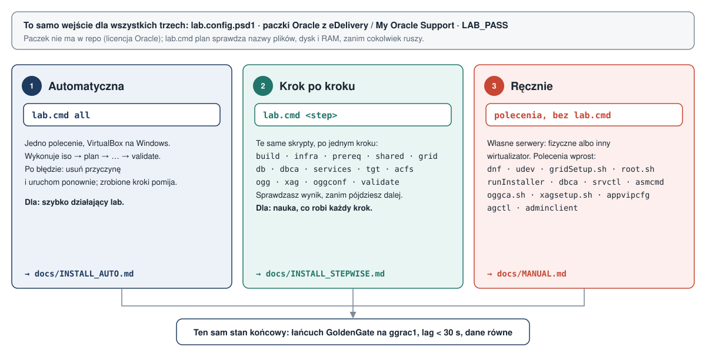

# 🚀 Instalacja, droga 1 — automatyczna: `lab.cmd all`

🇬🇧 [English](INSTALL_AUTO.md) | 🇵🇱 Polski

[]()
[](TIMINGS_PL.md)
[]()
[]()

> 🎯 Jedno polecenie buduje cały lab: cztery maszyny wirtualne, Oracle Linux 9, dwuwęzłowy RAC 26ai, bazę docelową,
> GoldenGate 23.26 z XAG i ACFS, replikację i na końcu sprawdzenie, że źródło i cel mają te same dane. Ty przygotowujesz
> komputer i pliki Oracle; resztę lab robi sam, przez około cztery godziny.



Inne drogi: krok po kroku, z kontrolą po każdym kroku → [INSTALL_STEPWISE_PL.md](INSTALL_STEPWISE_PL.md);
w pełni ręcznie, na własnych serwerach → [MANUAL_PL.md](MANUAL_PL.md).

## 📋 1. Zanim zaczniesz

1. **Host**: Windows 11, 64 GB RAM, do 390 GB wolnego miejsca, VirtualBox 7, PowerShell 7, klient OpenSSH, Python 3.8+,
   hypervisor Windows **wyłączony**. Szczegóły i sprawdzenie: [ENVIRONMENT_PL.md](ENVIRONMENT_PL.md#-wymagania-wobec-hosta).
2. **Klucz SSH** (raz): `ssh-keygen -t ed25519` → `~\.ssh\id_ed25519`. Maszyny wpuszczają roota tylko tym kluczem.
3. **Pliki Oracle** w jednym katalogu (nie ma ich w repozytorium, licencja Oracle):

   | Klucz w `lab.config.psd1` | Plik | Skąd |
   |---|---|---|
   | `GridZip` | `V1054596-01-OracleDatabaseGridInfrastructure23.26.1.0.0forLinux x86-64.zip` | Oracle Software Delivery Cloud |
   | `DbZip` | `V1054592-01-OracleDatabase23.26.1.0.0forLinux x86-64.zip` | Oracle Software Delivery Cloud |
   | `GridRu` | `p40002013_230000_Linux-x86-64.zip` (RU GI 23.26.4) | My Oracle Support |
   | `DbRu` | `p40007731_230000_Linux-x86-64.zip` (RU DB 23.26.4) | My Oracle Support |
   | `OPatch` | `p6880880_230000_Linux-x86-64.zip` (≥ 12.2.0.1.53) | My Oracle Support |
   | `OggZip` | `p40225913_2326402OGGRU_Linux-x86-64.zip` (GoldenGate 23.26.4.0.2, pełna instalacja) | My Oracle Support |
   | `XagZip` | `p31215432_190000_Generic.zip` (XAG 10.2) | My Oracle Support |

   Jeśli Oracle wydał nowsze pliki, wpisz ich nazwy do `lab.config.psd1`; numery RU skrypty odczytują z wnętrza ZIP-ów,
   więc nic więcej się nie zmienia. Nowszych wydań tu nie testowano.
4. **`lab.config.psd1`**: ustaw `Binaries.Dir` (katalog z punktu wyżej), `LabDrive` (dysk na maszyny) i `IsoDir`
   (gdzie trafi ISO startowe Oracle Linux). Resztę można zostawić.
5. **Hasło** na czas sesji (nigdy nie trafia do repozytorium):

   ```powershell
   $env:LAB_PASS = '<haslo>'    # co najmniej 8 znaków: tylko litery, cyfry, _
   ```

   Staje się hasłem systemowym root, grid i oracle, hasłem SYS / SYSTEM / administratora PDB / ASM i hasłem `ggadmin`.
   Administrator GoldenGate `oggadmin` dostaje `LAB_PASS` plus klasy znaków wymagane przez GoldenGate 23.26 (`_`, wielka
   litera, mała litera, cyfra, te, których brakuje; najwyżej 30 znaków). Jak hasło trafia na maszyny:
   [SETTINGS.md](../SETTINGS.md).

## 🔎 2. Podgląd

```powershell
cd D:\labs\gg-rac26ai-lab
.\lab.cmd plan
```

`plan` niczego nie zmienia. Pokazuje pliki Oracle (czy są, wersja, kontrola OPatch), ISO, plan maszyn (vCPU, RAM, dyski,
karty sieciowe, stan), renderuje kickstarty z zamaskowanym hasłem, sprawdza wolne miejsce i odmawia, jeśli w tej samej
sieci host-only działają maszyny innego labu. Kończy się `== READY` (kod wyjścia 0) albo `== NOT READY` z listą rzeczy
do poprawienia. Brak ISO to tylko ostrzeżenie: `all` pobiera je na początku.

Opcjonalnie: `.\lab.cmd all -DryRun` wypisuje każde wywołanie VBoxManage i każdy skrypt maszyny z argumentami, niczego
nie dotykając.

## ▶️ 3. Uruchomienie

```powershell
.\lab.cmd all
```

`all` wykonuje kolejno poniższe kroki. Każdy krok pomija to, co już zrobione, więc `all` można powtórzyć po błędzie.
Czyste czasy pochodzą ze zmierzonej budowy ([TIMINGS_PL.md](TIMINGS_PL.md): VirtualBox na laptopie; `grid` i `db`
mierzone przy 2 vCPU / 10 GB na węzeł RAC, więc są raczej zawyżone).

| Krok | Co się dzieje | Czysty czas |
|---|---|---|
| `iso` | pobiera ISO startowe OL 9.8, jeśli go nie ma, sprawdza SHA-256 | sekundy (pobieranie: zależy od łącza) |
| `plan` | musi dać READY, inaczej `all` staje | sekundy |
| `build` | sieć host-only, dyski współdzielone, 4 maszyny, instalacja OL 9 bez pytań z kickstartów | 10 min |
| `infra` | DNS (dnsmasq) i NTP (chrony) na gginfra | 13 s |
| `prereq` | resolver i czas z gginfra, kontrole systemu na obu węzłach RAC | 2 min |
| `shared` | nazwy udev dla dysków ASM, klucze SSH między węzłami dla grid i oracle | 50 s |
| `grid` | Grid Infrastructure z RU, `root.sh` na obu węzłach, AHF/TFA wyłączone, `+FRA`, kontrole klastra | 1 h 28 min |
| `db` | oprogramowanie bazy z RU na obu węzłach, `root.sh` | 1 h 35 min (zawyżone przez swap) |
| `dbca` | CDB RAC `ggcdb` + PDB `SRCPDB`, archivelog, parametry GoldenGate | 7 min |
| `services` | serwisy `gg_srcpdb`, `srv_load1`, `srv_load2`, schematy demo, generator obciążenia | 30 s |
| `tgt` | ggtgt: kontrole systemu, oprogramowanie bazy, CDB `tgtcdb` + `TGTPDB`, autostart, schematy demo | 30 min |
| `acfs` | wolumen i system plików ACFS `/u01/oggdeploy`, zamontowany na ggrac1 | 45 s |
| `ogg` | oprogramowanie GoldenGate na 3 maszynach, deployment celu i jego jednostka systemd | 6 min |
| `xag` | XAG 10.2, VIP `oggvip`, deployment źródła na ACFS, zasób XAG, start | 1,5 min |
| `oggconf` | użytkownicy GoldenGate, poświadczenia, heartbeat, EXT1, DP1, REP1 | 35 s |
| `validate` | wszystkie kontrole, 60 s obciążenia, porównanie danych źródło = cel | 1 min 40 s |

Suma czystych czasów: **ok. 4 h 04 min**. Ta sama kolejność na schemacie:
[03-build-steps_pl.svg](diagrams/03-build-steps_pl.svg). Co sprawdza każdy krok i jak to sprawdzić samemu:
[INSTALL_STEPWISE_PL.md](INSTALL_STEPWISE_PL.md).

Tak kończy się udana budowa:

```text
== VALID: lab in the base state (stage A)
```

## 📜 4. Gdzie patrzeć w trakcie

| Gdzie | Co |
|---|---|
| konsola | każdy skrypt maszyny zaczyna się wierszem `==> [vm] skrypt argumenty`, potem wiersze `OK` / `WARN` / `SKIP` oraz `CHECK ok` / `CHECK FAIL` |
| `logs\steps.csv` (host) | jeden wiersz na krok: początek, koniec (UTC), wynik, numer próby |
| `/root/lab/run/<krok>.out` (VM) | pełne wyjście skryptu maszyny; `<krok>.rc` to jego kod wyjścia |
| `/root/lab/logs/*.log` (VM) | logi instalatorów, dbca, oggca, agctl, adminclient ze skryptów labu (hasła zamaskowane) |
| `/u01/app/oraInventory/logs`, `$ORACLE_BASE/cfgtoollogs` | własne logi Oracle: instalatory, dbca, asmca, oggca |

Skrypty maszyn działają odłączone od sesji SSH (`guest/run_step.sh`: `setsid`, wyjście do pliku). Zerwane SSH albo
zamknięta konsola nie zabija `dbca` ani instalatora; ponowne uruchomienie tego samego kroku podłącza się do działającego,
zamiast startować drugi instalator.

Powłoka na maszynie: `.\lab.cmd ssh ggrac1` (root, ten sam klucz i opcje co w skryptach).

## 🛠️ 5. Gdy coś się nie uda

1. Przeczytaj ostatni wiersz `CHECK FAIL` albo `ERROR`: większość zatrzymań mówi, co zrobić dalej.
2. Usuń przyczynę i uruchom **`.\lab.cmd all` jeszcze raz** (albo tylko krok, który padł, patrz
   [INSTALL_STEPWISE_PL.md](INSTALL_STEPWISE_PL.md)). Zrobiona praca jest rozpoznawana (znaczniki w `/root/lab/done`,
   inventory Oracle, `srvctl config`, istniejące deploymenty) i pomijana.
3. Niedokończona operacja Oracle (instalacja Grid, `dbca`, `oggca`) **nigdy nie jest usuwana automatycznie**. Krok
   staje i wypisuje polecenie sprzątania (np. `dbca -silent -deleteDatabase ...` albo `rootcrs.sh -deconfig -force`).
4. Maszyna, której instalacja systemu się nie skończyła: `.\lab.cmd destroy <vm>`, potem `.\lab.cmd all` (`build`
   utworzy ją od nowa).
5. Wstrzymanie długiej budowy po bieżącym kroku: utwórz pusty plik `logs\STOP`. Kroki nie startują, dopóki on istnieje;
   usuń go i uruchom `all` ponownie, żeby iść dalej.

Znane pułapki tego wydania i ich poprawki: [PITFALLS_26AI_PL.md](PITFALLS_26AI_PL.md).

## ✅ 6. Po budowie

- `.\lab.cmd validate` w dowolnej chwili: kontrole, 60 s obciążenia i porównanie danych.
- Codzienna obsługa (start, stop, baseline, rozwiązywanie problemów): [OPERATIONS_PL.md](OPERATIONS_PL.md).
- Testy awarii: [TESTS_PL.md](../TESTS_PL.md).

`all` nie uruchamia testów awarii i nie robi migawek dysków (`lab.cmd snapshot` jest zarezerwowane, niezaimplementowane).
