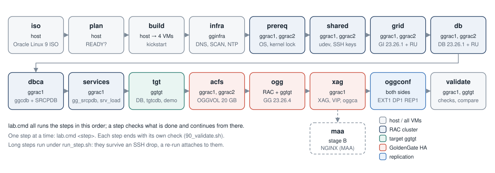

# 🪜 Install path 2 — step by step: `lab.cmd <step>`

🇬🇧 English | 🇵🇱 [Polski](INSTALL_STEPWISE_PL.md)

> 🎯 The same build as `lab.cmd all`, one step at a time. After each step you see what it checked, you can look for
> yourself with the commands below, and you decide when to go on. Good for learning, for a first build, and for finding
> the step that broke.

Preparation (host, Oracle files, `LAB_PASS`, `lab.config.psd1`) is the same as in
[INSTALL_AUTO.md](INSTALL_AUTO.md#-1-before-you-start). Fully manual path without the scripts: [MANUAL.md](MANUAL.md).

## 📐 How every step works

- `.\lab.cmd <step>` runs on the host. It copies `guest/lib.sh`, the role scripts, `sql/`, `ogg/` and the node's
  generated `lab.env` / `hosts.env` / response files to `/root/lab` on the VM, then runs one guest script over SSH.
- Every step is **re-runnable**: finished work is recognised and skipped (`SKIP`, `OK ... already ...`).
- Most steps end with a validation (`90_validate.sh <section>`): one `CHECK ok` / `CHECK FAIL` line per check; any
  `FAIL` stops the step with a non-zero exit code.
- `-DryRun` on any step prints what would run, changes nothing.
- Your own checks: open a root shell with `.\lab.cmd ssh <vm>`; commands for grid / oracle below run as
  `su - grid -c '...'` / `su - oracle -c '...'` (their profiles set `ORACLE_HOME`, `PATH`, `ORACLE_SID`).
- Times are the clean times of the measured build ([TIMINGS.md](TIMINGS.md)): VirtualBox on a Windows laptop,
  hypervisor off; `grid` and `db` with 2 vCPU / 10 GB per RAC node (today 3 vCPU / 14 GB), so take them as upper values.
- On a step error: read the last `CHECK FAIL` / `ERROR`, fix it, run **the same step** again. Logs on the VM:
  `/root/lab/run/<step>.out`, `/root/lab/logs/`.

## 1️⃣ `iso` — Oracle Linux boot ISO

- **Does:** downloads `OracleLinux-R9-U8-x86_64-boot.iso` into `IsoDir` if it is missing (`curl.exe`, resumable), then
  checks its SHA-256 against `host/os-profiles.psd1`.
- **Ends with:** `== ISO SHA-256 OK`.
- **Check yourself:** `Get-FileHash D:\ISOs\OracleLinux-R9-U8-x86_64-boot.iso -Algorithm SHA256`.
- **Time:** 2–3 s with the ISO present; the download depends on your internet.
- **Go on when:** SHA-256 OK. **On error:** a mismatch means a broken file: delete it and run `iso` again.

## 2️⃣ `plan` — read-only preview

- **Does:** lists Oracle files (present, RU / OPatch / GoldenGate version, SHA-256 if given), the VM plan, free disk
  space, renders masked kickstarts, looks for VMs of other labs on the lab network.
- **Ends with:** `== READY` (exit 0) or `== NOT READY` and the list of problems (exit 1).
- **Time:** seconds. **Go on when:** READY. A free-space warning does not block (`SpaceCheck = 'warn'`).

## 3️⃣ `build` — VMs and Oracle Linux 9

- **Does:** creates or reuses the host-only adapter `192.168.58.1/24` (VirtualBox DHCP removed), the two fixed shareable
  disks (DATA1 60 GB, FRA1 30 GB), the four VMs (NIC1 host-only, NIC2 NAT, NIC3 `ggrac-ic` on RAC nodes, shared disks
  on SATA ports 2 and 3), adds the firewall rule for TCP 8000 (UAC), renders the kickstarts with the real password,
  starts a small HTTP server on the host and types the boot line (`inst.ks=http://192.168.58.1:8000/kickstart/out/<vm>.ks`)
  into each VM console. Then waits for SSH on each VM and for `POST-INSTALL DONE` in `/root/ks-post.log`, detaches
  the ISO. The rendered kickstarts (they contain the password) are deleted at the end, also after a failure.
- **Ends with:** no error; `.\lab.cmd status` shows four VMs `running`.
- **Check yourself:** `.\lab.cmd ssh ggrac1`, then `grep 'POST-INSTALL DONE' /root/ks-post.log`, `uname -r`,
  `dnf versionlock list | grep kernel`, `getenforce` (Enforcing), `id grid`.
- **Time:** about 10 min for all four VMs (OS packages come from yum.oracle.com, so the internet speed counts).
- **Go on when:** all four VMs answer SSH. **On error:** a VM that exists but never finished its install is not touched
  again; the message says `lab.cmd destroy <vm>`, then `lab.cmd build`. Existing finished VMs are skipped.

## 4️⃣ `infra` — DNS and time on gginfra

- **Does:** `guest/infra/10_dnsmasq.sh` (records from `hosts.env` into `/etc/lab.hosts`, `/etc/dnsmasq.d/lab.conf`,
  SCAN as 3 A records, PTR zone of the lab, other names forwarded to NAT DNS, `firewalld` off) and
  `20_chrony.sh` (`allow 192.168.58.0/24`, `local stratum 8`).
- **Ends with:** `infra/90_validate.sh`: SCAN = 3 addresses, A and PTR of the nodes, `oggvip`, a non-lab name through
  NAT, chrony `Leap status: Normal`, UDP 123 listening.
- **Check yourself** (on gginfra): `dig +short ggrac-scan.gg.lab.test @127.0.0.1` (three addresses),
  `dig +short -x 192.168.58.11 @127.0.0.1`, `chronyc tracking`.
- **Time:** 13 s. **Go on when:** no `CHECK FAIL`.

## 5️⃣ `prereq` — RAC nodes: resolver, time, OS checks

- **Does:** `guest/rac/10_os_prereq.sh` on both nodes: `dns=none` in NetworkManager, `/etc/resolv.conf` → gginfra,
  chrony only from gginfra (internet pools commented out), avahi and `firewalld` off.
- **Ends with:** waits up to 60 s for chrony `^*` on 192.168.58.10, then checks: SCAN = 3 addresses, PTR of the node,
  ping of both public and both `-priv` names, SCAN / VIP / `oggvip` addresses still free (before GI), preinstall RPM,
  grid in asmadmin, oracle in asmdba, THP `madvise`, HugePages > 0, `NOZEROCONF=yes`, kernel version-locked and the
  running kernel is a locked one, RAM ≥ 8 GB, `/u01` ≥ 40 GB free.
- **Check yourself:** `chronyc -n sources`, `cat /sys/kernel/mm/transparent_hugepage/enabled`,
  `grep HugePages_Total /proc/meminfo`, `dig +short ggrac-scan`.
- **Time:** 2 min. **Go on when:** the step ends without `OS prerequisites failed`.

## 6️⃣ `shared` — ASM disk names and SSH equivalence

- **Does:** `20_asm_udev.sh` on both nodes finds the 60 GiB and 30 GiB disks by size, reads their `ID_SERIAL` and writes
  `/etc/udev/rules.d/99-oracle-asmdevices.rules` (`/dev/oracleasm/DATA1`, `FRA1`, `grid:asmdba 0660`). Then
  `30_ssh_equivalence.sh` creates PEM RSA keys for grid and oracle on both nodes, the host collects the public keys and
  authorises them on both nodes, fills `known_hosts`, and verifies `ssh` from each node to each node (short name, FQDN,
  IP) for both users.
- **Ends with:** `/dev/oracleasm/<disk> -> /dev/sdX (grid:asmdba 660)` on both nodes and `CHECK ok` for every SSH pair.
- **Check yourself:** `ls -lL /dev/oracleasm/` on both nodes; `su - grid -c 'ssh ggrac2 hostname'`.
- **Time:** 50 s. **Go on when:** both disks are visible with the same names on both nodes.
- **On error:** `no 61440 MiB disk` = the shared disks are not attached (check the VM in VirtualBox); `has partitions` =
  someone partitioned the disk: ASM needs the whole device.

## 7️⃣ `grid` — Grid Infrastructure 23.26 with RU

- **Does** (`40_install_grid.sh`, in phases):
  1. copies the GI ZIP, GI RU and OPatch to `/u01/stage` on ggrac1 (skipped when the size matches);
  2. `stage`: unzips GI into the Grid home, replaces OPatch, unzips the RU, checks every key of our `gridsetup.rsp`
     against the sample shipped in this release, installs `cvuqdisk` and copies its RPM to ggrac2;
  3. `cvuqdisk` on ggrac2;
  4. `install`: `gridSetup.sh -silent -ignorePrereqFailure -applyRU /u01/stage/ru_gi/40002013 -responseFile ...`
     (password filled into a 600 copy);
  5. `root`: `orainstRoot.sh` and `root.sh` on ggrac1, then on ggrac2 (one after the other);
  6. `ahf`: stops AHF/TFA and disables `oracle-tfa.service` on both nodes (it starved 2–3 vCPU nodes);
  7. `config`: `gridSetup.sh -silent -executeConfigTools`;
  8. `fra`: `asmca -silent -createDiskGroup -diskGroupName FRA ...` and `srvctl start diskgroup -diskgroup FRA`.
- **Ends with:** `90_validate.sh grid`: cluster online on all nodes, 2 nodes in `olsnodes`, 3 SCAN listeners and 3 SCAN
  VIPs running, `+DATA` and `+FRA` mounted, chrony synced to gginfra, CTSS absent or Observer, AHF/TFA off.
- **Check yourself:** `su - grid -c 'crsctl check cluster -all'`, `su - grid -c 'crsctl stat res -t'`,
  `su - grid -c 'srvctl status scan_listener'`, `su - grid -c 'asmcmd lsdg'`,
  `systemctl is-enabled oracle-tfa.service` (disabled).
- **Time:** about 1 h 28 min (copy and unzip 10 min, install with RU 30 min, `root.sh` 8 min on node 1 and 18 min on
  node 2, config tools 15 min, `+FRA` 3 min).
- **Go on when:** no `CHECK FAIL` in the grid section.
- **On error:** a half-finished install (home in the inventory without `CRS="true"`) stops with the two options it
  prints (inspect the log, or `runInstaller -silent -detachHome` and empty the home). A failed `root.sh` can be re-run
  (it resumes from its checkpoint); if it fails again the message gives `rootcrs.sh -deconfig -force`. An unknown
  response-file key stops the step **before** the installer and names the key.

## 8️⃣ `db` — database software with RU

- **Does:** copies the DB ZIP, DB RU and OPatch to ggrac1; `50_install_db.sh stage` (unzip, OPatch, RU, response-file
  key check), `install` (`runInstaller -silent -ignorePrereqFailure -waitforcompletion -applyRU
  /u01/stage/ru_db/40007731` with `clusterNodes=ggrac1,ggrac2`: the installer copies the home to ggrac2 over SSH),
  `root` (`root.sh` on both nodes).
- **Ends with:** installer `rc=0` (`rc=6` = warnings, see the log) and `root.sh (DB) OK` on both nodes. No separate
  validation section; `dbca` is the real test.
- **Check yourself:** `su - oracle -c '$ORACLE_HOME/OPatch/opatch lspatches'` on both nodes (the RU sub-patches);
  `grep dbhome_1 /u01/app/oraInventory/ContentsXML/inventory.xml`.
- **Time:** measured 1 h 35 min, but inflated: the nodes had 10 GB and swapped (stage 38 min, applying the RU 51 min,
  install 6 min). With 14 GB expect less; a new measurement is pending.
- **Go on when:** both `root.sh` runs are OK.

## 9️⃣ `dbca` — RAC CDB `ggcdb`

- **Does:** `60_create_db.sh` on ggrac1: `dbca -silent -createDatabase -responseFile ... -ignorePreReqs
  -enableArchive true -recoveryAreaSize 26112` (RAC on ggrac1, ggrac2; one PDB `SRCPDB`; `+DATA` and `+FRA`;
  `use_large_pages=TRUE`, SGA 4096 MB), starts the database, makes sure `SRCPDB` is `READ WRITE`, then
  `sql/01_src_prep_cdb.sql`: `enable_goldengate_replication=TRUE` and `streams_pool_size=1280M` with `SID='*'`,
  `FORCE LOGGING`, minimal supplemental logging, log switch on all threads, PDB open on all instances.
- **Ends with:** `source CDB ggcdb ready`. The full database check comes with `services`.
- **Check yourself:** `su - oracle -c 'srvctl status database -db ggcdb'`; in `sqlplus / as sysdba`:
  `select log_mode, force_logging, supplemental_log_data_min from v$database;`.
- **Time:** 7 min.
- **On error:** files in `+DATA/GGCDB` without a cluster registration, or a registered database without an open PDB,
  stop the step with the cleanup command (`dbca -silent -deleteDatabase -sourceDB ggcdb -forceArchiveLogDeletion`).
  Nothing is deleted automatically.

## 🔟 `services` — services and demo data

- **Does:** `65_services.sh`: `srvctl add service` for `gg_srcpdb` (preferred `ggcdb1`, available `ggcdb2`; GoldenGate
  will follow this one), `srv_load1` (preferred `ggcdb1`), `srv_load2` (preferred `ggcdb2`), starts them, then
  `sql/05_demo_schema.sql` (schemas HR and SALES, 6 tables, seed rows) and `sql/06_loadgen.sql` (package
  `SALES.LOADGEN`).
- **Ends with:** `90_validate.sh db`: 2 instances, 2 open threads, ARCHIVELOG, FORCE LOGGING, supplemental logging,
  GoldenGate parameter and streams pool on both instances, `SRCPDB` open on both, service placement as configured, 6
  demo tables, 3 seed rows in `sales.types26`, `SALES.LOADGEN` valid.
- **Check yourself:** `su - oracle -c 'srvctl status service -db ggcdb'`,
  `su - oracle -c 'srvctl config service -db ggcdb -service gg_srcpdb'`.
- **Time:** 30 s. **Go on when:** no `CHECK FAIL` in the db section.

## 1️⃣1️⃣ `tgt` — target database on ggtgt

- **Does:** `tgt/10_os_prereq.sh` (resolver and time from gginfra, checks), copies DB ZIP, RU, OPatch, installs the DB
  software single-instance (`stage`, `install`, `root`), then `tgt/60_create_db.sh`: `listener.ora` and `lsnrctl start`,
  `dbca -silent -createDatabase` (single instance, file system `/u01/oradata`), autostart (`/etc/oratab` `:Y` and the
  systemd unit `oracle-db.service` that runs `dbstart` through `/usr/bin/bash` because of SELinux),
  `sql/03_tgt_prep_cdb.sql` (GoldenGate parameter, FORCE LOGGING, `TGTPDB` open and `SAVE STATE`),
  `sql/05_demo_schema.sql` (the same tables and seed rows as the source: no initial load needed).
- **Ends with:** `tgt/90_validate.sh db`: instance OPEN, `TGTPDB` READ WRITE and saved state, FORCE LOGGING, GoldenGate
  parameter, listener serves `TGTPDB`, 6 demo tables, 3 seed rows, oratab `Y`, `oracle-db.service` enabled and active.
- **Check yourself** (on ggtgt): `systemctl status oracle-db.service`, `su - oracle -c 'lsnrctl status'`.
- **Time:** about 30 min (stage 13 min, install 12 min, dbca 5 min).
- **On error:** a half-created database (`/u01/oradata/TGTCDB` without an oratab entry) stops with the cleanup command.

## 1️⃣2️⃣ `acfs` — ACFS for the GoldenGate deployment

- **Does:** `70_acfs.sh prep` on both nodes (`acfsdriverstate supported` must print ACFS-9200, drivers loaded,
  `/u01/oggdeploy` created), then `create` on ggrac1: `asmcmd volcreate -G DATA -s 20G OGGVOL`,
  `mkfs -t acfs /dev/asm/oggvol-NNN` (only on an empty volume), `srvctl add filesystem ... -path /u01/oggdeploy -user
  oracle -autostart RESTORE`, `srvctl start filesystem ... -node ggrac1`, owner `oracle:oinstall`.
- **Ends with:** `90_validate.sh acfs`: ACFS supported and loaded, `ora.data.oggvol.acfs` ONLINE on exactly one node,
  mount point owned by `oracle:oinstall`.
- **Check yourself:** `crsctl stat res ora.data.oggvol.acfs -t`, `df -h /u01/oggdeploy`.
- **Time:** 45 s.
- **On error:** `ACFS not supported on kernel ...` means the running kernel is not certified for ACFS (see KB129209);
  change `Os.Kernel` / `Os.UekRepo` and rebuild the RAC VMs.

## 1️⃣3️⃣ `ogg` — GoldenGate software and the target deployment

- **Does:** copies the GoldenGate ZIP to ggrac1, ggrac2 and ggtgt; `80_install_ogg.sh` on each (unzip, response-file key
  check, `runInstaller -silent -waitforcompletion` with `INSTALL_OPTION=ORA23ai` into `/u01/app/ogg/ogg26ai_ma`; an
  optional bundle patch with `opatch apply`); then `tgt/86_oggca_target.sh`: `oggca.sh -silent` creates Service Manager
  `ggsm01` and deployment `oggtarget` on ggtgt (ports 9100–9104, no TLS in stage A), `registerServiceManager.sh` registers
  the systemd unit `OracleGoldenGate`, enabled and started.
- **Ends with:** `tgt/90_validate.sh ogg`: unit active and enabled, Service Manager answers HTTP 200/401 on
  `ggtgt:9100`, Receiver listening on 9103, deployment directory present.
- **Check yourself:** `systemctl status OracleGoldenGate` on ggtgt;
  `curl -s -o /dev/null -w '%{http_code}\n' http://ggtgt.gg.lab.test:9100/services/v2/deployments`.
- **Time:** about 6 min (copy and three installs about 5 min, `oggca` 13 s, registration and checks 23 s).
- **On error:** `oggca` rejects the admin password = password policy (see [PITFALLS_26AI.md](PITFALLS_26AI.md)); a
  half-created deployment stops with what to remove.

## 1️⃣4️⃣ `xag` — XAG, VIP, source deployment, XAG resource

- **Does:** copies the XAG ZIP to ggrac1; `85_install_xag.sh`: `xagsetup.sh --install --directory /u01/app/xag
  --all_nodes`, checks that root and oracle find `/u01/app/xag/bin/agctl` first in `PATH`. `87_xag_register.sh vip`:
  `appvipcfg create -network=1 -ip=192.168.58.40 -vipname=oggvip -user=root`, `crsctl setperm` for oracle, start on
  ggrac1. `86_oggca_source.sh`: `oggca.sh -silent` creates `ggsm01` and `oggsource` on ACFS, bound to `oggvip`, integrated
  with XAG; writes the TNS alias `OGGSOURCE_PDB` (IPC to the local listener, service `gg_srcpdb`).
  `87_xag_register.sh add`: `agctl add goldengate oggsource ...` (full options in [MANUAL.md](MANUAL.md#16--register-goldengate-with-xag)),
  `agctl start goldengate oggsource --node ggrac1`.
- **Ends with:** `90_validate.sh ogg`: root uses the XAG 10.2 `agctl`, `agctl status goldengate oggsource` running on
  the node of `gg_srcpdb`, ACFS and `oggvip` ONLINE on the same node, Service Manager answers on `oggvip:9100`.
- **Check yourself:** `agctl status goldengate oggsource`, `agctl config goldengate oggsource`,
  `crsctl stat res oggvip -t`.
- **Time:** about 1.5 min.
- **On error:** `agctl start failed` with a running Service Manager listed = a Service Manager started outside XAG
  blocks it: stop that process, run `xag` again.

## 1️⃣5️⃣ `oggconf` — replication

- **Does:** `88_oggconf_source.sh` on ggrac1: user `ggadmin` in `SRCPDB` (`sql/02_src_users_pdb.sql`, role
  `OGG_CAPTURE`), `ext1.prm` into the deployment, then one adminclient session: credential alias `ggsource`,
  `ADD SCHEMATRANDATA HR / SALES`, heartbeat table (`FREQUENCY 5`), `REGISTER EXTRACT ext1 DATABASE`, `ADD EXTRACT ext1,
  INTEGRATED TRANLOG, BEGIN NOW`, trail `et`, profile `MAA` (autostart, autorestart), start; a second session: alias
  `ggtgt_dp` and Distribution Path `dp1` to `ws://ggtgt.gg.lab.test:9103`. `88_oggconf_target.sh` on ggtgt: `ggadmin` in
  `TGTPDB` (`OGG_APPLY`, DML on the demo tables, DDL privileges for test T10), `rep1.prm`, alias `ggtarget`, heartbeat,
  checkpoint table, `ADD REPLICAT rep1, PARALLEL`, profile `MAA`, start.
- **Ends with:** `oggconf` itself does not validate (adminclient exits 2 after any failed command, for example "already
  exists" on a re-run); the result is checked by `validate`.
- **Check yourself:** in adminclient on ggrac1 `CONNECT http://oggvip.gg.lab.test:9100 DEPLOYMENT oggsource AS oggadmin`,
  `INFO ALL`, `INFO DISTPATH dp1`; on ggtgt the same against `http://ggtgt.gg.lab.test:9100 DEPLOYMENT oggtarget`.
- **Time:** about 35 s. Replicat and Extract need about a minute to be RUNNING (profile autostart delay 60 s).

## 1️⃣6️⃣ `validate` — the whole lab

- **Does:** `90_validate.sh grid db acfs ogg repl` on ggrac1 and `db ogg repl` on ggtgt, then `loadgen.sh 10 60`
  (10 rows per second for 60 s through `srv_load1` and `srv_load2` at the same time, as SYSTEM through the SCAN), then
  compares row counts and `ORA_HASH` sums table by table (`sql/10_compare.sql`) every 10 s for up to 180 s.
- **Ends with:** a table `Table, SourceRows, TargetRows, Missing, Match` and `== VALID: lab in the base state (stage A)`.
- Replication checks in it: EXT1 RUNNING, DP1 running, no ABENDED process, LogMiner capture ENABLED, REP1 RUNNING,
  checkpoint table present, heartbeat lag below 30 s.
- **Time:** 1 min 40 s.

Then: daily use and the base state → [OPERATIONS.md](OPERATIONS.md); failure tests → [TESTS.md](../TESTS.md).

## 🧰 Run the guest scripts yourself (over SSH)

Under the hood every `lab.cmd` step calls the same bash scripts. To run them yourself instead of `lab.cmd`:

`lab.cmd <step>` copies `guest/` to `/root/lab` on every VM. You can then run the same scripts yourself over SSH,
as **root**, in this order. Every script is re-runnable; `DRY_RUN=1 bash <script>` only prints its commands.

| # | Node | Command (as root) |
|---|---|---|
| 1 | gginfra | `bash /root/lab/infra/10_dnsmasq.sh`, `bash /root/lab/infra/20_chrony.sh`, `bash /root/lab/infra/90_validate.sh` |
| 2 | ggrac1, ggrac2 | `bash /root/lab/rac/10_os_prereq.sh`, then `bash /root/lab/rac/20_asm_udev.sh` |
| 3 | both, then both | `bash /root/lab/rac/30_ssh_equivalence.sh keygen grid` → copy the printed keys to `/root/lab/keys_grid.txt` on both → `authorize grid /root/lab/keys_grid.txt` → `verify grid`; same for `oracle` |
| 4 | ggrac1 | `bash /root/lab/rac/40_install_grid.sh stage` (ggrac2: `cvuqdisk`), ggrac1: `install`, ggrac1 then ggrac2: `root`, ggrac1: `config`, `fra` |
| 5 | ggrac1 | `bash /root/lab/rac/50_install_db.sh stage`, `install`; ggrac1 then ggrac2: `root` |
| 6 | ggrac1 | `bash /root/lab/rac/60_create_db.sh`, `bash /root/lab/rac/65_services.sh`, `bash /root/lab/rac/90_validate.sh grid db` |
| 7 | ggtgt | `bash /root/lab/tgt/10_os_prereq.sh`, `tgt/50_install_db.sh stage\|install\|root`, `bash /root/lab/tgt/60_create_db.sh` |
| 8 | ggrac1, ggrac2 | `bash /root/lab/rac/70_acfs.sh prep`; ggrac1: `bash /root/lab/rac/70_acfs.sh create` |
| 9 | ggrac1, ggrac2, ggtgt | `bash /root/lab/rac/80_install_ogg.sh` (each RAC node), `bash /root/lab/tgt/80_install_ogg.sh`, `bash /root/lab/tgt/86_oggca_target.sh` |
| 10 | ggrac1 | `bash /root/lab/rac/85_install_xag.sh`, `rac/87_xag_register.sh vip`, `rac/86_oggca_source.sh`, `rac/87_xag_register.sh add` |
| 11 | ggrac1, ggtgt | `bash /root/lab/rac/88_oggconf_source.sh`, then on ggtgt `bash /root/lab/tgt/88_oggconf_target.sh` |
| 12 | ggrac1, ggtgt | `bash /root/lab/rac/90_validate.sh`, `bash /root/lab/tgt/90_validate.sh`, `bash /root/lab/shared/loadgen.sh 10 60`, `bash /root/lab/shared/compare.sh` on both |

The binaries must be in `/u01/stage` first (`lab.cmd grid|db|tgt|ogg|xag` copy them, or `scp` them yourself).

## 🔧 Other verbs

| Verb | What it does |
|---|---|
| `net` | only the host-only adapter (part of `build`) |
| `status`, `start`, `stop`, `ssh`, `baseline`, `destroy` | see [OPERATIONS.md](OPERATIONS.md) |
| `test`, `snapshot`, `maa` | reserved: print where the work is and exit 2 (tests: `tests/run_test.ps1`; stage B with NGINX not written) |
