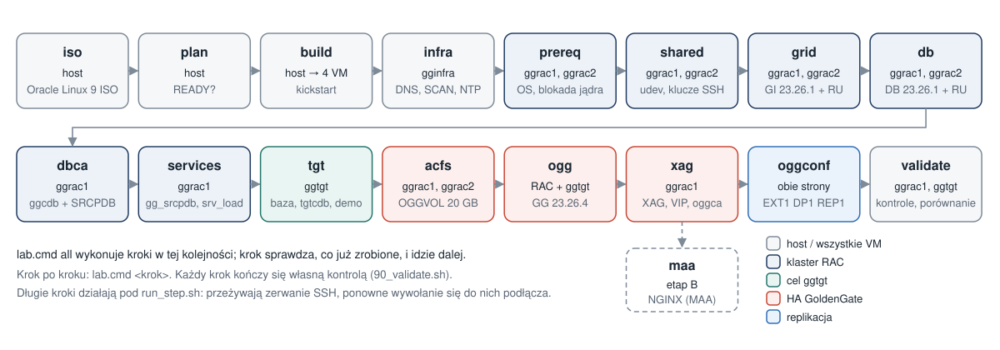

# 🪜 Instalacja, droga 2 — krok po kroku: `lab.cmd <krok>`

🇬🇧 [English](INSTALL_STEPWISE.md) | 🇵🇱 Polski

> 🎯 Ta sama budowa co `lab.cmd all`, ale po jednym kroku. Po każdym kroku widzisz, co zostało sprawdzone, możesz
> zajrzeć sam poleceniami z tej strony i sam decydujesz, kiedy iść dalej. Dobre do nauki, do pierwszej budowy i do
> znalezienia kroku, który się zepsuł.

Przygotowanie (host, pliki Oracle, `LAB_PASS`, `lab.config.psd1`) jest takie samo jak w
[INSTALL_AUTO_PL.md](INSTALL_AUTO_PL.md#-1-zanim-zaczniesz). Droga w pełni ręczna, bez skryptów: [MANUAL_PL.md](MANUAL_PL.md).

## 📐 Jak działa każdy krok

- `.\lab.cmd <krok>` uruchamiasz na hoście. Kopiuje on na maszynę do `/root/lab` pliki `guest/lib.sh`, skrypty roli,
  `sql/`, `ogg/` oraz wygenerowane dla węzła `lab.env` / `hosts.env` / pliki odpowiedzi, a potem przez SSH uruchamia
  jeden skrypt maszyny.
- Każdy krok można **powtarzać**: zrobiona praca jest rozpoznawana i pomijana (`SKIP`, `OK ... already ...`).
- Większość kroków kończy się walidacją (`90_validate.sh <sekcja>`): jeden wiersz `CHECK ok` / `CHECK FAIL` na kontrolę;
  każdy `FAIL` zatrzymuje krok z niezerowym kodem wyjścia.
- `-DryRun` przy dowolnym kroku pokazuje, co by się wykonało, i niczego nie zmienia.
- Własne kontrole: powłoka roota przez `.\lab.cmd ssh <vm>`; polecenia dla grid / oracle poniżej uruchamiasz jako
  `su - grid -c '...'` / `su - oracle -c '...'` (ich profile ustawiają `ORACLE_HOME`, `PATH`, `ORACLE_SID`).
- Czasy to czyste czasy ze zmierzonej budowy ([TIMINGS_PL.md](TIMINGS_PL.md)): VirtualBox na laptopie z Windows,
  hypervisor wyłączony; `grid` i `db` przy 2 vCPU / 10 GB na węzeł RAC (dziś 3 vCPU / 14 GB), więc traktuj je jako górne.
- Przy błędzie kroku: przeczytaj ostatni `CHECK FAIL` / `ERROR`, usuń przyczynę, uruchom **ten sam krok** jeszcze raz.
  Logi na maszynie: `/root/lab/run/<krok>.out`, `/root/lab/logs/`.

## 1️⃣ `iso` — ISO startowe Oracle Linux

- **Robi:** pobiera `OracleLinux-R9-U8-x86_64-boot.iso` do `IsoDir`, jeśli go nie ma (`curl.exe`, ze wznawianiem),
  i sprawdza sumę SHA-256 z `host/os-profiles.psd1`.
- **Kończy się:** `== ISO SHA-256 OK`.
- **Sprawdź sam:** `Get-FileHash D:\ISOs\OracleLinux-R9-U8-x86_64-boot.iso -Algorithm SHA256`.
- **Czas:** 2–3 s, gdy ISO już jest; pobieranie zależy od łącza.
- **Dalej, gdy:** SHA-256 OK. **Przy błędzie:** niezgodna suma = uszkodzony plik: usuń go i uruchom `iso` ponownie.

## 2️⃣ `plan` — podgląd bez zmian

- **Robi:** pokazuje pliki Oracle (czy są, wersja RU / OPatch / GoldenGate, SHA-256, jeśli podane), plan maszyn, wolne
  miejsce, renderuje kickstarty z zamaskowanym hasłem, szuka maszyn innych labów w sieci labu.
- **Kończy się:** `== READY` (kod 0) albo `== NOT READY` z listą problemów (kod 1).
- **Czas:** sekundy. **Dalej, gdy:** READY. Ostrzeżenie o miejscu nie blokuje (`SpaceCheck = 'warn'`).

## 3️⃣ `build` — maszyny i Oracle Linux 9

- **Robi:** tworzy albo używa istniejącej karty host-only `192.168.58.1/24` (serwer DHCP VirtualBoxa usunięty), dwa
  stałe dyski współdzielone (DATA1 60 GB, FRA1 30 GB), cztery maszyny (karta 1 host-only, karta 2 NAT, karta 3
  `ggrac-ic` na węzłach RAC, dyski współdzielone na portach SATA 2 i 3), dodaje regułę zapory dla TCP 8000 (UAC),
  renderuje kickstarty z prawdziwym hasłem, uruchamia na hoście mały serwer HTTP i wpisuje w konsolę każdej maszyny linię
  startową (`inst.ks=http://192.168.58.1:8000/kickstart/out/<vm>.ks`). Potem czeka na SSH każdej maszyny i na
  `POST-INSTALL DONE` w `/root/ks-post.log`, odpina ISO. Wyrenderowane kickstarty (mają hasło) są usuwane na końcu,
  także po błędzie.
- **Kończy się:** bez błędu; `.\lab.cmd status` pokazuje cztery maszyny `running`.
- **Sprawdź sam:** `.\lab.cmd ssh ggrac1`, potem `grep 'POST-INSTALL DONE' /root/ks-post.log`, `uname -r`,
  `dnf versionlock list | grep kernel`, `getenforce` (Enforcing), `id grid`.
- **Czas:** ok. 10 min dla czterech maszyn (pakiety systemu idą z yum.oracle.com, więc liczy się szybkość łącza).
- **Dalej, gdy:** wszystkie cztery maszyny odpowiadają na SSH. **Przy błędzie:** maszyna, która istnieje, ale nie
  skończyła instalacji, nie jest ruszana; komunikat mówi: `lab.cmd destroy <vm>`, potem `lab.cmd build`. Gotowe maszyny
  są pomijane.

## 4️⃣ `infra` — DNS i czas na gginfra

- **Robi:** `guest/infra/10_dnsmasq.sh` (rekordy z `hosts.env` do `/etc/lab.hosts`, `/etc/dnsmasq.d/lab.conf`, SCAN jako
  3 rekordy A, strefa PTR labu, reszta nazw do DNS NAT, `firewalld` wyłączony) i `20_chrony.sh`
  (`allow 192.168.58.0/24`, `local stratum 8`).
- **Kończy się:** `infra/90_validate.sh`: SCAN = 3 adresy, rekordy A i PTR węzłów, `oggvip`, nazwa spoza labu przez NAT,
  chrony `Leap status: Normal`, nasłuch UDP 123.
- **Sprawdź sam** (na gginfra): `dig +short ggrac-scan.gg.lab.test @127.0.0.1` (trzy adresy),
  `dig +short -x 192.168.58.11 @127.0.0.1`, `chronyc tracking`.
- **Czas:** 13 s. **Dalej, gdy:** brak `CHECK FAIL`.

## 5️⃣ `prereq` — węzły RAC: resolver, czas, kontrole systemu

- **Robi:** `guest/rac/10_os_prereq.sh` na obu węzłach: `dns=none` w NetworkManagerze, `/etc/resolv.conf` → gginfra,
  chrony tylko z gginfra (pule internetowe zakomentowane), avahi i `firewalld` wyłączone.
- **Kończy się:** czeka do 60 s na `^*` w chrony dla 192.168.58.10, potem sprawdza: SCAN = 3 adresy, PTR węzła, ping obu
  nazw publicznych i obu `-priv`, adresy SCAN / VIP / `oggvip` jeszcze wolne (przed GI), pakiet preinstall, grid w
  asmadmin, oracle w asmdba, THP `madvise`, HugePages > 0, `NOZEROCONF=yes`, jądro zablokowane i działające jądro jest
  jednym z zablokowanych, RAM ≥ 8 GB, `/u01` ≥ 40 GB wolnego.
- **Sprawdź sam:** `chronyc -n sources`, `cat /sys/kernel/mm/transparent_hugepage/enabled`,
  `grep HugePages_Total /proc/meminfo`, `dig +short ggrac-scan`.
- **Czas:** 2 min. **Dalej, gdy:** krok kończy się bez `OS prerequisites failed`.

## 6️⃣ `shared` — nazwy dysków ASM i zaufanie SSH

- **Robi:** `20_asm_udev.sh` na obu węzłach znajduje dyski 60 GiB i 30 GiB po rozmiarze, odczytuje ich `ID_SERIAL` i
  zapisuje `/etc/udev/rules.d/99-oracle-asmdevices.rules` (`/dev/oracleasm/DATA1`, `FRA1`, `grid:asmdba 0660`). Potem
  `30_ssh_equivalence.sh` tworzy klucze PEM RSA dla grid i oracle na obu węzłach, host zbiera klucze publiczne i
  autoryzuje je na obu węzłach, wypełnia `known_hosts` i sprawdza `ssh` z każdego węzła do każdego (nazwa krótka, FQDN,
  IP) dla obu użytkowników. Zaufanie SSH (SSH equivalence) to logowanie bez hasła między węzłami: instalatory Oracle
  kopiują nim pliki na drugi węzeł.
- **Kończy się:** `/dev/oracleasm/<dysk> -> /dev/sdX (grid:asmdba 660)` na obu węzłach i `CHECK ok` dla każdej pary SSH.
- **Sprawdź sam:** `ls -lL /dev/oracleasm/` na obu węzłach; `su - grid -c 'ssh ggrac2 hostname'`.
- **Czas:** 50 s. **Dalej, gdy:** oba dyski widać pod tymi samymi nazwami na obu węzłach.
- **Przy błędzie:** `no 61440 MiB disk` = dyski współdzielone nie są podpięte (sprawdź maszynę w VirtualBoxie);
  `has partitions` = ktoś założył partycje: ASM potrzebuje całego urządzenia.

## 7️⃣ `grid` — Grid Infrastructure 23.26 z RU

- **Robi** (`40_install_grid.sh`, w fazach):
  1. kopiuje ZIP GI, RU GI i OPatch do `/u01/stage` na ggrac1 (pomija, gdy rozmiar się zgadza);
  2. `stage`: rozpakowuje GI do Grid home, podmienia OPatch, rozpakowuje RU, sprawdza każdy klucz naszego `gridsetup.rsp`
     ze wzorcem dostarczonym w tym wydaniu, instaluje `cvuqdisk` i kopiuje jego RPM na ggrac2;
  3. `cvuqdisk` na ggrac2;
  4. `install`: `gridSetup.sh -silent -ignorePrereqFailure -applyRU /u01/stage/ru_gi/40002013 -responseFile ...`
     (hasło wpisane do kopii z prawami 600);
  5. `root`: `orainstRoot.sh` i `root.sh` na ggrac1, potem na ggrac2 (jeden po drugim);
  6. `ahf`: zatrzymuje AHF/TFA i wyłącza `oracle-tfa.service` na obu węzłach (zagładzał węzły z 2–3 vCPU);
  7. `config`: `gridSetup.sh -silent -executeConfigTools`;
  8. `fra`: `asmca -silent -createDiskGroup -diskGroupName FRA ...` i `srvctl start diskgroup -diskgroup FRA`.
- **Kończy się:** `90_validate.sh grid`: klaster online na wszystkich węzłach, 2 węzły w `olsnodes`, 3 listenery SCAN i
  3 VIP-y SCAN działają, `+DATA` i `+FRA` zamontowane, chrony zsynchronizowany z gginfra, brak CTSS albo tryb Observer,
  AHF/TFA wyłączone.
- **Sprawdź sam:** `su - grid -c 'crsctl check cluster -all'`, `su - grid -c 'crsctl stat res -t'`,
  `su - grid -c 'srvctl status scan_listener'`, `su - grid -c 'asmcmd lsdg'`,
  `systemctl is-enabled oracle-tfa.service` (disabled).
- **Czas:** ok. 1 h 28 min (kopia i rozpakowanie 10 min, instalacja z RU 30 min, `root.sh` 8 min na węźle 1 i 18 min na
  węźle 2, narzędzia konfiguracyjne 15 min, `+FRA` 3 min).
- **Dalej, gdy:** brak `CHECK FAIL` w sekcji grid.
- **Przy błędzie:** przerwana instalacja (home w inventory bez `CRS="true"`) zatrzymuje się z dwiema opcjami, które
  wypisuje (obejrzeć log albo `runInstaller -silent -detachHome` i opróżnić home). Nieudany `root.sh` można uruchomić
  ponownie (wznawia od punktu kontrolnego); gdy padnie znowu, komunikat podaje `rootcrs.sh -deconfig -force`. Nieznany
  klucz pliku odpowiedzi zatrzymuje krok **przed** instalatorem i podaje ten klucz.

## 8️⃣ `db` — oprogramowanie bazy z RU

- **Robi:** kopiuje ZIP bazy, RU DB i OPatch na ggrac1; `50_install_db.sh stage` (rozpakowanie, OPatch, RU, kontrola
  kluczy pliku odpowiedzi), `install` (`runInstaller -silent -ignorePrereqFailure -waitforcompletion -applyRU
  /u01/stage/ru_db/40007731` z `clusterNodes=ggrac1,ggrac2`: instalator kopiuje home na ggrac2 przez SSH), `root`
  (`root.sh` na obu węzłach).
- **Kończy się:** instalator `rc=0` (`rc=6` = ostrzeżenia, patrz log) i `root.sh (DB) OK` na obu węzłach. Bez osobnej
  sekcji walidacji; prawdziwym testem jest `dbca`.
- **Sprawdź sam:** `su - oracle -c '$ORACLE_HOME/OPatch/opatch lspatches'` na obu węzłach (podłatki RU);
  `grep dbhome_1 /u01/app/oraInventory/ContentsXML/inventory.xml`.
- **Czas:** zmierzone 1 h 35 min, ale zawyżone: węzły miały 10 GB i używały swapu (stage 38 min, nakładanie RU 51 min,
  instalacja 6 min). Przy 14 GB spodziewaj się mniej; nowy pomiar czeka.
- **Dalej, gdy:** oba `root.sh` są OK.

## 9️⃣ `dbca` — baza RAC `ggcdb`

- **Robi:** `60_create_db.sh` na ggrac1: `dbca -silent -createDatabase -responseFile ... -ignorePreReqs
  -enableArchive true -recoveryAreaSize 26112` (RAC na ggrac1, ggrac2; jedna PDB `SRCPDB`; `+DATA` i `+FRA`;
  `use_large_pages=TRUE`, SGA 4096 MB), uruchamia bazę, pilnuje, by `SRCPDB` była `READ WRITE`, potem
  `sql/01_src_prep_cdb.sql`: `enable_goldengate_replication=TRUE` i `streams_pool_size=1280M` z `SID='*'`,
  `FORCE LOGGING`, minimalny supplemental logging, przełączenie logów na wszystkich wątkach, PDB otwarta na wszystkich
  instancjach. Supplemental logging to dopisywanie do redo dodatkowych kolumn, bez których Extract nie odtworzy zmiany.
- **Kończy się:** `source CDB ggcdb ready`. Pełna kontrola bazy przychodzi z krokiem `services`.
- **Sprawdź sam:** `su - oracle -c 'srvctl status database -db ggcdb'`; w `sqlplus / as sysdba`:
  `select log_mode, force_logging, supplemental_log_data_min from v$database;`.
- **Czas:** 7 min.
- **Przy błędzie:** pliki w `+DATA/GGCDB` bez rejestracji w klastrze albo zarejestrowana baza bez otwartej PDB
  zatrzymują krok z poleceniem sprzątania (`dbca -silent -deleteDatabase -sourceDB ggcdb -forceArchiveLogDeletion`).
  Nic nie jest usuwane automatycznie.

## 🔟 `services` — serwisy i dane demo

- **Robi:** `65_services.sh`: `srvctl add service` dla `gg_srcpdb` (preferowana `ggcdb1`, zapasowa `ggcdb2`; za tym
  serwisem pójdzie GoldenGate), `srv_load1` (preferowana `ggcdb1`), `srv_load2` (preferowana `ggcdb2`), uruchamia je,
  potem `sql/05_demo_schema.sql` (schematy HR i SALES, 6 tabel, wiersze startowe) i `sql/06_loadgen.sql` (pakiet
  `SALES.LOADGEN`).
- **Kończy się:** `90_validate.sh db`: 2 instancje, 2 otwarte wątki, ARCHIVELOG, FORCE LOGGING, supplemental logging,
  parametr GoldenGate i streams pool na obu instancjach, `SRCPDB` otwarta na obu, serwisy tam, gdzie skonfigurowane, 6
  tabel demo, 3 wiersze startowe w `sales.types26`, `SALES.LOADGEN` VALID.
- **Sprawdź sam:** `su - oracle -c 'srvctl status service -db ggcdb'`,
  `su - oracle -c 'srvctl config service -db ggcdb -service gg_srcpdb'`.
- **Czas:** 30 s. **Dalej, gdy:** brak `CHECK FAIL` w sekcji db.

## 1️⃣1️⃣ `tgt` — baza docelowa na ggtgt

- **Robi:** `tgt/10_os_prereq.sh` (resolver i czas z gginfra, kontrole), kopiuje ZIP bazy, RU, OPatch, instaluje
  oprogramowanie bazy na jedną instancję (`stage`, `install`, `root`), potem `tgt/60_create_db.sh`: `listener.ora` i
  `lsnrctl start`, `dbca -silent -createDatabase` (jedna instancja, pliki w `/u01/oradata`), autostart (`/etc/oratab`
  `:Y` i jednostka systemd `oracle-db.service`, która uruchamia `dbstart` przez `/usr/bin/bash` z powodu SELinux),
  `sql/03_tgt_prep_cdb.sql` (parametr GoldenGate, FORCE LOGGING, `TGTPDB` otwarta i `SAVE STATE`),
  `sql/05_demo_schema.sql` (te same tabele i wiersze startowe co w źródle: nie trzeba ładowania początkowego).
- **Kończy się:** `tgt/90_validate.sh db`: instancja OPEN, `TGTPDB` READ WRITE i zapisany stan, FORCE LOGGING, parametr
  GoldenGate, listener obsługuje `TGTPDB`, 6 tabel demo, 3 wiersze startowe, oratab `Y`, `oracle-db.service` włączona i
  aktywna.
- **Sprawdź sam** (na ggtgt): `systemctl status oracle-db.service`, `su - oracle -c 'lsnrctl status'`.
- **Czas:** ok. 30 min (stage 13 min, instalacja 12 min, dbca 5 min).
- **Przy błędzie:** w połowie utworzona baza (`/u01/oradata/TGTCDB` bez wpisu w oratab) zatrzymuje krok z poleceniem
  sprzątania.

## 1️⃣2️⃣ `acfs` — ACFS na deployment GoldenGate

- **Robi:** `70_acfs.sh prep` na obu węzłach (`acfsdriverstate supported` musi wypisać ACFS-9200, sterowniki załadowane,
  `/u01/oggdeploy` utworzony), potem `create` na ggrac1: `asmcmd volcreate -G DATA -s 20G OGGVOL`,
  `mkfs -t acfs /dev/asm/oggvol-NNN` (tylko na pustym wolumenie), `srvctl add filesystem ... -path /u01/oggdeploy -user
  oracle -autostart RESTORE`, `srvctl start filesystem ... -node ggrac1`, właściciel `oracle:oinstall`.
- **Kończy się:** `90_validate.sh acfs`: ACFS obsługiwany i załadowany, `ora.data.oggvol.acfs` ONLINE na dokładnie
  jednym węźle, punkt montowania należy do `oracle:oinstall`.
- **Sprawdź sam:** `crsctl stat res ora.data.oggvol.acfs -t`, `df -h /u01/oggdeploy`.
- **Czas:** 45 s.
- **Przy błędzie:** `ACFS not supported on kernel ...` znaczy, że działające jądro nie jest certyfikowane dla ACFS
  (patrz KB129209); zmień `Os.Kernel` / `Os.UekRepo` i zbuduj maszyny RAC od nowa.

## 1️⃣3️⃣ `ogg` — oprogramowanie GoldenGate i deployment celu

- **Robi:** kopiuje ZIP GoldenGate na ggrac1, ggrac2 i ggtgt; `80_install_ogg.sh` na każdej (rozpakowanie, kontrola
  kluczy pliku odpowiedzi, `runInstaller -silent -waitforcompletion` z `INSTALL_OPTION=ORA23ai` do
  `/u01/app/ogg/ogg26ai_ma`; opcjonalna łatka zbiorcza przez `opatch apply`); potem `tgt/86_oggca_target.sh`:
  `oggca.sh -silent` tworzy Service Manager `ggsm01` i deployment `oggtarget` na ggtgt (porty 9100–9104, bez TLS na
  etapie A), `registerServiceManager.sh` rejestruje jednostkę systemd `OracleGoldenGate`, włączoną i uruchomioną.
  Deployment to jedna instancja GoldenGate Microservices z własnymi usługami i plikami; Service Manager nimi zarządza.
- **Kończy się:** `tgt/90_validate.sh ogg`: jednostka aktywna i włączona, Service Manager odpowiada HTTP 200/401 na
  `ggtgt:9100`, Receiver nasłuchuje na 9103, katalog deploymentu jest.
- **Sprawdź sam:** `systemctl status OracleGoldenGate` na ggtgt;
  `curl -s -o /dev/null -w '%{http_code}\n' http://ggtgt.gg.lab.test:9100/services/v2/deployments`.
- **Czas:** ok. 6 min (kopia i trzy instalacje ok. 5 min, `oggca` 13 s, rejestracja i kontrole 23 s).
- **Przy błędzie:** `oggca` odrzuca hasło administratora = polityka haseł (patrz [PITFALLS_26AI_PL.md](PITFALLS_26AI_PL.md));
  w połowie utworzony deployment zatrzymuje krok z informacją, co usunąć.

## 1️⃣4️⃣ `xag` — XAG, VIP, deployment źródła, zasób XAG

- **Robi:** kopiuje ZIP XAG na ggrac1; `85_install_xag.sh`: `xagsetup.sh --install --directory /u01/app/xag
  --all_nodes`, sprawdza, że root i oracle znajdują najpierw `/u01/app/xag/bin/agctl` w `PATH`. `87_xag_register.sh vip`:
  `appvipcfg create -network=1 -ip=192.168.58.40 -vipname=oggvip -user=root`, `crsctl setperm` dla oracle, start na
  ggrac1. `86_oggca_source.sh`: `oggca.sh -silent` tworzy `ggsm01` i `oggsource` na ACFS, związane z `oggvip`,
  zintegrowane z XAG; zapisuje alias TNS `OGGSOURCE_PDB` (IPC do lokalnego listenera, serwis `gg_srcpdb`).
  `87_xag_register.sh add`: `agctl add goldengate oggsource ...` (pełne opcje w
  [MANUAL_PL.md](MANUAL_PL.md#16--rejestracja-goldengate-w-xag)), `agctl start goldengate oggsource --node ggrac1`.
  XAG to agent Clusterware, który pilnuje GoldenGate i przenosi go na drugi węzeł razem z ACFS, VIP i serwisem.
- **Kończy się:** `90_validate.sh ogg`: root używa `agctl` z XAG 10.2, `agctl status goldengate oggsource` działa na
  węźle serwisu `gg_srcpdb`, ACFS i `oggvip` ONLINE na tym samym węźle, Service Manager odpowiada na `oggvip:9100`.
- **Sprawdź sam:** `agctl status goldengate oggsource`, `agctl config goldengate oggsource`,
  `crsctl stat res oggvip -t`.
- **Czas:** ok. 1,5 min.
- **Przy błędzie:** `agctl start failed` z wypisanym działającym Service Managerem = Service Manager uruchomiony poza
  XAG blokuje start: zatrzymaj ten proces i uruchom `xag` ponownie.

## 1️⃣5️⃣ `oggconf` — replikacja

- **Robi:** `88_oggconf_source.sh` na ggrac1: użytkownik `ggadmin` w `SRCPDB` (`sql/02_src_users_pdb.sql`, rola
  `OGG_CAPTURE`), `ext1.prm` do deploymentu, potem jedna sesja adminclient: alias poświadczeń `ggsource`,
  `ADD SCHEMATRANDATA HR / SALES`, tabela heartbeat (`FREQUENCY 5`), `REGISTER EXTRACT ext1 DATABASE`, `ADD EXTRACT ext1,
  INTEGRATED TRANLOG, BEGIN NOW`, trail `et`, profil `MAA` (autostart, autorestart), start; druga sesja: alias
  `ggtgt_dp` i Distribution Path `dp1` do `ws://ggtgt.gg.lab.test:9103`. `88_oggconf_target.sh` na ggtgt: `ggadmin` w
  `TGTPDB` (`OGG_APPLY`, DML na tabelach demo, uprawnienia DDL dla testu T10), `rep1.prm`, alias `ggtarget`, heartbeat,
  tabela punktów kontrolnych, `ADD REPLICAT rep1, PARALLEL`, profil `MAA`, start. Extract czyta zmiany z redo i zapisuje
  je do trailu (plików GoldenGate); Distribution Path wysyła trail do celu; Replicat nakłada zmiany na bazę docelową.
- **Kończy się:** sam `oggconf` nie waliduje (adminclient kończy się kodem 2 po każdym nieudanym poleceniu, np. „already
  exists” przy powtórce); wynik sprawdza `validate`.
- **Sprawdź sam:** w adminclient na ggrac1 `CONNECT http://oggvip.gg.lab.test:9100 DEPLOYMENT oggsource AS oggadmin`,
  `INFO ALL`, `INFO DISTPATH dp1`; na ggtgt to samo wobec `http://ggtgt.gg.lab.test:9100 DEPLOYMENT oggtarget`.
- **Czas:** ok. 35 s. Replicat i Extract potrzebują ok. minuty, żeby mieć stan RUNNING (opóźnienie autostartu profilu 60 s).

## 1️⃣6️⃣ `validate` — cały lab

- **Robi:** `90_validate.sh grid db acfs ogg repl` na ggrac1 i `db ogg repl` na ggtgt, potem `loadgen.sh 10 60`
  (10 wierszy na sekundę przez 60 s jednocześnie przez `srv_load1` i `srv_load2`, jako SYSTEM przez SCAN), potem co 10 s,
  najdłużej 180 s, porównuje tabela po tabeli liczby wierszy i sumy `ORA_HASH` (`sql/10_compare.sql`).
- **Kończy się:** tabelą `Table, SourceRows, TargetRows, Missing, Match` i `== VALID: lab in the base state (stage A)`.
- Kontrole replikacji: EXT1 RUNNING, DP1 running, brak procesu ABENDED, przechwytywanie LogMiner ENABLED, REP1 RUNNING,
  tabela punktów kontrolnych jest, lag heartbeat poniżej 30 s. Lag to opóźnienie: ile sekund mija od zmiany w źródle do
  jej nałożenia w celu.
- **Czas:** 1 min 40 s.

Dalej: codzienna obsługa i stan bazowy → [OPERATIONS_PL.md](OPERATIONS_PL.md); testy awarii → [TESTS_PL.md](../TESTS_PL.md).

## 🧰 Skrypty gości uruchamiane samemu (przez SSH)

Pod spodem każdy krok `lab.cmd` wywołuje te same skrypty bash. Żeby uruchomić je samemu zamiast `lab.cmd`:

`lab.cmd <krok>` kopiuje `guest/` do `/root/lab` na każdej maszynie. Te same skrypty możesz uruchamiać sam przez SSH,
jako **root**, w tej kolejności. Każdy skrypt jest powtarzalny; `DRY_RUN=1 bash <skrypt>` tylko wypisuje polecenia.

| # | Węzeł | Polecenie (root) |
|---|---|---|
| 1 | gginfra | `bash /root/lab/infra/10_dnsmasq.sh`, `bash /root/lab/infra/20_chrony.sh`, `bash /root/lab/infra/90_validate.sh` |
| 2 | ggrac1, ggrac2 | `bash /root/lab/rac/10_os_prereq.sh`, potem `bash /root/lab/rac/20_asm_udev.sh` |
| 3 | oba, potem oba | `bash /root/lab/rac/30_ssh_equivalence.sh keygen grid` → wypisane klucze do `/root/lab/keys_grid.txt` na obu → `authorize grid /root/lab/keys_grid.txt` → `verify grid`; to samo dla `oracle` |
| 4 | ggrac1 | `bash /root/lab/rac/40_install_grid.sh stage` (ggrac2: `cvuqdisk`), ggrac1: `install`, ggrac1 potem ggrac2: `root`, ggrac1: `config`, `fra` |
| 5 | ggrac1 | `bash /root/lab/rac/50_install_db.sh stage`, `install`; ggrac1 potem ggrac2: `root` |
| 6 | ggrac1 | `bash /root/lab/rac/60_create_db.sh`, `bash /root/lab/rac/65_services.sh`, `bash /root/lab/rac/90_validate.sh grid db` |
| 7 | ggtgt | `bash /root/lab/tgt/10_os_prereq.sh`, `tgt/50_install_db.sh stage\|install\|root`, `bash /root/lab/tgt/60_create_db.sh` |
| 8 | ggrac1, ggrac2 | `bash /root/lab/rac/70_acfs.sh prep`; ggrac1: `bash /root/lab/rac/70_acfs.sh create` |
| 9 | ggrac1, ggrac2, ggtgt | `bash /root/lab/rac/80_install_ogg.sh` (każdy węzeł RAC), `bash /root/lab/tgt/80_install_ogg.sh`, `bash /root/lab/tgt/86_oggca_target.sh` |
| 10 | ggrac1 | `bash /root/lab/rac/85_install_xag.sh`, `rac/87_xag_register.sh vip`, `rac/86_oggca_source.sh`, `rac/87_xag_register.sh add` |
| 11 | ggrac1, ggtgt | `bash /root/lab/rac/88_oggconf_source.sh`, potem na ggtgt `bash /root/lab/tgt/88_oggconf_target.sh` |
| 12 | ggrac1, ggtgt | `bash /root/lab/rac/90_validate.sh`, `bash /root/lab/tgt/90_validate.sh`, `bash /root/lab/shared/loadgen.sh 10 60`, `bash /root/lab/shared/compare.sh` na obu |

Binaria muszą najpierw być w `/u01/stage` (kopiują je `lab.cmd grid|db|tgt|ogg|xag` albo własny `scp`).

## 🔧 Pozostałe polecenia

| Polecenie | Co robi |
|---|---|
| `net` | tylko karta host-only (część `build`) |
| `status`, `start`, `stop`, `ssh`, `baseline`, `destroy` | patrz [OPERATIONS_PL.md](OPERATIONS_PL.md) |
| `test`, `snapshot`, `maa` | zarezerwowane: mówią, gdzie jest ta praca, i kończą się kodem 2 (testy: `tests/run_test.ps1`; etap B z NGINX nienapisany) |
