# 📊 Results of the failure tests (measured 16.11.2026)

🇬🇧 English | 🇵🇱 [Polski](RESULTS_PL.md)

[]()
[-blueviolet)]()
[]()
[]()

> 🎯 What happened in every failure test, run by run: recovery time, detection time, time until the lag was back below
> 30 s, the node GoldenGate ended on and whether the data matched. Results that differ from the expectation and runs
> that failed stay in, each with its cause. How the tests work: [TESTS.md](../TESTS.md); the words: [CONCEPTS.md](CONCEPTS.md).

## ⚠️ Measurement conditions (read first)

- **Platform:** VirtualBox 7 on one Windows 11 laptop, Windows hypervisor off. Four VMs: `ggrac1`, `ggrac2` (3 vCPU,
  14 GB RAM each), `ggtgt` (2 vCPU, 6 GB), `gginfra` (1 vCPU, 2 GB). Shared ASM disks are fixed-size VDI files on the laptop's local disk.
- **Software:** Oracle AI Database and Grid Infrastructure 23.26.1 + RU 23.26.4, GoldenGate 23.26.4.0.2 Microservices,
  XAG 10.2, Oracle Linux 9 (UEK8). HA stage A: XAG + ACFS + application VIP, no NGINX ([DESIGN.md](../DESIGN.md)).
- **Load:** `loadgen.sh`, 10 rows/s per instance through both instances (one commit per row). Heartbeat every 5 s.
- **One day, one lab.** Three runs per test where possible (T7: one). These are **lab numbers**, not a service level for
  production hardware: real servers detect failures and boot differently, and production load is different.
- **Clock:** every time is seconds after the fault (`t_fault = 0`), host clock, samples every 1 s (CRS, lag) or 2 s
  (GoldenGate processes). A marker can therefore be late by up to one sample.
- **RTO** here = time until the lag is back below 30 s (`t_lag_ok`), because the Replicat never stopped in these runs
  (definition in [TESTS.md](../TESTS.md#what-is-measured)).

## 🧾 Summary

| Test | Runs | Passed | RTO median [s] | RTO min–max [s] | Max lag [s] | GoldenGate ends on | Data | As expected? |
|---|---|---|---|---|---|---|---|---|
| T1 planned relocation | 5 | 3 | **64.5** | 54.3–65.4 | 69 | `ggrac2` | equal | yes (3/3) |
| T2 power-off GG node | 3 | 3 | **131.4** | 129.6–135.6 | 163 | `ggrac2` | equal | yes (3/3) |
| T3 power-off other node | 3 | 3 | **40.4** | 40.3–127.4 | 128 | `ggrac1` (stays) | equal | yes (3/3), lag jump larger than hoped |
| T4 instance crash | 6 | 0 | – | – | 1216 | nowhere | not replicated while down | **no**: GoldenGate does not come back (2/2) |
| T4b crash + manual move | 3 | 3 | 178.6 (from fault) | 147.7–296.2 | 581 | `ggrac2` | equal | yes (3/3); move → lag OK median **28.7 s** |
| T5 kill Service Manager | 3 | 3 | **53.0** | 46.9–56.8 | 53 | `ggrac1` (restart in place) | equal | yes (3/3) |
| T6 critical Extract killed | 3 | 3 | **38.4** | 37.3–42.3 | 50 | `ggrac1` (restart in place) | equal | flag did not block (3/3) |
| T7 interconnect cut | 1 | 1 | 159.1 | – | 129 | `ggrac1` (stays) | equal | yes (1/1) |
| T8 lag under load | 3 | 1 | – | – | 15 | `ggrac1` | equal | yes; median lag 11 s |
| T9 data comparison | 1 | 1 | – | – | 15 | `ggrac1` | equal | yes |
| T10 DDL and 26ai types | 2 | 2 | – | – | 16 | `ggrac1` | equal | yes (DDL in attempt 2) |

"Data equal" = every table equal in `COUNT(*)` and `SUM(ORA_HASH)`, no missing and no duplicate `SEQ` for either instance.
No run lost a committed row.

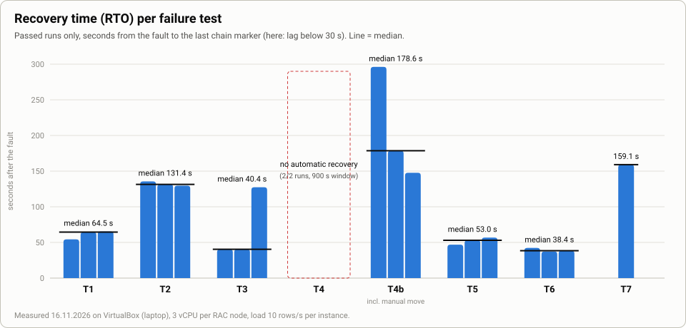

## 🧪 Test by test

Columns: **RTO** = `rto_s`; **detect** = `t_crs_detect`; **EXT1** = `t_ext_running`; **lag OK** = `t_lag_ok`;
**back** = duration of `lab.cmd baseline` after the run. Run names are directories in [results/runs/](../results/runs/).

### T1 — Planned relocation

| Run | RTO [s] | detect [s] | service on ggrac2 [s] | EXT1 [s] | lag OK [s] | ends on | data (LOAD_EVENTS src = tgt) | back [s] |
|---|---|---|---|---|---|---|---|---|
| `T1-20261116-120520` | 54.3 | 13.4 | 2.1 | 43.7 | 54.3 | ggrac2 | 4605 = 4605 | 106.1 |
| `T1-20261116-121125` | 64.5 | 12.4 | 1.5 | 60.8 | 64.5 | ggrac2 | 4853 = 4853 | 104.9 |
| `T1-20261116-121737` | 65.4 | 12.6 | 1.8 | 60.3 | 65.4 | ggrac2 | 4845 = 4845 | 106.2 |

**Median 64.5 s.** As expected. Answers to the open question: `agctl relocate` **moved the service `gg_srcpdb` itself**
(ONLINE on `ggrac2` 1.5–2.1 s after the command, `service_moved=true`); no `srvctl relocate service` was needed.
Order seen: service (2 s) → first resource down on `ggrac1` (12–13 s) → VIP and ACFS on `ggrac2` (25–26 s) → `DP1`
(30 s) → XAG resource ONLINE (32–34 s) → `EXT1` (44–61 s) → lag OK. The spread comes from `EXT1` (10 s vs about 28 s
after the XAG resource).

Not counted: `T1-20261116-112526` (measurement error: the lag probe took the maximum over all path rows of `gg_lag`;
after the move the old path only aged and the curve reached 730 s while replication worked; data were equal, 15370 =
15370) and `T1-20261116-114040` (refused to start, "lag 93 s", same probe bug, no fault injected). The probe was fixed
to use the freshest path row before the counted runs.

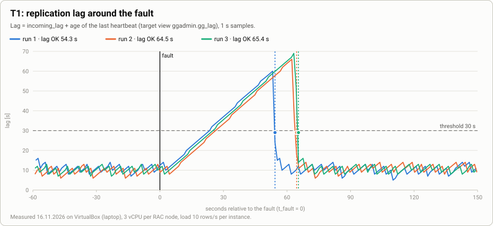
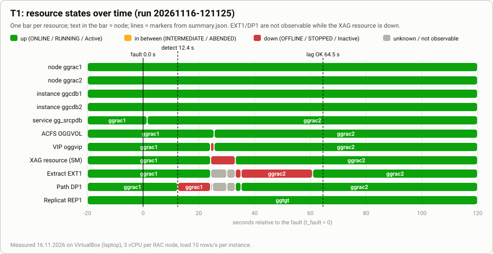

### T2 — Hard power-off of the GoldenGate node

| Run | RTO [s] | detect (eviction) [s] | ACFS [s] | XAG ONLINE [s] | EXT1 [s] | lag OK [s] | ends on | data | back [s] |
|---|---|---|---|---|---|---|---|---|---|
| `T2-20261116-122954` | 135.6 | 32.9 | 36.7 | 45.9 | 73.0 | 135.6 | ggrac2 | 3615 = 3615 | 257.3 |
| `T2-20261116-124244` | 131.4 | 32.7 | 37.0 | 44.8 | 73.4 | 131.4 | ggrac2 | 3396 = 3396 | 257.8 |
| `T2-20261116-125346` | 129.6 | 32.1 | 36.1 | 46.7 | 71.5 | 129.6 | ggrac2 | 3396 = 3396 | 290.4 |

**Median 131.4 s, spread 6 s.** As expected: recovery without a human, `ggrac1` evicted, the whole chain on `ggrac2`.
Where the time goes (median run): about 33 s until the cluster evicts `ggrac1` (service and VIP move in the same second),
4 s to ACFS, 12 s to the XAG resource ONLINE, then `EXT1` stays ABENDED for 25–29 s and is RUNNING at about 72 s;
the remaining about 60 s the Extract reads the backlog, including the redo of thread 1 of the dead instance. Every `SEQ`
row of instance 1 committed before the fault reached the target (0 missing in all three runs).

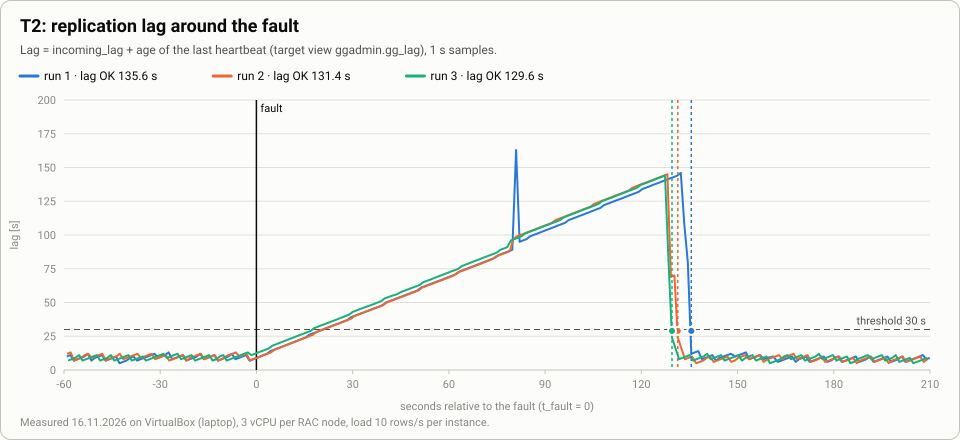
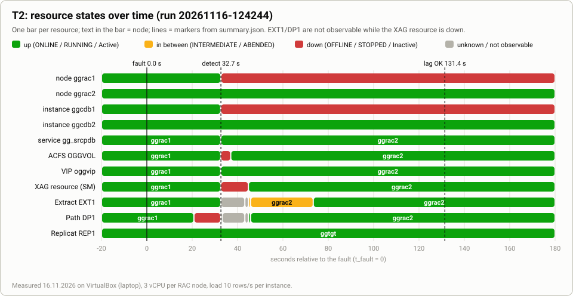

### T3 — Power-off of the second node

| Run | RTO [s] | detect (eviction) [s] | lag OK [s] | max lag [s] | relapses | ends on | data | back [s] |
|---|---|---|---|---|---|---|---|---|
| `T3-20261116-160222` | 40.3 | 31.5 | 40.3 | 48 | 1 (34 s at about 343 s) | ggrac1 | 4576 = 4576 | 192.4 |
| `T3-20261116-161451` | 40.4 | 30.8 | 40.4 | 75 | 0 | ggrac1 | 4431 = 4431 | 169.0 |
| `T3-20261116-162545` | 127.4 | 31.4 | 127.4 | 128 | 0 | ggrac1 | 5413 = 5413 | 164.2 |

**Median 40.4 s.** GoldenGate never moved (no XAG action), every `INST=2` row arrived: as expected. **Not as hoped:**
the "short lag jump" is at least 31 s in every run: until the cluster evicts `ggrac2`, the source cannot commit
heartbeats at all (cluster reconfiguration, then instance recovery of thread 2). In run 3 the Extract then stood still
for about another 60 s while heartbeats were produced normally, which gave 127 s. Run 1 had one later relapse (lag 34 s
at about 343 s, an Extract delay of 21 s). **The cause of these Extract stalls was not found**; logs of database,
GoldenGate and CRS are silent at those moments ([analysis](analysis/T3_EXTRACT_STALLS.md)).
Note: `t_lag_ok` of run 1 was recomputed with the rule "first lasting return" (the first rule took the return after
the *last* high sample and gave 344.6 s); `summary.json` records this in `t_lag_ok_rule`.

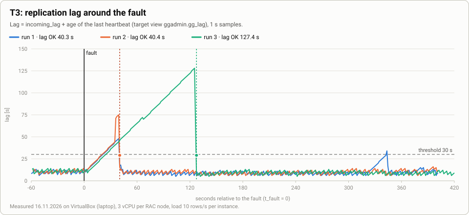
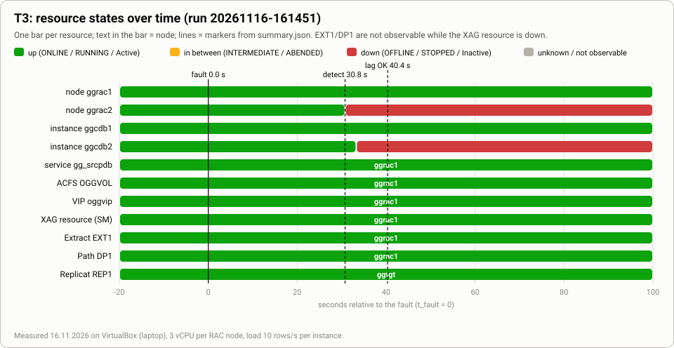

### T4 — Instance crash (kill -9 of PMON)

| Run | Result | What happened |
|---|---|---|
| `T4-20261116-131818`, `-132026`, `-132237` | harness error | the fault command `srvctl stop instance ... -stopoption abort` was refused by CRS (CRS-2974: the singleton service needs `-force`); no fault. The test was changed to `kill -9` of PMON |
| `T4-20261116-133519` | **failed (real result)** | instance down at 5.2 s, service on `ggrac2` at 5.2 s, CRS restarted `ggcdb1` locally at 19.9 s, XAG resource OFFLINE at 32.9 s, then **GoldenGate ran nowhere until the end of the 900 s window** (max lag 1216 s). VIP and ACFS stayed on `ggrac1`. Data at compare time: 1198 of 11260 rows on the target: not replicated, not proven lost |
| `T4-20261116-135751` | interrupted | the same picture until it was stopped by hand during the recovery wait; no evidence files except the expectation |
| `T4-20261116-144352` | failed + measurement error | GoldenGate result as in 133519 (XAG OFFLINE at 33.8 s, nothing for 900 s); additionally CRS **did not** restart `ggcdb1`. The data comparison ran on the node without an instance and is invalid (`measurement_error=data_compare`) |

**Not as expected:** the hypothesis "GoldenGate follows the service to `ggrac2`" was wrong in this configuration (2/2
complete runs, the interrupted one agrees). The CRS log of 133519 shows why
([crsd_excerpt.txt](../results/runs/T4-20261116-133519/crsd_excerpt.txt)):

```text
Hard Stop dependency prevents a relocate of xag.oggsource.goldengate from ggrac1
Hard stop on ora.ggcdb.gg_srcpdb.svc prevents xag.oggsource.goldengate from starting/stopping. ... CRS-0222
CRS-2676: Start of 'ora.ggcdb.gg_srcpdb.svc' on 'ggrac2' succeeded
CRS-2673: Attempting to stop 'xag.oggsource.goldengate' on 'ggrac1'
```

CRS moved the service, then stopped XAG on `ggrac1` and made no further start attempt for 20 minutes. GoldenGate started
again only when `lab.cmd baseline` moved the service back to `ggcdb1`.
Why CRS once restarted the instance and once not: `ora.ggcdb.db` has the default `RESTART_ATTEMPTS=2` within
`UPTIME_THRESHOLD=1h`; 144352 was the third PMON kill within the hour ([analysis](analysis/T4_INSTANCE_RESTART.md)).

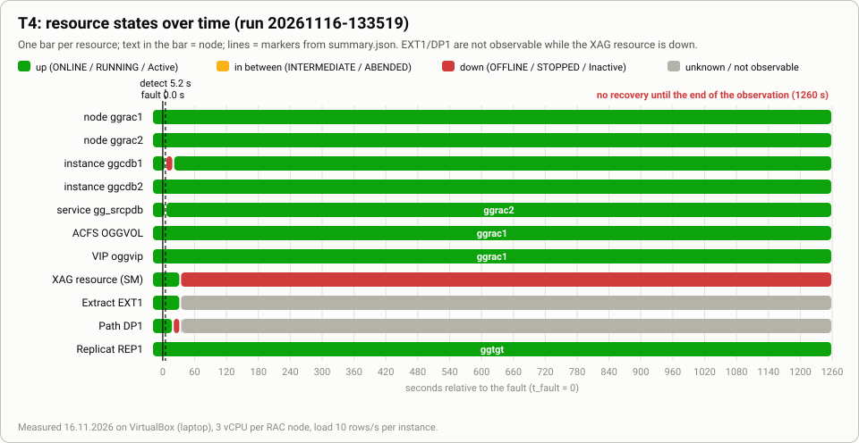

### T4b — Instance crash + manual GoldenGate move

| Run | RTO from fault [s] | detect [s] | move offered [s] | move run [s] | approval wait [s] | move → lag OK [s] | ends on | data | back [s] |
|---|---|---|---|---|---|---|---|---|---|
| `T4b-20261116-152230` | 296.2 | 4.0 | 122.9 | 267.5 | 144.6 | **28.7** | ggrac2 | 5523 = 5523 | 110.5 |
| `T4b-20261116-153428` | 178.6 | 24.5 | 122.6 | 125.7 | 3.1 | **52.9** | ggrac2 | 4369 = 4369 | 111.2 |
| `T4b-20261116-154243` | 147.7 | 22.0 | 120.4 | 123.5 | 3.1 | **24.2** | ggrac2 | 4011 = 4011 | 432.9 |

**As expected.** In every run GoldenGate was not running at 120 s, so the branch `agctl start goldengate oggsource --node
ggrac2` ran (exit code 0); the start pulled VIP and ACFS to `ggrac2` by itself, `crsctl relocate resource oggvip -f` was
never needed. **The manual move itself costs a median of 28.7 s** (24.2–52.9 s); the RTO from the fault is dominated by
the time a human needs to react (here: 120 s by design plus the approval). In run 1 the approval waited 144.6 s
because the test automation monitor read the wrong file (an automation fault, not a cluster one); runs 2 and 3 show the intended reaction. In run 2 `EXT1` came 28 s after the XAG resource, hence
the longer 52.9 s. In run 3 (`154243`) CRS did not restart `ggcdb1` (restart budget exhausted, see T4), which only made
`lab.cmd baseline` longer (432.9 s).

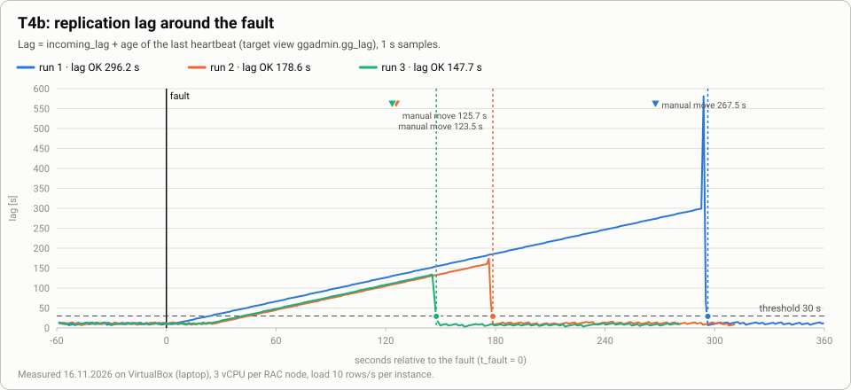
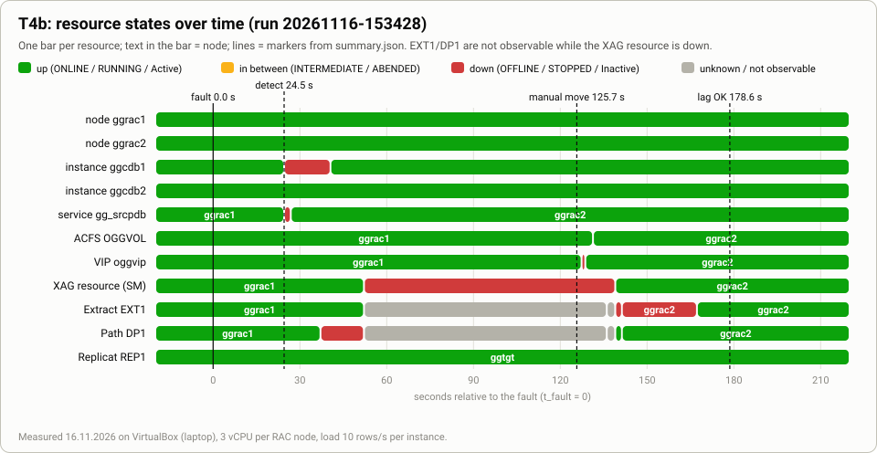

### T5 — Kill the Service Manager

| Run | RTO [s] | detect [s] | XAG ONLINE [s] | EXT1 [s] | lag OK [s] | XAG action | data | back [s] |
|---|---|---|---|---|---|---|---|---|
| `T5-20261116-164712` | 46.9 | 1.6 | 16.3 | 40.7 | 46.9 | restart in place | 4507 = 4507 | 52.5 |
| `T5-20261116-165217` | 53.0 | 0.9 | 21.9 | 49.1 | 53.0 | restart in place | 4625 = 4625 | 52.2 |
| `T5-20261116-165725` | 56.8 | 2.2 | 24.3 | 51.6 | 56.8 | restart in place | 4684 = 4684 | 50.5 |

**Median 53.0 s.** XAG restarted the deployment on the same node every time (no relocate). `EXT1` went through ABENDED
and was RUNNING 24–27 s after the XAG resource. Bug 37468391 did not show up (one Service Manager per node).

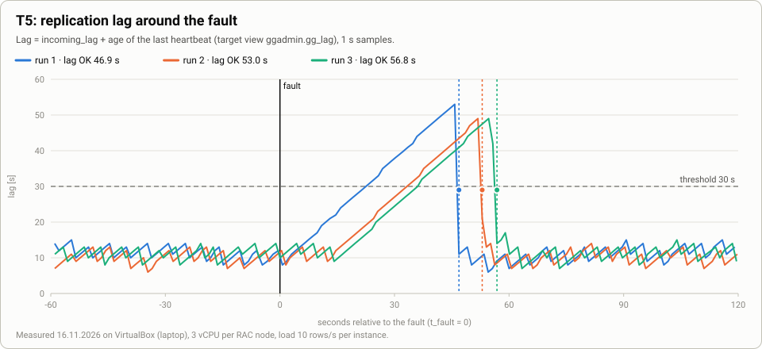
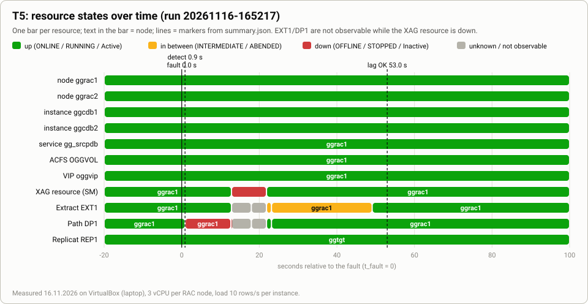

### T6 — Extract marked "Critical to deployment health"

| Run | RTO [s] | EXT1 ABENDED [s] | XAG INTERMEDIATE [s] | EXT1 RUNNING [s] | XAG ONLINE [s] | lag OK [s] | data | back [s] |
|---|---|---|---|---|---|---|---|---|
| `T6-20261116-174258` | 42.3 | 1.6 | 12.1 | 32.6 | 41.6 | 42.3 | 5773 = 5773 | 54.5 |
| `T6-20261116-175056` | 37.3 | 2.9 | 24.8 | 33.9 | 54.5 | 37.3 | 5491 = 5491 | 61.9 |
| `T6-20261116-175700` | 38.4 | 2.6 | 21.9 | 33.4 | 51.4 | 38.4 | 5472 = 5472 | 111.2 |

**Median 38.4 s.** With the flag ON the deployment **was not blocked** in any run: `EXT1` was RUNNING again 31 s after
the kill and stayed on `ggrac1`. The visible effect of the flag is that the XAG resource went INTERMEDIATE for about
30 s (and came back ONLINE only after `EXT1` was running). MAA says "can interfere"; in this lab and with this profile
it did not. Not recorded: the profile export before the first run and the number of restart attempts of `EXT1`.

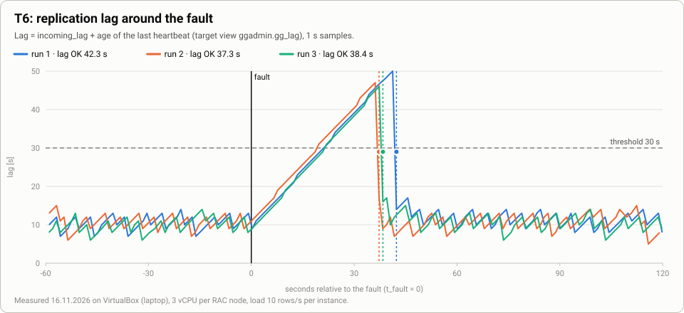
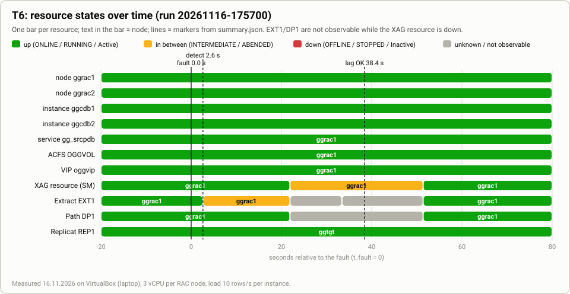

### T7 — Interconnect cut

| Run | RTO [s] | detect (eviction) [s] | lag OK [s] | max lag [s] | evicted | ends on | data | back [s] |
|---|---|---|---|---|---|---|---|---|
| `T7-20261116-181110` | 159.1 | 65.7 | 159.1 | 129 | ggrac2 | ggrac1 | 4008 = 4008 | 641.2 |

**As expected, one run only.** The node with the cut link (`ggrac2`) was evicted; the node with GoldenGate survived, so
GoldenGate did not move. Detection took about 66 s, twice as long as after a power-off (about 31 s in T3); for about
65 s both nodes stayed Active while the lag grew (interpretation: the cluster first waits for its network heartbeat
timeout, which was not read from the lab). Lag stayed above 30 s until 159 s. Back to base took 641 s (link up, CRS
autostart on `ggrac2`, service `srv_load2` back). Which node is evicted depends on Clusterware rules; with GoldenGate on
the evicted node the result would look like T2 (not measured).

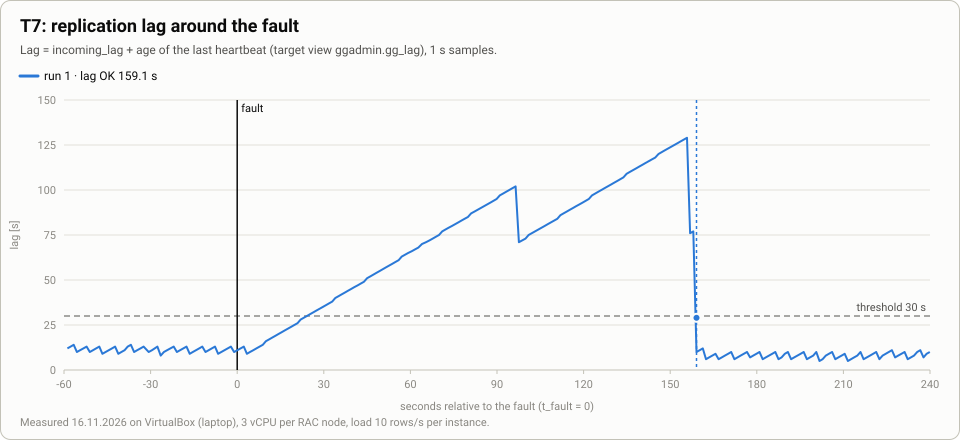
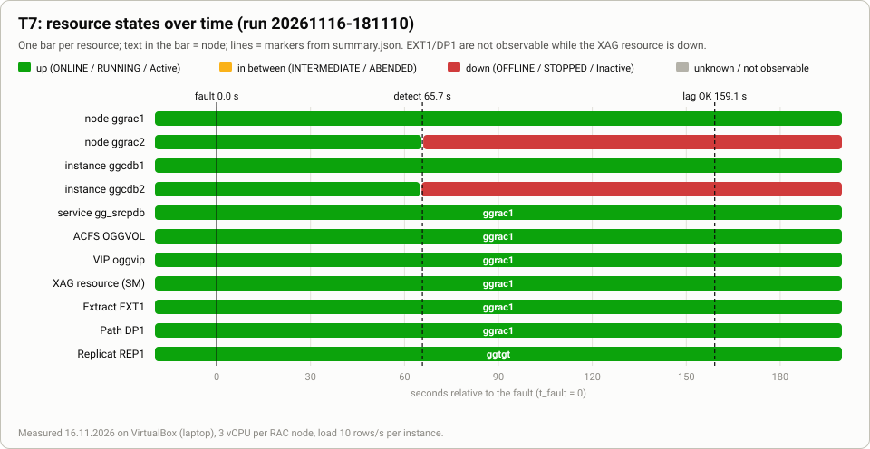

### T8 — Lag under load (no fault)

| Run | Result | Lag min / median / p95 / max [s] | rows INST 1 / INST 2 (src = tgt) |
|---|---|---|---|
| `T8-20261116-110916` | passed | 5 / 11 / 14 / 15 (619 samples, 10 min) | 6552 / 6516 |
| `T8-20261116-104132` | refused | harness bug: the base-state probe returned nothing, no fault, no load | – |
| `T8-20261116-105457` | harness error | harness bug: a result file was read while the sampler held it open | – |

Lag below 30 s all the time and both redo threads arrive: as expected. "A few seconds" was too optimistic for this
measure: the heartbeat comes every 5 s and the age of the last one is part of the lag, so the quiet curve is a saw tooth
from 5 to 15 s.

### T9 — Data comparison

`T9-20261116-112227`: 6/6 tables equal, `LOAD_EVENTS` 694 = 694, `SEQ` 347 = 347 per instance, no missing, no
duplicates. Max lag 15 s. (This run's `compare.json` has row counts only; the hash sums were added to the file later.
The match itself already included the sums.)

### T10 — DDL and 26ai data types

| Run | Result | What was measured |
|---|---|---|
| `T10-20261116-170741` | passed | row 101 (`VECTOR [1.5,2.5,3.5]` FLOAT32, `BOOLEAN TRUE`, `JSON`) on the target after **4.6 s**, values identical; `ALTER TABLE ... ADD (note VARCHAR2(30))` on the target after **8.9 s**; row 102 with the new column after **4.5 s**, identical; clean-up (delete + `DROP COLUMN`) replicated in about 4 s |
| `T10-20261116-170251` | passed, **without DDL** (`measurement_error=ddl_not_run`) | the helper for the manual steps started too late and its first insert failed with ORA-03405 (two statements on one line); the run only proves quiet replication |

`VECTOR`, `BOOLEAN`, `JSON` and DDL (`DDL INCLUDE MAPPED`) replicate unchanged: as expected. The step times come from the
log of the manual steps, resolution about 1 s (not from `summary.json`).

## ❌ Runs that did not count, and why

| Run | Verdict | Cause | Cluster or harness? |
|---|---|---|---|
| `T8-20261116-104132` | refused | base-state probe returned an empty result (array handling bug) | harness |
| `T8-20261116-105457` | harness error | result file read while the sampler still wrote it | harness |
| `T1-20261116-112526` | measurement error (lag) | lag probe took the maximum over all `gg_lag` path rows | harness (probe) |
| `T1-20261116-114040` | refused | same probe bug: "lag 93 s" | harness (probe) |
| `T4-20261116-131818`, `-132026`, `-132237` | harness error | `srvctl stop instance -stopoption abort` refused, CRS-2974 | harness (wrong fault command) |
| `T4-20261116-133519` | **failed** | GoldenGate not restarted after the instance crash: hard stop dependency on the service, CRS-0222 | **cluster (real result)** |
| `T4-20261116-135751` | interrupted | stopped by hand, same picture as 133519 | – |
| `T4-20261116-144352` | failed + measurement error (data) | as 133519; instance not restarted (restart budget exhausted); compare ran on the node without an instance | cluster + harness |
| `T10-20261116-170251` | passed, no DDL | manual DDL helper late, ORA-03405 | harness (manual steps) |

Every harness bug above was fixed before the counted runs of the same test; each published run directory with a note
has a `harness_note.txt`.

## ⏱️ Back to the base state

`lab.cmd baseline` after each run (seconds): after T1 105–106, after T2 257–290 (boot of `ggrac1`), after T3 164–192
(boot of `ggrac2`), after T4b 110–111 and 433 (instance not restarted by CRS), after T5 50–53, after T6 54–111, after T7
641 (link, rejoin, instance autostart), after T8–T10 51–55.

## 🔍 What these results do not tell

- Times on physical servers with production load (detection, boot and redo volume differ).
- Stage B (NGINX, TLS) was not measured.
- T4 with another XAG or service configuration; whether a different dependency setup would let GoldenGate follow the
  service after an instance crash was not tested.
- The cause of the Extract stalls in T3.
- T7 with GoldenGate on the evicted node; more than one T7 run.

## 🔗 Data and tools

- Raw data per run: [results/runs/](../results/runs/), described in [results/README.md](../results/README.md).
- Charts: `python tools/make_charts.py` rebuilds every SVG in `docs/img/results/` from that data.
- Analyses: [T4: instance restart budget](analysis/T4_INSTANCE_RESTART.md),
  [T3: Extract stalls](analysis/T3_EXTRACT_STALLS.md).
- Example failover drawn as a diagram: [07-failover-timeline.svg](diagrams/07-failover-timeline.svg).
