# 📊 Wyniki testów awarii (pomiar 16.11.2026)

🇬🇧 [English](RESULTS.md) | 🇵🇱 Polski

[]()
[-blueviolet)]()
[]()
[]()

> 🎯 Co wyszło w każdym teście awarii, przebieg po przebiegu: czas powrotu, czas wykrycia, czas do powrotu laga poniżej
> 30 s, węzeł, na którym skończył GoldenGate, i czy dane się zgadzały. Wyniki niezgodne z oczekiwaniem i przebiegi
> nieudane zostają, każdy z przyczyną. Jak działają testy: [TESTS_PL.md](../TESTS_PL.md); pojęcia: [CONCEPTS_PL.md](CONCEPTS_PL.md).

## ⚠️ Warunki pomiaru (najpierw to)

- **Platforma:** VirtualBox 7 na jednym laptopie z Windows 11, hypervisor Windows wyłączony. Cztery VM: `ggrac1`,
  `ggrac2` (po 3 vCPU i 14 GB RAM), `ggtgt` (2 vCPU, 6 GB), `gginfra` (1 vCPU, 2 GB). Współdzielone dyski ASM to pliki VDI
  o stałym rozmiarze na lokalnym dysku laptopa.
- **Oprogramowanie:** Oracle AI Database i Grid Infrastructure 23.26.1 + RU 23.26.4, GoldenGate 23.26.4.0.2 Microservices,
  XAG 10.2, Oracle Linux 9 (UEK8). Etap HA A: XAG + ACFS + aplikacyjny VIP, bez NGINX ([DESIGN.md](../DESIGN.md)).
- **Obciążenie:** `loadgen.sh`, 10 wierszy/s na instancję przez obie instancje (commit po każdym wierszu). Heartbeat co 5 s.
- **Jeden dzień, jeden lab.** Trzy przebiegi na test, gdzie się dało (T7: jeden). To **liczby z labu**, a nie poziom
  usług dla sprzętu produkcyjnego: prawdziwe serwery inaczej wykrywają awarie i inaczej się uruchamiają, inne jest też
  obciążenie.
- **Zegar:** każdy czas to sekundy od awarii (`t_fault = 0`), zegar hosta, próbki co 1 s (CRS, lag) albo co 2 s (procesy
  GoldenGate). Znacznik może więc być spóźniony najwyżej o jedną próbkę.
- **RTO** (czas przywrócenia) to tu czas do powrotu laga poniżej 30 s (`t_lag_ok`), bo Replicat w tych przebiegach nigdy
  nie stanął (definicja w [TESTS_PL.md](../TESTS_PL.md#co-mierzymy)).

## 🧾 Podsumowanie

| Test | Przebiegi | Zaliczone | Mediana RTO [s] | RTO min–max [s] | Maks. lag [s] | GoldenGate kończy na | Dane | Zgodnie z oczekiwaniem? |
|---|---|---|---|---|---|---|---|---|
| T1 planowe przeniesienie | 5 | 3 | **64,5** | 54,3–65,4 | 69 | `ggrac2` | zgodne | tak (3/3) |
| T2 wyłączenie węzła z GG | 3 | 3 | **131,4** | 129,6–135,6 | 163 | `ggrac2` | zgodne | tak (3/3) |
| T3 wyłączenie drugiego węzła | 3 | 3 | **40,4** | 40,3–127,4 | 128 | `ggrac1` (zostaje) | zgodne | tak (3/3), skok laga większy, niż zakładaliśmy |
| T4 awaria instancji | 6 | 0 | – | – | 1216 | nigdzie | niezreplikowane w czasie przestoju | **nie**: GoldenGate nie wraca (2/2) |
| T4b awaria + ręczne przeniesienie | 3 | 3 | 178,6 (od awarii) | 147,7–296,2 | 581 | `ggrac2` | zgodne | tak (3/3); od przeniesienia do lag OK mediana **28,7 s** |
| T5 zabicie Service Managera | 3 | 3 | **53,0** | 46,9–56,8 | 53 | `ggrac1` (restart na miejscu) | zgodne | tak (3/3) |
| T6 zabicie krytycznego Extractu | 3 | 3 | **38,4** | 37,3–42,3 | 50 | `ggrac1` (restart na miejscu) | zgodne | flaga nie zablokowała (3/3) |
| T7 przecięty interconnect | 1 | 1 | 159,1 | – | 129 | `ggrac1` (zostaje) | zgodne | tak (1/1) |
| T8 lag pod obciążeniem | 3 | 1 | – | – | 15 | `ggrac1` | zgodne | tak; mediana laga 11 s |
| T9 porównanie danych | 1 | 1 | – | – | 15 | `ggrac1` | zgodne | tak |
| T10 DDL i typy 26ai | 2 | 2 | – | – | 16 | `ggrac1` | zgodne | tak (DDL w podejściu 2) |

„Dane zgodne” = każda tabela równa w `COUNT(*)` i `SUM(ORA_HASH)`, bez brakujących i zdublowanych `SEQ` dla obu
instancji. Żaden przebieg nie zgubił zatwierdzonego wiersza.

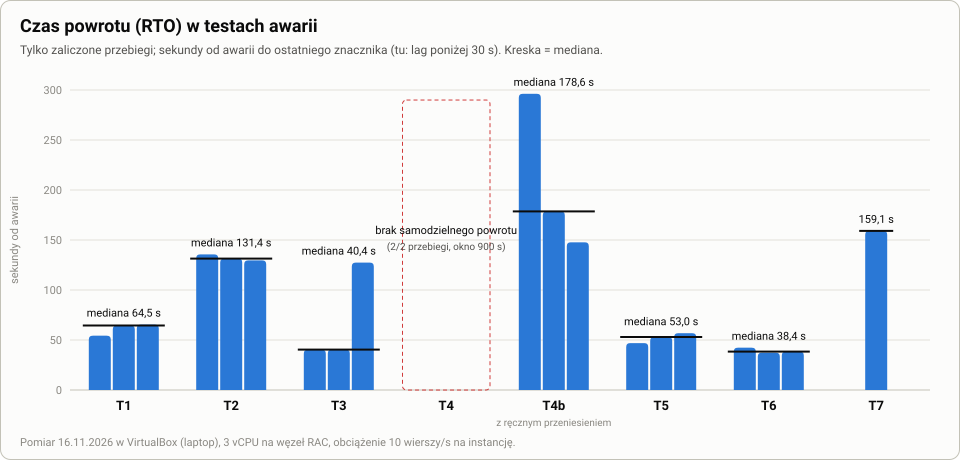

## 🧪 Test po teście

Kolumny: **RTO** = `rto_s`; **wykrycie** = `t_crs_detect`; **EXT1** = `t_ext_running`; **lag OK** = `t_lag_ok`;
**powrót** = czas `lab.cmd baseline` po przebiegu. Nazwy przebiegów to katalogi w [results/runs/](../results/runs/).

### T1 — Planowe przeniesienie

| Przebieg | RTO [s] | wykrycie [s] | serwis na ggrac2 [s] | EXT1 [s] | lag OK [s] | kończy na | dane (LOAD_EVENTS źródło = cel) | powrót [s] |
|---|---|---|---|---|---|---|---|---|
| `T1-20261116-120520` | 54,3 | 13,4 | 2,1 | 43,7 | 54,3 | ggrac2 | 4605 = 4605 | 106,1 |
| `T1-20261116-121125` | 64,5 | 12,4 | 1,5 | 60,8 | 64,5 | ggrac2 | 4853 = 4853 | 104,9 |
| `T1-20261116-121737` | 65,4 | 12,6 | 1,8 | 60,3 | 65,4 | ggrac2 | 4845 = 4845 | 106,2 |

**Mediana 64,5 s.** Zgodnie z oczekiwaniem. Odpowiedź na otwarte pytanie: `agctl relocate` **sam przeniósł serwis
`gg_srcpdb`** (ONLINE na `ggrac2` 1,5–2,1 s po poleceniu, `service_moved=true`); `srvctl relocate service` nie był
potrzebny. Widoczna kolejność: serwis (2 s) → pierwszy zasób zatrzymany na `ggrac1` (12–13 s) → VIP i ACFS na `ggrac2`
(25–26 s) → `DP1` (30 s) → zasób XAG ONLINE (32–34 s) → `EXT1` (44–61 s) → lag OK. Rozrzut daje `EXT1` (10 s wobec
ok. 28 s po zasobie XAG).

Niewliczone: `T1-20261116-112526` (błąd pomiaru: próbnik laga brał maksimum ze wszystkich wierszy ścieżek w `gg_lag`;
po przeniesieniu stara ścieżka tylko się starzała i krzywa doszła do 730 s, choć replikacja działała; dane zgodne,
15370 = 15370) i `T1-20261116-114040` (odmowa startu „lag 93 s”, ten sam błąd próbnika, bez awarii). Przed liczonymi
przebiegami próbnik poprawiono: bierze najświeższy wiersz ścieżki.

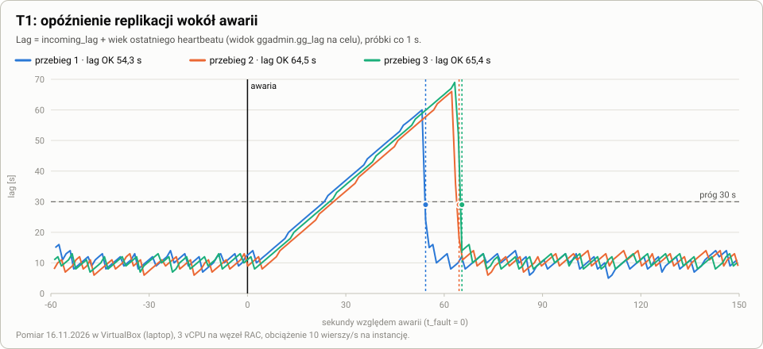
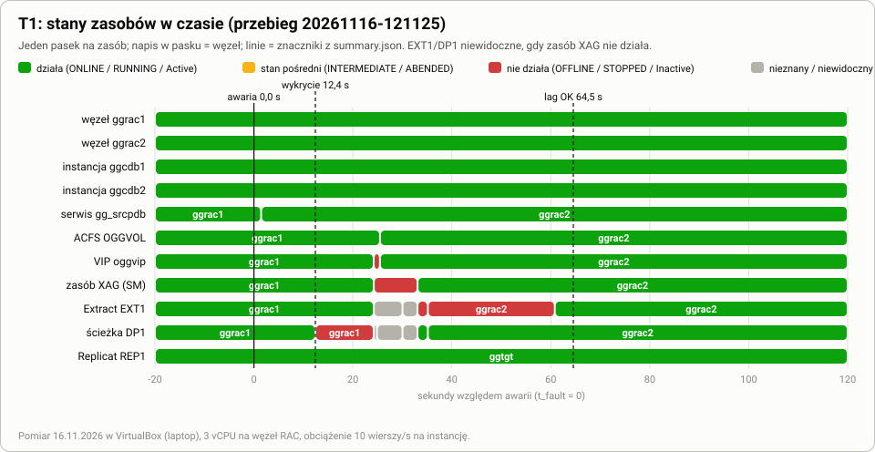

### T2 — Twarde wyłączenie węzła z GoldenGate

| Przebieg | RTO [s] | wykrycie (wykluczenie) [s] | ACFS [s] | XAG ONLINE [s] | EXT1 [s] | lag OK [s] | kończy na | dane | powrót [s] |
|---|---|---|---|---|---|---|---|---|---|
| `T2-20261116-122954` | 135,6 | 32,9 | 36,7 | 45,9 | 73,0 | 135,6 | ggrac2 | 3615 = 3615 | 257,3 |
| `T2-20261116-124244` | 131,4 | 32,7 | 37,0 | 44,8 | 73,4 | 131,4 | ggrac2 | 3396 = 3396 | 257,8 |
| `T2-20261116-125346` | 129,6 | 32,1 | 36,1 | 46,7 | 71,5 | 129,6 | ggrac2 | 3396 = 3396 | 290,4 |

**Mediana 131,4 s, rozrzut 6 s.** Zgodnie z oczekiwaniem: powrót bez człowieka, `ggrac1` wykluczony, cały łańcuch na
`ggrac2`. Gdzie idzie czas (przebieg środkowy): ok. 33 s, zanim klaster wykluczy `ggrac1` (serwis i VIP przenoszą się
w tej samej sekundzie), 4 s do ACFS, 12 s do zasobu XAG ONLINE, potem `EXT1` jeszcze 25–29 s w stanie ABENDED i RUNNING
ok. 72 s; pozostałe ok. 60 s Extract nadrabia zaległości, w tym redo wątku 1 padniętej instancji. Każdy wiersz `SEQ`
instancji 1 zatwierdzony przed awarią dotarł na cel (0 brakujących we wszystkich trzech przebiegach).

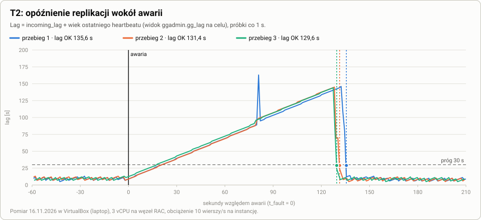
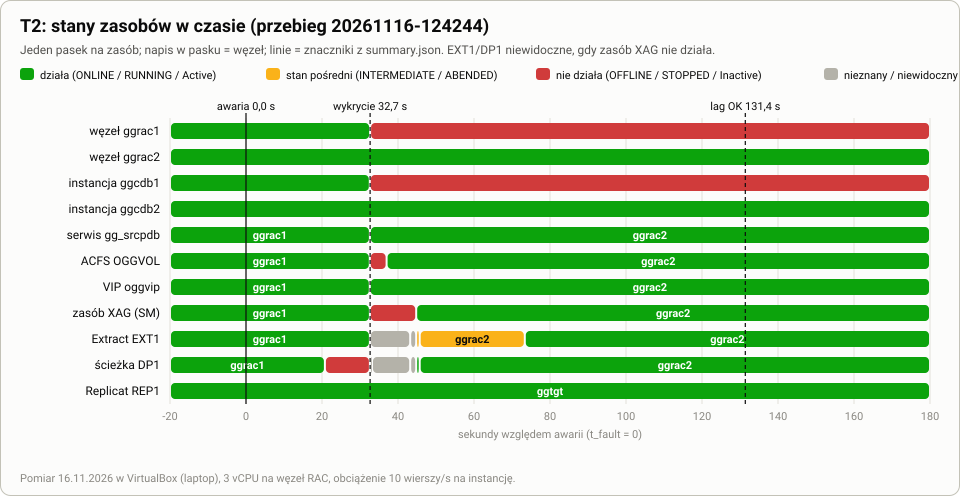

### T3 — Wyłączenie drugiego węzła

| Przebieg | RTO [s] | wykrycie (wykluczenie) [s] | lag OK [s] | maks. lag [s] | nawroty | kończy na | dane | powrót [s] |
|---|---|---|---|---|---|---|---|---|
| `T3-20261116-160222` | 40,3 | 31,5 | 40,3 | 48 | 1 (34 s ok. 343 s) | ggrac1 | 4576 = 4576 | 192,4 |
| `T3-20261116-161451` | 40,4 | 30,8 | 40,4 | 75 | 0 | ggrac1 | 4431 = 4431 | 169,0 |
| `T3-20261116-162545` | 127,4 | 31,4 | 127,4 | 128 | 0 | ggrac1 | 5413 = 5413 | 164,2 |

**Mediana 40,4 s.** GoldenGate się nie ruszył (XAG nic nie robił), każdy wiersz `INST=2` dotarł: zgodnie z oczekiwaniem.
**Inaczej, niż zakładaliśmy:** „krótki skok laga” to w każdym przebiegu co najmniej 31 s: zanim klaster wykluczy
`ggrac2`, źródło w ogóle nie zatwierdza heartbeatów (rekonfiguracja klastra, potem instance recovery wątku 2).
W przebiegu 3 Extract stał potem jeszcze ok. 60 s, choć heartbeaty powstawały normalnie, stąd 127 s. Przebieg 1 miał
jeden późniejszy nawrót (lag 34 s ok. 343 s, opóźnienie Extractu 21 s). **Przyczyny tych przestojów Extractu nie
ustalono**; logi bazy, GoldenGate i CRS w tych chwilach milczą ([analiza](analysis/T3_EXTRACT_STALLS_PL.md)).
Uwaga: `t_lag_ok` przebiegu 1 przeliczono regułą „pierwszy trwały powrót” (pierwsza reguła brała powrót po *ostatniej*
wysokiej próbce i dawała 344,6 s); `summary.json` zapisuje to w `t_lag_ok_rule`.

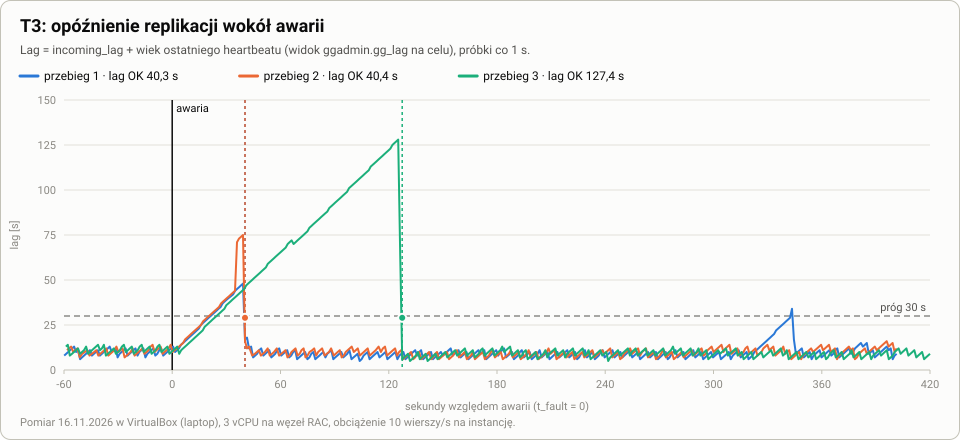
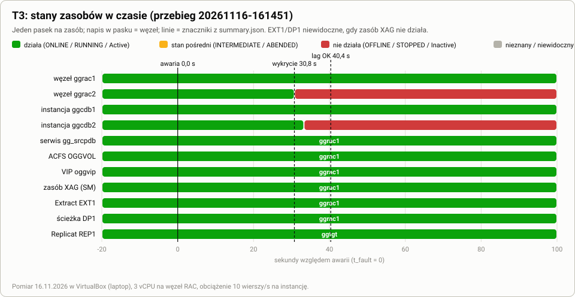

### T4 — Awaria instancji (kill -9 PMON)

| Przebieg | Wynik | Co się stało |
|---|---|---|
| `T4-20261116-131818`, `-132026`, `-132237` | błąd automatu | polecenie awarii `srvctl stop instance ... -stopoption abort` CRS odrzucił (CRS-2974: singleton serwis wymaga `-force`); awarii nie było. Test zmieniono na `kill -9` PMON |
| `T4-20261116-133519` | **niezaliczony (wynik prawdziwy)** | instancja padła po 5,2 s, serwis na `ggrac2` po 5,2 s, CRS zrestartował `ggcdb1` lokalnie po 19,9 s, zasób XAG OFFLINE po 32,9 s, potem **GoldenGate nie działał nigdzie do końca okna 900 s** (maks. lag 1216 s). VIP i ACFS zostały na `ggrac1`. Dane w chwili porównania: 1198 z 11260 wierszy na celu: niezreplikowane, nie dowód utraty |
| `T4-20261116-135751` | przerwany | ten sam obraz do ręcznego zatrzymania w czasie czekania na powrót; poza oczekiwaniem brak plików z dowodami |
| `T4-20261116-144352` | niezaliczony + błąd pomiaru | wynik GoldenGate jak w 133519 (XAG OFFLINE po 33,8 s, nic przez 900 s); dodatkowo CRS **nie** zrestartował `ggcdb1`. Porównanie danych poszło na węźle bez instancji i jest nieważne (`measurement_error=data_compare`) |

**Niezgodne z oczekiwaniem:** hipoteza „GoldenGate idzie za serwisem na `ggrac2`” w tej konfiguracji się nie sprawdziła
(2/2 pełne przebiegi, przerwany potwierdza). Dlaczego, pokazuje log CRS przebiegu 133519
([crsd_excerpt.txt](../results/runs/T4-20261116-133519/crsd_excerpt.txt)):

```text
Hard Stop dependency prevents a relocate of xag.oggsource.goldengate from ggrac1
Hard stop on ora.ggcdb.gg_srcpdb.svc prevents xag.oggsource.goldengate from starting/stopping. ... CRS-0222
CRS-2676: Start of 'ora.ggcdb.gg_srcpdb.svc' on 'ggrac2' succeeded
CRS-2673: Attempting to stop 'xag.oggsource.goldengate' on 'ggrac1'
```

CRS przeniósł serwis, potem zatrzymał XAG na `ggrac1` i przez 20 minut nie próbował go uruchomić. GoldenGate wystartował
dopiero, gdy `lab.cmd baseline` przeniósł serwis z powrotem na `ggcdb1`.
Dlaczego CRS raz zrestartował instancję, a raz nie: `ora.ggcdb.db` ma domyślne `RESTART_ATTEMPTS=2` w oknie
`UPTIME_THRESHOLD=1h`; 144352 to trzecie zabicie PMON w ciągu godziny ([analiza](analysis/T4_INSTANCE_RESTART_PL.md)).

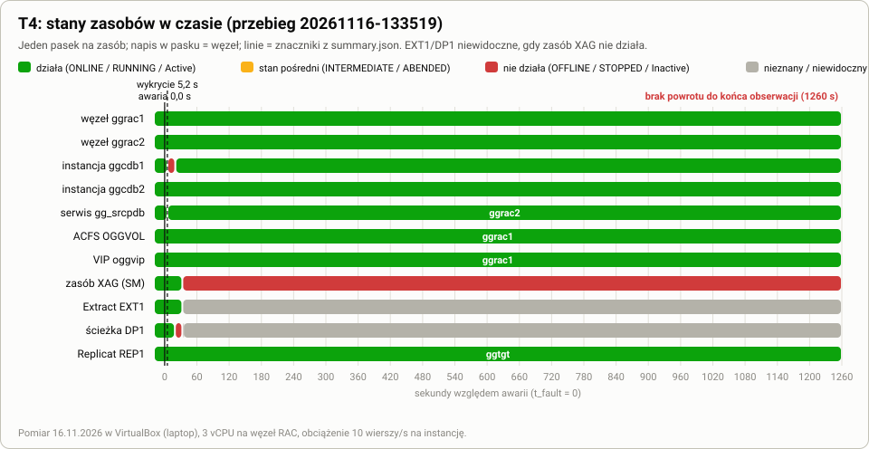

### T4b — Awaria instancji + ręczne przeniesienie GoldenGate

| Przebieg | RTO od awarii [s] | wykrycie [s] | propozycja przeniesienia [s] | przeniesienie [s] | czekanie na zgodę [s] | przeniesienie → lag OK [s] | kończy na | dane | powrót [s] |
|---|---|---|---|---|---|---|---|---|---|
| `T4b-20261116-152230` | 296,2 | 4,0 | 122,9 | 267,5 | 144,6 | **28,7** | ggrac2 | 5523 = 5523 | 110,5 |
| `T4b-20261116-153428` | 178,6 | 24,5 | 122,6 | 125,7 | 3,1 | **52,9** | ggrac2 | 4369 = 4369 | 111,2 |
| `T4b-20261116-154243` | 147,7 | 22,0 | 120,4 | 123,5 | 3,1 | **24,2** | ggrac2 | 4011 = 4011 | 432,9 |

**Zgodnie z oczekiwaniem.** W każdym przebiegu GoldenGate po 120 s nie działał, więc wykonała się gałąź `agctl start
goldengate oggsource --node ggrac2` (kod wyjścia 0); start sam pociągnął VIP i ACFS na `ggrac2`, `crsctl relocate resource
oggvip -f` nie był potrzebny. **Samo ręczne przeniesienie kosztuje medianę 28,7 s** (24,2–52,9 s); RTO od awarii zależy
głównie od czasu reakcji człowieka (tu: 120 s z założenia plus zgoda). W przebiegu 1 zgoda czekała 144,6 s,
bo monitor automatu testów czytał niewłaściwy plik (błąd automatu, nie klastra); przebiegi 2 i 3 pokazują zamierzoną reakcję. W przebiegu 2 `EXT1` wstał 28 s po zasobie XAG, stąd
dłuższe 52,9 s. W przebiegu 3 (`154243`) CRS nie zrestartował `ggcdb1` (wyczerpany limit restartów, zob. T4), co
wydłużyło tylko `lab.cmd baseline` (432,9 s).

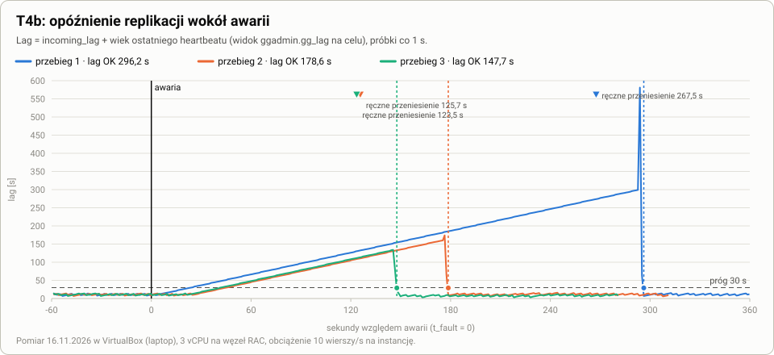
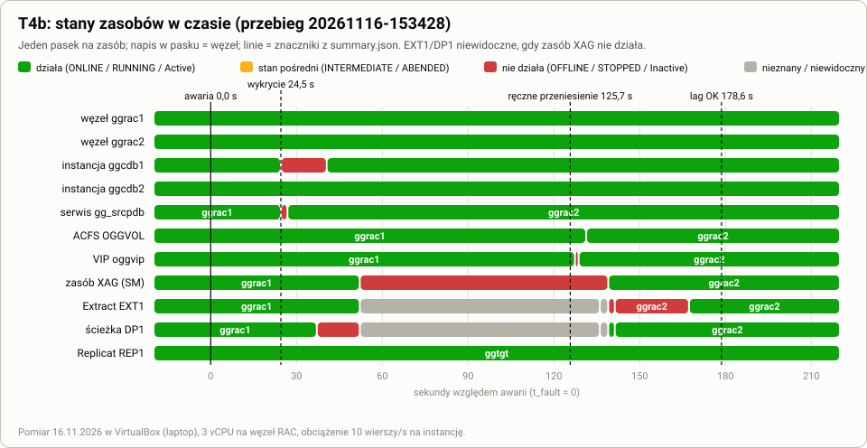

### T5 — Zabicie Service Managera

| Przebieg | RTO [s] | wykrycie [s] | XAG ONLINE [s] | EXT1 [s] | lag OK [s] | akcja XAG | dane | powrót [s] |
|---|---|---|---|---|---|---|---|---|
| `T5-20261116-164712` | 46,9 | 1,6 | 16,3 | 40,7 | 46,9 | restart na miejscu | 4507 = 4507 | 52,5 |
| `T5-20261116-165217` | 53,0 | 0,9 | 21,9 | 49,1 | 53,0 | restart na miejscu | 4625 = 4625 | 52,2 |
| `T5-20261116-165725` | 56,8 | 2,2 | 24,3 | 51,6 | 56,8 | restart na miejscu | 4684 = 4684 | 50,5 |

**Mediana 53,0 s.** XAG za każdym razem zrestartował deployment na tym samym węźle (bez przenoszenia). `EXT1` przeszedł
przez ABENDED i był RUNNING 24–27 s po zasobie XAG. Błąd 37468391 się nie pojawił (jeden Service Manager na węzeł).

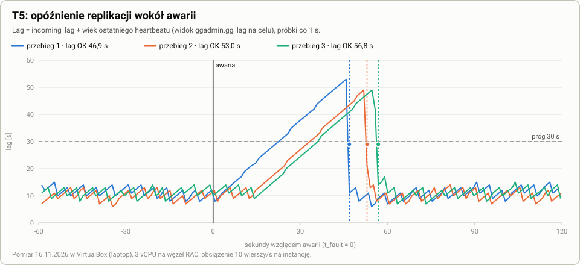
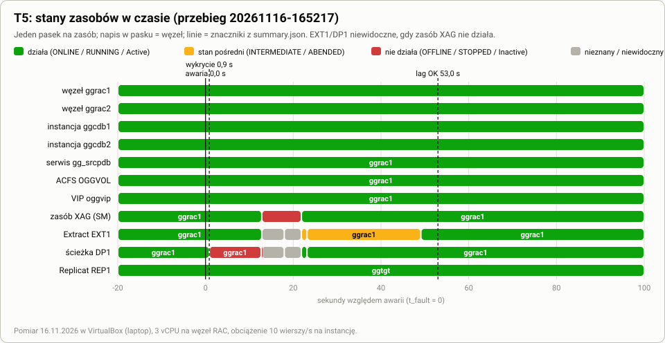

### T6 — Extract oznaczony „Critical to deployment health”

| Przebieg | RTO [s] | EXT1 ABENDED [s] | XAG INTERMEDIATE [s] | EXT1 RUNNING [s] | XAG ONLINE [s] | lag OK [s] | dane | powrót [s] |
|---|---|---|---|---|---|---|---|---|
| `T6-20261116-174258` | 42,3 | 1,6 | 12,1 | 32,6 | 41,6 | 42,3 | 5773 = 5773 | 54,5 |
| `T6-20261116-175056` | 37,3 | 2,9 | 24,8 | 33,9 | 54,5 | 37,3 | 5491 = 5491 | 61,9 |
| `T6-20261116-175700` | 38,4 | 2,6 | 21,9 | 33,4 | 51,4 | 38,4 | 5472 = 5472 | 111,2 |

**Mediana 38,4 s.** Z flagą WŁ. deployment **nie został zablokowany** w żadnym przebiegu: `EXT1` był znów RUNNING 31 s
po zabiciu i został na `ggrac1`. Widoczny skutek flagi: zasób XAG przez ok. 30 s był w stanie INTERMEDIATE (i wrócił do
ONLINE dopiero po starcie `EXT1`). MAA mówi „może przeszkodzić”; w tym labie i z tym profilem nie przeszkodziła. Nie
zapisano: eksportu profilu przed pierwszym przebiegiem ani liczby prób restartu `EXT1`.

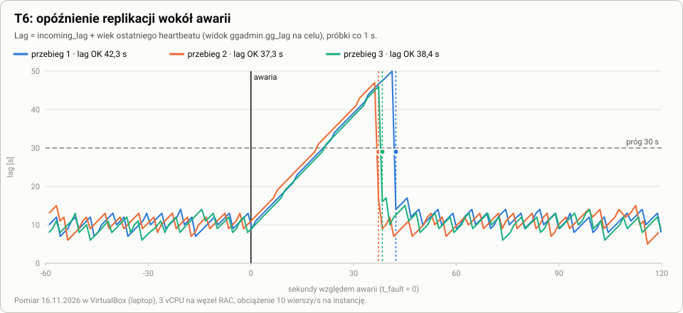
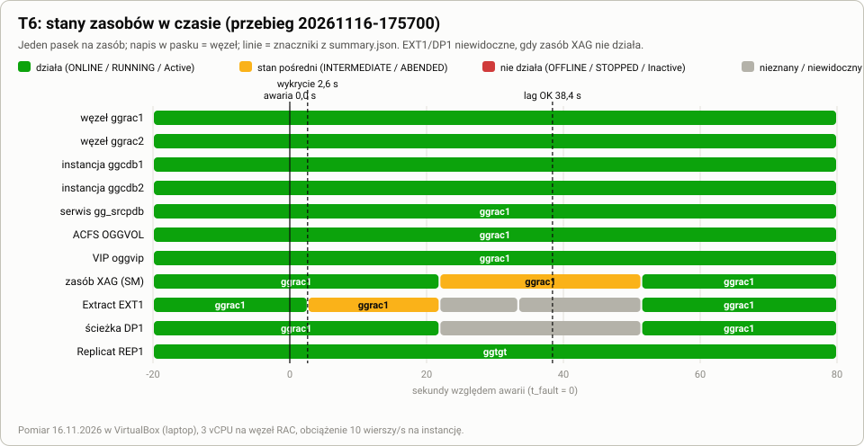

### T7 — Przecięty interconnect

| Przebieg | RTO [s] | wykrycie (wykluczenie) [s] | lag OK [s] | maks. lag [s] | wykluczony | kończy na | dane | powrót [s] |
|---|---|---|---|---|---|---|---|---|
| `T7-20261116-181110` | 159,1 | 65,7 | 159,1 | 129 | ggrac2 | ggrac1 | 4008 = 4008 | 641,2 |

**Zgodnie z oczekiwaniem, tylko jeden przebieg.** Wykluczony został węzeł z przeciętym łączem (`ggrac2`); węzeł
z GoldenGate przetrwał, więc GoldenGate się nie przenosił. Wykrycie trwało ok. 66 s, dwa razy dłużej niż po wyłączeniu
zasilania (ok. 31 s w T3); przez ok. 65 s oba węzły były Active, a lag rósł (interpretacja: klaster najpierw czeka na
upływ limitu sieciowego heartbeatu, którego wartości z labu nie odczytaliśmy). Lag był powyżej 30 s do 159 s. Powrót do
bazy trwał 641 s (łącze, powrót do klastra, autostart instancji na `ggrac2`, powrót `srv_load2`). Który węzeł wypada,
zależy od reguł Clusterware; gdyby wypadł węzeł z GoldenGate, wynik wyglądałby jak T2 (niezmierzone).

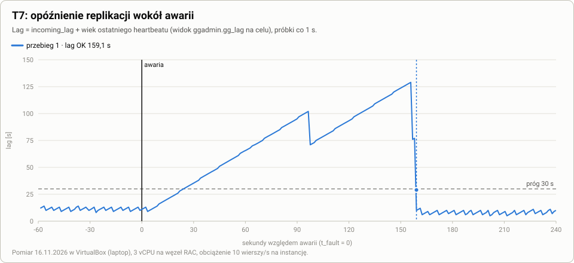
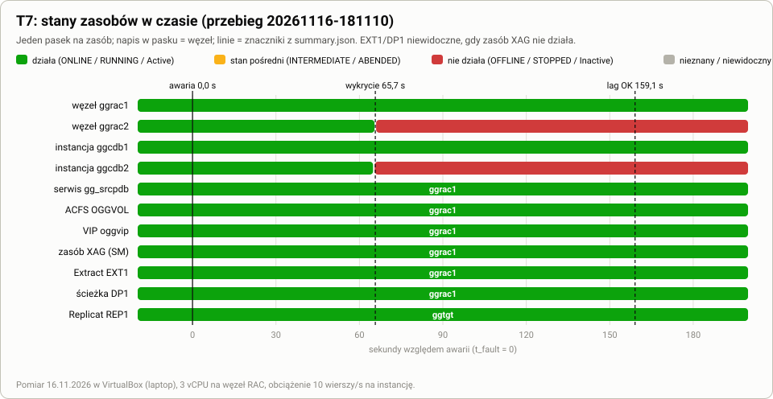

### T8 — Lag pod obciążeniem (bez awarii)

| Przebieg | Wynik | Lag min / mediana / p95 / maks. [s] | wiersze INST 1 / INST 2 (źródło = cel) |
|---|---|---|---|
| `T8-20261116-110916` | zaliczony | 5 / 11 / 14 / 15 (619 próbek, 10 min) | 6552 / 6516 |
| `T8-20261116-104132` | odmowa | błąd automatu: kontrola stanu bazowego nic nie zwróciła, bez awarii i obciążenia | – |
| `T8-20261116-105457` | błąd automatu | błąd automatu: plik wyniku czytany, gdy próbnik trzymał go otwartego | – |

Lag cały czas poniżej 30 s i dochodzą oba wątki redo: zgodnie z oczekiwaniem. „Kilka sekund” było zbyt optymistyczne
dla tej miary: heartbeat przychodzi co 5 s, a wiek ostatniego jest częścią laga, więc spokojna krzywa to piła od 5 do 15 s.

### T9 — Porównanie danych

`T9-20261116-112227`: 6/6 tabel zgodnych, `LOAD_EVENTS` 694 = 694, `SEQ` 347 = 347 na instancję, bez brakujących
i duplikatów. Maks. lag 15 s. (W `compare.json` tego przebiegu są tylko liczby wierszy; sumy kontrolne dopisano do pliku
później. Sama zgodność już wtedy obejmowała sumy.)

### T10 — DDL i typy danych 26ai

| Przebieg | Wynik | Co zmierzono |
|---|---|---|
| `T10-20261116-170741` | zaliczony | wiersz 101 (`VECTOR [1.5,2.5,3.5]` FLOAT32, `BOOLEAN TRUE`, `JSON`) na celu po **4,6 s**, wartości identyczne; `ALTER TABLE ... ADD (note VARCHAR2(30))` na celu po **8,9 s**; wiersz 102 z nową kolumną po **4,5 s**, identyczny; sprzątanie (delete + `DROP COLUMN`) zreplikowane w ok. 4 s |
| `T10-20261116-170251` | zaliczony, **bez DDL** (`measurement_error=ddl_not_run`) | pomocnik do ręcznych kroków ruszył za późno, a jego pierwszy insert dał ORA-03405 (dwa polecenia w jednej linii); przebieg dowodzi tylko spokojnej replikacji |

`VECTOR`, `BOOLEAN`, `JSON` i DDL (`DDL INCLUDE MAPPED`) replikują się bez zmian: zgodnie z oczekiwaniem. Czasy kroków
pochodzą z logu ręcznych kroków, rozdzielczość ok. 1 s (nie z `summary.json`).

## ❌ Przebiegi niewliczone i dlaczego

| Przebieg | Werdykt | Przyczyna | Klaster czy automat? |
|---|---|---|---|
| `T8-20261116-104132` | odmowa | kontrola stanu bazowego zwróciła pusty wynik (błąd obsługi tablicy) | automat |
| `T8-20261116-105457` | błąd automatu | plik wyniku czytany, gdy próbnik jeszcze pisał | automat |
| `T1-20261116-112526` | błąd pomiaru (lag) | próbnik laga brał maksimum ze wszystkich wierszy ścieżek `gg_lag` | automat (próbnik) |
| `T1-20261116-114040` | odmowa | ten sam błąd próbnika: „lag 93 s” | automat (próbnik) |
| `T4-20261116-131818`, `-132026`, `-132237` | błąd automatu | `srvctl stop instance -stopoption abort` odrzucony, CRS-2974 | automat (złe polecenie awarii) |
| `T4-20261116-133519` | **niezaliczony** | GoldenGate nie wystartował po awarii instancji: twarda zależność od serwisu, CRS-0222 | **klaster (wynik prawdziwy)** |
| `T4-20261116-135751` | przerwany | zatrzymany ręcznie, ten sam obraz co 133519 | – |
| `T4-20261116-144352` | niezaliczony + błąd pomiaru (dane) | jak 133519; instancja nie zrestartowana (wyczerpany limit restartów); porównanie na węźle bez instancji | klaster + automat |
| `T10-20261116-170251` | zaliczony, bez DDL | pomocnik ręcznego DDL za późno, ORA-03405 | automat (kroki ręczne) |

Każdy błąd automatu z tej listy poprawiono przed liczonymi przebiegami tego samego testu; każdy opublikowany katalog
przebiegu z uwagą ma plik `harness_note.txt`.

## ⏱️ Powrót do stanu bazowego

`lab.cmd baseline` po każdym przebiegu (sekundy): po T1 105–106, po T2 257–290 (start `ggrac1`), po T3 164–192 (start
`ggrac2`), po T4b 110–111 i 433 (instancja niezrestartowana przez CRS), po T5 50–53, po T6 54–111, po T7 641 (łącze,
powrót do klastra, autostart instancji), po T8–T10 51–55.

## 🔍 Czego te wyniki nie mówią

- Jakie są czasy na serwerach fizycznych z obciążeniem produkcyjnym (inne wykrywanie, start i ilość redo).
- Etap B (NGINX, TLS) nie był mierzony.
- T4 z inną konfiguracją XAG albo serwisu; czy inny układ zależności pozwoliłby GoldenGate pójść za serwisem po awarii
  instancji, nie sprawdzaliśmy.
- Przyczyna przestojów Extractu w T3.
- T7 z GoldenGate na wykluczanym węźle; więcej niż jeden przebieg T7.

## 🔗 Dane i narzędzia

- Surowe dane przebiegów: [results/runs/](../results/runs/), opis w [results/README_PL.md](../results/README_PL.md).
- Wykresy: `python tools/make_charts.py` odbudowuje każdy SVG w `docs/img/results/` z tych danych.
- Analizy: [T4: limit restartów instancji](analysis/T4_INSTANCE_RESTART_PL.md),
  [T3: przestoje Extractu](analysis/T3_EXTRACT_STALLS_PL.md).
- Przykładowy failover jako diagram: [07-failover-timeline_pl.svg](diagrams/07-failover-timeline_pl.svg).
